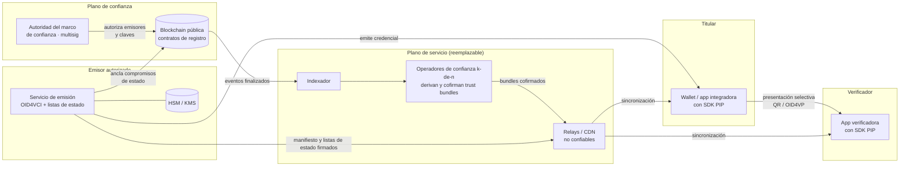
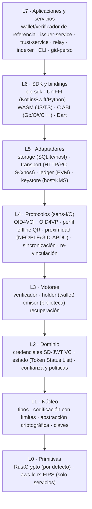
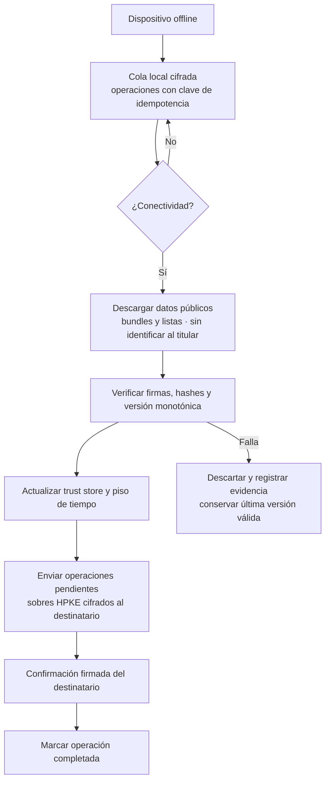

# ARCHITECTURE.md — Arquitectura de PIP (Portable Identity Protocol)

> **Estado:** Borrador normativo v0.3 · **Ámbito:** todo el repositorio · **Propietario:** Mantenedores del protocolo
> **Revisión v0.3 (2026-10-15):** incorpora ADR-0021 (**Aceptado**): ampliación de alcance para identidad portable por NFC (teléfono HCE y tarjeta física Java Card), código numérico de sesión y perfil `pip-identity-v1` (fases F19–F25). El diseño detallado de cada subsistema se cierra en ADR-0022 a ADR-0026 durante F19.
> **Nombre definitivo:** Gravital ID (`gravital-id` / `gid`, según ADR-0001). En la documentación se conserva "PIP" como acrónimo conceptual del protocolo (*Portable Identity Protocol*).

Este documento define **qué se construye, por qué y con qué límites**. Es normativo: el código que lo contradiga es un defecto. Cualquier cambio de arquitectura requiere un ADR aceptado (`docs/adr/`) y la actualización de este documento en el mismo PR.

Las palabras **DEBE**, **NO DEBE**, **DEBERÍA**, **PUEDE** se interpretan como MUST, MUST NOT, SHOULD y MAY de RFC 2119.

---

## Índice

1. Propósito y alcance
2. Análisis de viabilidad: qué es posible y qué no
3. Complejidades de ingeniería en Rust
4. Principios de diseño (P-01 … P-15)
5. Contexto del sistema y actores
6. Vista de capas
7. Modelo de identidad e identificadores
8. Credenciales
9. Presentaciones y protección de sesión
10. Estado y revocación
11. Registro de confianza, raíz, trust bundles y capa ledger
12. Gestión de claves
13. Almacenamiento local
14. Sincronización eventual
15. Recuperación y migración
16. Perfiles
17. SDK y portabilidad multi-lenguaje
18. Servicios de infraestructura y despliegue
19. Seguridad: amenazas principales y controles
20. Privacidad y cumplimiento
21. Observabilidad y operación
22. Decisiones abiertas (ADRs pendientes)
23. Glosario
24. Referencias normativas

---

## 1. Propósito y alcance

### 1.1 Qué es PIP

PIP es un **protocolo de identidad portable** y su **implementación de referencia en Rust**, distribuida como biblioteca y SDK integrable desde múltiples lenguajes. Permite:

- **Emitir** credenciales verificables a titulares (personas, empleados, organizaciones, dispositivos).
- **Almacenar** esas credenciales en un dispositivo controlado por el titular (teléfono móvil, aplicación de escritorio/web o tarjeta física con elemento seguro Java Card), cifradas o protegidas por hardware.
- **Presentar** solo los atributos necesarios (divulgación selectiva), vinculados criptográficamente al verificador y a la sesión, por **QR**, **NFC** (teléfono Android HCE o tarjeta física), **BLE** o en línea (**OID4VP** y **código numérico efímero de sesión** de 9–10 dígitos).
- **Verificar** credenciales **sin conexión a Internet** y sin consultar a ningún servidor central (tanto por QR como por proximidad NFC/BLE).
- **Compartir confianza** (qué emisores están autorizados, con qué claves, qué listas de estado son auténticas) mediante un **registro público en blockchain** que nadie controla en solitario.
- **Sincronizar** de forma eventual cuando hay conectividad y **recuperar** la identidad tras perder un dispositivo (o revocar una tarjeta física extraviada).

### 1.2 Qué NO es PIP (no-objetivos)

| No-objetivo | Motivo |
|---|---|
| Una blockchain propia | Operar una red de consenso no aporta valor diferencial y multiplica el riesgo. Se usa una red existente como capa de anclaje. |
| Un proveedor de identidad (IdP) centralizado | Contradice el propósito. PIP no autentica usuarios en nombre de terceros. |
| Un servicio de KYC | La verificación de identidad real la hacen emisores autorizados; PIP transporta y verifica sus atestaciones. |
| Un almacén de datos personales | Ningún servicio de PIP almacena credenciales completas ni historiales de presentación. |
| Una wallet comercial | Se entregan wallet y verificador **de referencia** para validar el protocolo; los productos finales los construyen integradores. |
| Un sustituto de la gobernanza legal | La blockchain registra y hace verificables las decisiones de confianza; no las toma. |

### 1.3 Diferenciador

La combinación de **portabilidad real** (un núcleo, muchos lenguajes, plataformas y factores de forma: móvil, web y tarjeta inteligente), **operación offline** (óptica y sin contacto tipo EMV), **interoperabilidad por estándares** y **recuperación segura**. El uso de blockchain es un medio, no el diferenciador.

---

## 2. Análisis de viabilidad: qué es posible y qué no

Este análisis existe para que ningún agente o desarrollador intente construir algo técnica o lógicamente imposible. Cada fila es vinculante.

| Objetivo | ¿Viable? | Condiciones y límites |
|---|---|---|
| Verificar sin servidor central (QR o NFC) | **Sí, completamente** | El verificador necesita un *trust bundle* firmado y un snapshot de estado obtenidos en algún momento previo. La verificación en sí es local y determinista. |
| Emitir sin servidor | **No** | La emisión requiere un emisor (una organización que responde por los datos). Se descentraliza *quién* puede emitir y *cómo se verifica su autoridad*, no la existencia del emisor. El emisor puede operar su servicio en infraestructura propia. |
| Revocación en tiempo real estando offline | **Imposible por definición** | Un dispositivo desconectado no puede saber de una revocación posterior a su último snapshot. PIP ofrece **frescura acotada**: el resultado declara la antigüedad del estado (`ValidWithStaleStatus`) y la política del consumidor decide. |
| Teléfono **Android** como tarjeta NFC | **Sí** | Mediante Host Card Emulation (`HostApduService`) con clave de vinculación en StrongBox/TEE (ADR-0021, F21). |
| **iPhone** como tarjeta NFC en Panamá | **No hoy** | Apple limita la emulación HCE y el programa NFC & SE de terceros a jurisdicciones elegibles (EEE, EE. UU., Reino Unido, Canadá, Brasil, Japón, Australia, Nueva Zelanda; Panamá no figura). Un iPhone **sí puede actuar como lector verificador** (Core NFC ISO 7816); como titular presenta por QR o BLE (R-15). |
| Tarjeta física que funcione offline "como una Visa" | **Sí, con hardware específico** | Requiere un elemento seguro programable (Java Card con generación interna de clave ECDSA P-256 no exportable) y personalización autenticada por el emisor (`gid-perso`, ADR-0021 / ADR-0024, F22). |
| Validar **solo** con un número de 9–10 dígitos **sin Internet** | **Imposible de forma segura** | 10 dígitos con uno de control dejan ~10⁹ combinaciones (≈ 30 bits): no hay firma ni prueba de posesión. Dictar un número estático equivale a una transacción sin tarjeta presente, que siempre requiere validación en línea. |
| Validar con un número de 9–10 dígitos **con Internet** | **Sí, como código de sesión** | El número (`SessionCode`, 10 dígitos con control Damm) identifica una **sesión efímera** en el relay, nunca a una persona. La seguridad recae en la solicitud firmada del verificador, el cifrado HPKE y la firma KB-JWT del titular (ADR-0021 / ADR-0025, F23). |
| Número persistente y global por persona | **No como identificador del protocolo** | Contradice §7.1 ("no existe un identificador global del titular") y P-09 (no correlación). Cualquier número por emisor es opcional, se trata como dato personal fuera de ledger/logs y exige consentimiento explícito (ADR-0025). |
| Cédula o documento de identidad portable (`pip-identity-v1`) | **Sí técnicamente; validez legal depende del emisor** | El perfil soporta retrato facial y predicados, distinguiendo con `vct` distintos la credencial **oficial** (emitida por la autoridad de registro civil, p. ej. Tribunal Electoral bajo el Decreto N.° 43 de 2024) de la **derivada** (emitida por una entidad autorizada que verificó al titular vía SVI). El retrato no cabe en un QR (~800 B útiles) y solo viaja por NFC o BLE (ADR-0021 / ADR-0026 / ADR-0028, F24). |
| Autenticación multi-inquilino, portabilidad y roles por app (`pip-tenant-role-v1`) | **Sí, sin servidor central global** | La identidad se centraliza en la bóveda del titular y cada app/servidor aloja su instancia del módulo (`Tenant Gateway`). La integridad del sujeto por inquilino se mantiene mediante `TenantSubjectId` determinista por inquilino y los roles se emiten como credenciales verificables offline/online (ADR-0027, F10/F11). |
| Evitar duplicidad de usuario por cédula/documento nacional | **Sí, en emisión con VOPRF/HSM** | La emisión normaliza el documento según el perfil del país (`NationalIdProfile`, en Panamá validado contra el SVI del Tribunal Electoral) y calcula un `UniquenessTag` ciego mediante clave en HSM (VOPRF RFC 9497 / HMAC-HSM), nunca en claro ni en la blockchain (`INV-02`). Si ya existe, redirige a re-vinculación (ADR-0028, F10). |
| Un solo dispositivo activo por tipo de soporte (1 móvil + 1 tarjeta Visa + 1 otro) y uso de IMEI | **Sí, con Atestación de Hardware / CPLC y ranuras por clase** | Android 10+ e iOS bloquean la lectura del IMEI por software para apps generales. En su lugar, la unicidad por clase (`DeviceFactorClass`: `mobile`, `card`, `other`) se garantiza con **Hardware Key Attestation** (StrongBox/TEE, incluyendo IMEI atestado por hardware en modo *Device Owner*/OEM) / **App Attest** en móviles y con el serial de silicio **CPLC** en tarjetas Java Card, asignando un índice de estado independiente por ranura y revocando atómicamente el dispositivo anterior de la misma clase al reemplazarlo (ADR-0029, F8/F10/F22). |
| Recuperar claves sin terceros | **Parcial** | Solo si se preconfiguró un mecanismo (código de recuperación de alta entropía, fragmentos Shamir entre guardianes). Las claves ligadas a hardware (móvil o tarjeta física) **no se pueden recuperar**: se recupera la capacidad de solicitar **reemisión** o **re-vinculación** al emisor. |
| Gobernanza de confianza descentralizada | **Parcial** | El ledger hace la gobernanza transparente, auditable y resistente a un solo operador (multisig, timelock). Las decisiones de quién es confiable siguen siendo humanas y legales (marco de confianza). |
| Datos personales en la blockchain | **Prohibido** | La blockchain es inmutable y pública; incompatible con el derecho de supresión (Ley 81 de 2019 de Panamá, RGPD). **Incluye hashes de datos personales**: un hash de un dato de baja entropía (cédula, fecha de nacimiento, teléfono) se revierte por fuerza bruta. |
| Presentaciones no correlacionables | **Parcial en v1** | SD-JWT es correlacionable si se reutiliza la misma credencial (misma firma del emisor, mismos digests). Mitigación v1: **emisión por lotes** y uso único por verificador. Firmas BBS (no correlacionables) se evaluarán cuando el estándar madure (hoy W3C Candidate Recommendation Draft). |
| Pruebas de predicado ("mayor de 18" sin revelar fecha) | **Sí, con restricciones** | En v1 solo mediante **claims precomputados por el emisor** (`age_over_18: true`). Pruebas de rango de conocimiento cero quedan fuera de v1. |
| Interoperabilidad con otros ecosistemas | **Sí en formato y protocolo** | Se usan estándares (SD-JWT VC, OpenID4VCI/VP). La interoperabilidad de **confianza** requiere acuerdos entre organizaciones; no la resuelve el código. |
| Un núcleo para muchos lenguajes | **Sí, con costos** | Rust + UniFFI / wasm-bindgen / C ABI. Costos: tamaño binario, asincronía a través de FFI, gestión de pánicos, compilación cruzada y matriz de CI cara (ver §3). |
| Independencia del proveedor RPC | **Sí, mitigada** | El RPC no está en la ruta de verificación. Para construir bundles se usan ≥2 proveedores independientes y opcionalmente nodo propio. |
| Identidad "auto-soberana" absoluta | **No en sentido literal** | El titular controla sus claves y decide qué divulga, pero el **valor** de una credencial depende de que el verificador confíe en el emisor. PIP maximiza el control del titular sin prometer lo imposible. |

### 2.1 Consecuencia de diseño

PIP se diseña como **tres planos separados**:

1. **Plano de verificación** (local, offline, determinista): núcleo Rust en el dispositivo.
2. **Plano de confianza** (público, auditable, lento): contratos en blockchain + bundles firmados derivados de su estado finalizado.
3. **Plano de servicio** (en línea, reemplazable, sin custodia): emisión, publicación, relays, indexadores.

Ningún fallo del plano 3 impide verificar credenciales existentes (plano 1). Un fallo del plano 2 solo impide **actualizar** la confianza, no usar la última conocida dentro de su ventana de validez.

---

## 3. Complejidades de ingeniería en Rust

Rust es la elección correcta para el núcleo (seguridad de memoria, rendimiento, compilación a todas las plataformas objetivo, ecosistema criptográfico maduro), pero introduce complejidades concretas que este diseño resuelve explícitamente:

| Complejidad | Impacto | Decisión |
|---|---|---|
| **Pánicos a través de FFI** | Un pánico que cruza la frontera FFI aborta el proceso del host o produce comportamiento indefinido en C ABI. | Código de biblioteca **sin** `unwrap`/`expect`/`panic!`/indexación que pueda fallar (lints `deny`). Las capas FFI capturan pánicos (`catch_unwind`) y los convierten en un error `PIP-E9999 InternalError`. En `wasm32-unknown-unknown` el valor por defecto es `panic=abort` (un pánico aborta la instancia; el desenrollado mediante WebAssembly Exception Handling exige hoy reconstruir `std` con una toolchain *nightly*, incompatible con la toolchain estable fijada): el binding WASM instala un *panic hook* que marca la instancia como envenenada, toda llamada posterior devuelve `PIP-E9999` y el host debe reinstanciar el módulo (ADR-0006). |
| **Asincronía entre lenguajes** | Kotlin (corrutinas), Swift (`async`), JS (`Promise`), Go y C no comparten modelo. | El **núcleo es síncrono y puro** (verificación, criptografía, formatos). Los protocolos (L4) son **máquinas de estado sans-I/O**: emiten *efectos* ("envía esta petición", "persiste este registro", "espera") y consumen sus resultados; no contienen `async` ni conocen ningún runtime (ADR-0019). El I/O real vive en adaptadores L5 (`pip-transport-http`, `pip-ledger-evm`) o en el host. Los bindings exponen un bucle de conducción idiomático (`suspend`, `async`, `Promise`, callbacks en C) sin lógica. |
| **WebAssembly** | `wasm32-unknown-unknown` no tiene sistema de archivos, hilos por defecto ni RNG del sistema; bibliotecas con C/ensamblador no compilan. | Backend criptográfico **puro Rust (RustCrypto)** por defecto; `getrandom` configurado con su backend para JS; almacenamiento inyectado por el host (IndexedDB); sin SQLite en WASM. |
| **Claves en hardware** | Secure Enclave (iOS) solo soporta **P-256**; StrongBox/TEE en Android tienen soporte amplio solo para P-256. Las claves no son exportables y Rust no puede acceder a ellas de forma portable. | **ES256 (ECDSA P-256 + SHA-256) es obligatorio** para claves de vinculación del titular. La firma se delega a un `KeyStore` implementado por el host (trait exterior vía UniFFI/wasm/C). La clave privada nunca entra en memoria Rust. Los almacenes de hardware devuelven firmas ECDSA en DER con `s` arbitrario: la conversión a P1363 (`r‖s`) se hace **en Rust** (P-11), la verificación **no** exige *low-S* y ninguna firma se usa como identificador ni como clave de deduplicación. |
| **Backend FIPS en servidores** | Algunos emisores regulados exigen módulos validados FIPS. | La frontera FIPS de un emisor es su **HSM/KMS**, donde reside la clave y se ejecuta la firma (REQ-ISS-002). Un backend alternativo con `aws-lc-rs` (modo FIPS) para el resto de operaciones del servicio es **condicional**: solo se implementa si ADR-0007 identifica un requisito regulatorio concreto, y entonces se selecciona por **tipo** (`CryptoBackend` como parámetro genérico en servicios), nunca por una feature excluyente (las features son aditivas). Nunca se requiere en móvil/WASM. |
| **Tamaño binario móvil** | Dependencias pesadas (cliente Ethereum, HTTP, SQLite) inflan el SDK. | Feature flags estrictos: `verifier` y `holder` no arrastran `pip-ledger-evm`. Perfiles de release con LTO, `codegen-units = 1`, `strip`, `opt-level = "z"` para móviles. Presupuesto de tamaño medido en CI (F9). |
| **Serialización canónica** | Firmas sobre JSON exigen bytes exactos; la canonicalización JSON-LD/RDF es compleja y frágil. | SD-JWT firma bytes en base64url (JWS): **no requiere canonicalización**. Motivo principal para elegir SD-JWT VC en v1 frente a Data Integrity con JSON-LD. |
| **Zeroización de secretos** | Rust puede limpiar memoria propia, pero no la de los GC de Kotlin/Swift/JS. | Ningún secreto cruza FFI (las claves privadas viven en el KeyStore del host; las DEK se usan solo dentro de Rust). Tipos secretos con `zeroize` y `Debug` redactado. |
| **Tiempo y aleatoriedad** | Pruebas no deterministas; relojes manipulables en dispositivos offline. | `Clock` y `Rng` inyectables en el núcleo; `pip-testkit` provee implementaciones deterministas. Detección de retroceso de reloj (§9.5). |
| **Compilación cruzada y CI** | iOS requiere runners macOS; Android requiere NDK; la matriz es cara. | CI escalonado: cada PR compila targets nativos + `wasm32`; matrices móviles completas en `main` y nocturnas; artefactos cacheados (ver PROJECT_STRUCTURE.md §9). |
| **Cadena de suministro** | Un crate comprometido compromete identidades. | `cargo-deny` (licencias, fuentes, advisories, duplicados), `cargo-audit`, revisión obligatoria de dependencias nuevas, `Cargo.lock` versionado, SBOM por release, builds reproducibles. |
| **Cliente blockchain en Rust** | Ecosistema cambiante (ethers-rs fue deprecado en favor de `alloy`). | Aislar en `pip-ledger-evm` detrás del trait `LedgerAdapter`; ningún otro crate depende de tipos de `alloy`. |
| **Garantías que dependen de lints** | Prohibir `std::net`, `std::fs` o `SystemTime::now` con `clippy` no cubre dependencias transitivas ni código futuro. | Los crates L1–L3 son `#![no_std]` + `alloc` (ADR-0019): la ausencia de red, sistema de archivos y reloj es una propiedad de compilación. CI compila el núcleo para un target *bare-metal*; como efecto, el verificador puede ejecutarse en hardware embebido (torniquetes, terminales). |

---

## 4. Principios de diseño

Los principios son referenciados por `AGENTS.md` y por los requisitos. Violarlos invalida un cambio.

| ID | Principio | Consecuencia práctica |
|---|---|---|
| **P-01** | **Offline primero** | La verificación nunca requiere red. Cualquier función de red es opcional y está fuera del núcleo de verificación. |
| **P-02** | **Cero datos personales en el ledger** | Ni datos, ni hashes de datos personales, ni identificadores de titulares en cadena. |
| **P-03** | **El titular controla sus claves** | Ningún servicio custodia claves privadas de titulares. |
| **P-04** | **Estándares antes que invención** | Se implementan estándares publicados; solo se define un perfil propio cuando no exista estándar, y se documenta como tal. |
| **P-05** | **Evidencia, no decisiones** | El SDK devuelve un resultado con evidencia; la decisión de negocio (aceptar/rechazar) la toma el integrador mediante su política. |
| **P-06** | **Núcleo puro y determinista** | Sin I/O, sin reloj implícito, sin aleatoriedad implícita en el núcleo. Mismas entradas ⇒ mismo resultado. Los crates L1–L3 son `no_std`; los protocolos son máquinas de estado sans-I/O. |
| **P-07** | **Agilidad criptográfica controlada** | Algoritmos fijados por perfil versionado; lista de permitidos explícita; todo lo demás se rechaza. |
| **P-08** | **Fallo cerrado (fail-closed)** | Ante datos faltantes, malformados o ambiguos, el resultado nunca es "válido". |
| **P-09** | **Minimización y no correlación** | Solo se divulga lo solicitado y consentido; claves distintas por credencial; sin llamadas al emisor durante la verificación. |
| **P-10** | **Sin puntos únicos de fallo** | Ningún servicio es indispensable para verificar ni para recuperar. |
| **P-11** | **Una API, muchos lenguajes** | Una única API pública en Rust; bindings generados; cero lógica de negocio en bindings. |
| **P-12** | **La documentación gobierna** | Spec-first: los cambios de comportamiento se documentan antes de implementarse. |
| **P-13** | **Seguro por defecto** | Configuración por defecto segura; cualquier opción insegura requiere activación explícita y su nombre contiene `insecure` o `dangerous`. |
| **P-14** | **Separación de planos** | Verificación, confianza y servicio son planos independientes (§2.1); ningún crate del plano de verificación depende del plano de servicio. |
| **P-15** | **Confianza por umbral** | Ninguna clave ni operador único puede alterar la confianza que usa un dispositivo offline: la raíz y los bundles requieren firmas k-de-n de organizaciones distintas (§11.5). |

---

## 5. Contexto del sistema y actores



| Actor | Responsabilidad | Confianza que se le exige |
|---|---|---|
| **Titular (holder)** | Posee credenciales y claves de vinculación; decide qué divulgar. | Ninguna sobre sus afirmaciones: todo lo que presenta se verifica. |
| **Emisor (issuer)** | Verifica hechos sobre el titular y emite credenciales; mantiene listas de estado. | Autorizado por el marco de confianza para perfiles y tipos concretos. |
| **Verificador (verifier)** | Solicita y verifica presentaciones; aplica su política. | Puede requerir registro (perfil) para limitar solicitudes abusivas. |
| **Autoridad del marco de confianza (TFA)** | Gobierna el registro: alta/baja de emisores, claves, políticas. Opera por multisig. | Se le exige transparencia: todas sus acciones quedan en el ledger. |
| **Operadores de infraestructura** | Ejecutan indexadores, servicio de confianza, relays. | **Ninguna**: todo lo que distribuyen está firmado o direccionado por contenido. |
| **Integradores** | Incorporan el SDK en sus sistemas. | Responsables de su UI de consentimiento y de su política de aceptación. |

---

## 6. Vista de capas



**Regla de dependencias:** una capa solo depende de capas inferiores. Las capas L0–L4 **no** realizan I/O: L1–L3 son `no_std` y L4 es sans-I/O (emite efectos y consume resultados). Todo I/O real ocurre en adaptadores L5 o en el host. La regla se verifica automáticamente (`cargo xtask check-layers`, ver PROJECT_STRUCTURE.md §4).

---

## 7. Modelo de identidad e identificadores

### 7.1 Titulares

- **No se requiere DID para titulares en v1.** La vinculación titular-credencial se expresa con la clave pública del titular en el claim `cnf` (JWK) de la credencial SD-JWT VC.
- Cada credencial (o cada copia de un lote) usa una **clave de vinculación distinta**. No existe un "identificador global del titular": esto evita la correlación entre verificadores.
- Los ecosistemas que exijan DIDs pueden usar `did:jwk` derivado de la misma clave (opcional, sin registro, resoluble offline).

### 7.2 Emisores

- Un emisor se identifica con un `IssuerId`: la URL HTTPS usada como `iss` en sus credenciales (compatible con SD-JWT VC).
- **La resolución de claves NO usa DNS ni HTTPS en tiempo de verificación.** El registro de confianza (§11) asocia `IssuerId` → claves autorizadas, perfiles, tipos de credencial (`vct`) y vigencias. Los verificadores PIP resuelven desde el trust bundle local.
- Verificadores externos que no usen PIP resuelven la clave por sus propios mecanismos estándar. El perfil HAIP 1.0 de OpenID (Final) exige que el SD-JWT VC lleve el certificado del emisor en la cabecera `x5c`; un emisor PUEDE incluirla para interoperar con ese ecosistema. El verificador PIP **nunca** la usa para decidir la confianza (INV-06): la clave sale del trust bundle. Si la alineación con HAIP es obligatoria para algún perfil, y cómo trata el verificador PIP una `x5c` presente, se decide en ADR-0003.
- **Emisores que sean personas naturales** se registran con un identificador seudónimo; su identidad legal consta en acuerdos fuera de la cadena (P-02).

### 7.3 Otros identificadores

| Identificador | Formato | Uso |
|---|---|---|
| `Kid` | JWK Thumbprint (RFC 7638, SHA-256, base64url) | Identificar claves de forma determinista. |
| `Vct` | URI estable definida por perfil | Tipo de credencial. |
| `ProfileId` | `pip-<dominio>-v<mayor>` | Perfil normativo (§16). |
| `TrustFrameworkId` | URI | Marco de confianza al que pertenece un bundle. |
| `BundleVersion` | Entero monotónico de 64 bits | Anti-rollback de trust bundles. |
| `StatusListUri` + índice | URI + entero | Referencia de estado de una credencial. |
| `SessionCode` | 10 dígitos numéricos (9 aleatorios + 1 de control Damm) | Código efímero de sesión en línea en el relay; nunca identifica a un titular (ADR-0021 / ADR-0025, F23). |

---

## 8. Credenciales

### 8.1 Formato v1

- **SD-JWT VC**: SD-JWT según **RFC 9901** con el perfil de credencial SD-JWT VC del IETF (`typ: dc+sd-jwt`). La versión exacta del borrador SD-JWT VC se fija en `docs/specs/CRYPTO_PROFILES.md` y solo cambia por ADR.
- **Algoritmo de firma obligatorio:** ES256. Otros algoritmos solo mediante nueva versión de perfil criptográfico.
- **Hash de divulgaciones:** SHA-256.
- **Sal:** ≥ 128 bits de un CSPRNG por divulgación.
- **Digests señuelo (decoys):** configurables por perfil para ocultar el número real de claims.

### 8.2 Estructura de claims

| Categoría | Claims | Divulgación |
|---|---|---|
| Siempre visibles | `iss`, `vct`, `iat`, `nbf` (opcional), `exp`, `cnf`, `status` | Obligatoria |
| Atributos | Definidos por el esquema del perfil y `vct` | Selectiva |
| Predicados | `age_over_18`, `age_over_21`, etc., cuando el perfil los define | Selectiva |

### 8.3 Emisión por lotes

Para mitigar la correlación (§2), un emisor PUEDE emitir **N copias** de la misma credencial, cada una con: clave de vinculación distinta, sales distintas e **índice de estado distinto** (compartir índice permitiría correlacionar). La wallet usa cada copia una sola vez por verificador según la política del perfil y solicita reposición cuando el lote se agota.

**Revocación de lotes.** Revocar una credencial emitida por lotes cambia sus N índices en la misma versión de la lista: quien compare versiones consecutivas puede enlazar esas copias a posteriori, y cada lote consume N entradas de la lista. Por eso el perfil fija uno de dos modos: (a) copias de **uso único y vida corta sin referencia de estado** (REQ-CRED-007), repuestas en línea; o (b) índices por copia, en cuyo caso el emisor DEBERÍA agrupar en cada publicación las actualizaciones de varios titulares.

### 8.4 Formatos futuros (fuera de v1)

| Formato | Uso previsto | Condición de entrada |
|---|---|---|
| ISO/IEC 18013-5 mdoc | Interoperabilidad con lectores gubernamentales estándar sobre NFC/BLE (el transporte de proximidad sobre SD-JWT VC se construye en F20–F22 según ADR-0021) | ADR-0022 + fase condicional F25 (o F18) |
| W3C VCDM 2.0 con JOSE/COSE | Ecosistemas basados en W3C | ADR + demanda de integradores |
| BBS (Data Integrity) | Presentaciones no correlacionables | Estándar en Recommendation + bibliotecas auditadas |
| Prueba de conocimiento cero sobre ECDSA P-256 | Presentaciones no correlacionables **compatibles con las claves de hardware existentes** (BBS no puede vincularse a una clave P-256 de Secure Enclave/StrongBox) | Especificación estable (hoy borrador informativo en CFRG, *Longfellow ZK*) + biblioteca auditada; ADR + F18 |

---

## 9. Presentaciones y protección de sesión

### 9.1 Presentación

La presentación es un **SD-JWT+KB**: la credencial con solo las divulgaciones elegidas más un **Key Binding JWT** firmado con la clave de vinculación del titular que contiene:

| Claim KB-JWT | Propósito |
|---|---|
| `nonce` | Valor aleatorio ≥ 128 bits generado por el verificador; impide replay. |
| `aud` | Identificador del verificador; impide reenvío a otro verificador. |
| `iat` | Momento de la presentación; ventana de frescura. |
| `sd_hash` | Hash del SD-JWT presentado; vincula la firma a las divulgaciones exactas. |

### 9.2 Consentimiento

El SDK **no firma** una presentación sin que el host haya obtenido consentimiento: `prepare_presentation()` devuelve qué claims se divulgarán y a quién; `confirm_presentation()` firma. La UI de consentimiento es responsabilidad del integrador, pero el flujo de dos pasos es obligatorio.

### 9.3 Protección contra replay

- El verificador genera el `nonce` y lo guarda en una **caché de nonces** con expiración (ventana definida por perfil).
- Rechaza: nonce desconocido, nonce reutilizado, `aud` distinto, `iat` fuera de ventana.
- La caché es local al verificador; no requiere red.
- **Límite conocido (retransmisión):** `nonce` y `aud` no impiden que un verificador malicioso retransmita en tiempo real la solicitud de un verificador legítimo. La mitigación es que el titular vea *quién* pregunta (solicitudes firmadas, §9.4) y, en los perfiles que lo exijan, un transporte de proximidad. Se analiza en `THREAT_MODEL.md`.

### 9.4 Transporte offline: QR en dos pasos y proximidad (NFC / tarjeta física / BLE)

```mermaid
sequenceDiagram
    participant V as Verificador (offline)
    participant H as Wallet del titular (offline)
    V->>V: Genera solicitud: id verificador, nonce, claims pedidos (DCQL), expiración, firma opcional
    V-->>H: QR 1 (solicitud)
    H->>H: Valida solicitud y política; muestra al titular qué se pide y quién
    H->>H: Titular consiente; construye SD-JWT+KB
    H-->>V: QR 2 (respuesta: presentación comprimida)
    V->>V: Verificación local completa con trust bundle y snapshot de estado
```

- **Codificación:** *transcodificación binaria sin pérdida* + DEFLATE + Base45 (RFC 9285) en modo alfanumérico QR. Comprimir directamente el texto base64url rinde poco; antes de comprimir, cada segmento base64url del SD-JWT+KB se decodifica a bytes y se empaqueta en un contenedor CBOR. El receptor reconstruye **exactamente** la cadena original (la decodificación base64url estricta es biyectiva), de modo que los bytes firmados no cambian. El formato se define en `PROTOCOL.md`; su ganancia se mide en el spike F0.T07.
- **Presupuesto de tamaño:** se fija por perfil tras medir (F5). Límite físico: un QR versión 40-L admite 4.296 caracteres alfanuméricos, pero su lectura con cámaras de teléfono desde pantallas es poco fiable; el presupuesto operativo será sensiblemente menor y se valida con pruebas reales.
- **Fragmentación:** si la respuesta excede el presupuesto, se usa una secuencia multi-QR con índice y hash de integridad. El spike F0.T07 compara la secuencia indexada con **códigos fuente** (QR animado tolerante a la pérdida de cuadros); ADR-0011 fija el esquema.
- **Transporte de proximidad por NFC y tarjeta física (ADR-0021, F20–F22):** el crate `gravital-id-proximity` (L4 sans-I/O) encapsula el intercambio sobre una sesión cifrada con HPKE (RFC 9180) hacia una clave efímera del verificador, vinculando el KB-JWT al transcrito canónico de la sesión (ADR-0023). Los mensajes viajan como comandos `GID-APDU` (ISO/IEC 7816-4: `SELECT`, `ENVELOPE`, `GET RESPONSE`, `VERIFY`, ADR-0022) entre un lector verificador (Android `IsoDep`, iPhone `Core NFC` o lector USB PC/SC en `gravital-id-transport-pcsc`) y un portador del titular: teléfono Android con Host Card Emulation (`HostApduService` + StrongBox/TEE, F21) o tarjeta inteligente física Java Card (`cards/javacard/gid-applet/`, F22, ADR-0024). Una vez reconstruida la presentación, el verificador invoca el mismo `VerifierPipeline::verify` que en la ruta QR y produce el mismo `VerificationResult` de cuatro estados (INV-04). BLE de proximidad con traspaso NFC se incluye como opción condicional en F21.T08 según los resultados del spike F19.T12.
- **Solicitudes firmadas:** perfiles que lo exijan requieren que el verificador firme la solicitud con una clave presente en el registro de verificadores del bundle, para que el titular sepa quién pregunta.

### 9.5 Tiempo confiable y retroceso de reloj

Un dispositivo offline puede tener el reloj manipulado. Cada trust bundle y lista de estado aceptados contienen un instante firmado. El dispositivo guarda el máximo instante firmado observado (**piso de tiempo confiable**). Si el reloj local es anterior a ese piso menos la tolerancia, la verificación devuelve **No verificable** con la evidencia `ClockRollbackDetected`.

**Estado persistente del verificador.** El piso de tiempo, las últimas versiones de raíz y de bundle aceptadas y la caché de nonces forman el *estado del verificador*. Los crates del núcleo no lo persisten: lo leen y escriben a través del trait `VerifierStateStore`, implementado por un adaptador o por el host. Si ese estado falta o no supera su comprobación de integridad (p. ej., tras borrar o restaurar los datos de la aplicación), el verificador **no** reanuda desde cero en silencio: devuelve `Unverifiable` con evidencia `VerifierStateReset` hasta que el integrador lo reinicialice explícitamente con una raíz fijada y un bundle vigente.

**Reloj monotónico.** El `Clock` del host PUEDE exponer además un reloj monotónico. Cuando existe, la antigüedad del estado se calcula con la cota inferior `piso + tiempo monotónico transcurrido`, que no depende del reloj de pared.

### 9.6 Presentación en línea

OpenID4VP 1.0 (especificación final) con consultas DCQL, para flujos en el mismo dispositivo y entre dispositivos con conectividad (F10).

---

## 10. Estado y revocación

### 10.1 Mecanismo

- **Token Status List** del IETF (borrador en cola del RFC Editor a mediados de 2026; la versión exacta se fija en `CRYPTO_PROFILES.md` y se actualiza al RFC final por ADR).
- Formato JWT firmado por el emisor o por una clave de estado delegada y registrada.
- Bits por entrada: 1 (válido/revocado) o 2 (válido/revocado/suspendido) según perfil.

### 10.2 Privacidad del estado

- Tamaño mínimo de lista por perfil (referencia: ≥ 131.072 entradas, alineado con la recomendación de W3C Bitstring Status List) para que la descarga no revele qué credencial interesa.
- Índices asignados **aleatoriamente**, nunca secuenciales.
- El verificador descarga **listas completas**, nunca consulta por credencial (no phone-home).

### 10.3 Distribución

- Las listas se publican en almacenamiento direccionado por contenido (hash SHA-256 del token) replicado en relays y CDN.
- Cada emisor publica un **manifiesto de estado** firmado con su clave de estado: `{ issuer_id, manifest_version (monotónico), issued_at, lists[ { uri, version, hash } ] }`. Es el único puntero mutable: permite a wallets y verificadores descubrir y precargar las listas vigentes de un emisor **sin pasar por el trust bundle** (ADR-0017). El cliente rechaza un manifiesto con versión inferior a la última aceptada de ese emisor.
- Cualquier mirror es aceptable porque el contenido está firmado; un mirror malicioso solo puede **retener** actualizaciones, lo cual se detecta por frescura.

### 10.4 Anclaje en ledger (detección de equivocación)

Periódicamente, cada emisor (o el servicio de confianza en su nombre) ancla en el contrato `StatusAnchor` un **compromiso** (raíz Merkle) de sus manifiestos de estado `(IssuerId, manifest_version, hash del manifiesto)`. Esto permite detectar que un emisor muestre listas distintas a verificadores distintos y prueba que una versión existía en un momento dado. Las listas en sí **no** van a la cadena.

### 10.5 Resultado de verificación

| Estado | Significado |
|---|---|
| **`Valid`** | Firma, formato, emisor, clave, vigencia, divulgaciones, vinculación y política correctos; estado dentro de la frescura exigida. |
| **`ValidWithStaleStatus`** | Todo lo criptográfico es correcto, pero el snapshot de estado supera la frescura exigida; puede existir una revocación posterior. |
| **`Unverifiable`** | Falta algo necesario: clave del emisor, bundle vigente, lista de estado o dato obligatorio; el emisor o su clave están suspendidos; se detectó retroceso de reloj; o se perdió el estado persistente del verificador. |
| **`Invalid`** | Firma incorrecta, emisor no autorizado, clave comprometida, credencial caducada o revocada, replay, divulgación alterada o incumplimiento de regla obligatoria. |

Cada resultado incluye una lista ordenada de **comprobaciones** con su resultado individual y la **evidencia** (versión del bundle, antigüedad del estado, clave usada, etc.). `Invalid` tiene precedencia sobre `Unverifiable`, que la tiene sobre `ValidWithStaleStatus`.

Cada comprobación termina en `Passed`, `Failed`, `Indeterminate` (faltó un dato) o `Skipped`. Una comprobación que depende de datos **no autenticados** no se evalúa: si la firma del emisor no pudo verificarse, vigencia, esquema, vinculación y estado quedan `Skipped`; nunca se informa "revocada" o "caducada" sobre un contenido que cualquiera pudo fabricar. `Valid` solo puede construirse cuando **todas** las comprobaciones obligatorias son `Passed`, y el diseño de tipos lo garantiza en compilación (ADR-0020). Estos resultados por comprobación son evidencia: **no** añaden estados al resultado (INV-04).

---

## 11. Registro de confianza, raíz, trust bundles y capa ledger

### 11.1 Qué va en la cadena y qué no

| En la cadena | Fuera de la cadena |
|---|---|
| Configuración del marco de confianza (hash del documento de gobierno, versión) | Credenciales y presentaciones |
| Emisores autorizados: `IssuerId`, perfiles, `vct` permitidos, vigencia | Datos personales y sus hashes |
| Huellas de claves de emisores y su estado (activa / retirada / suspendida / comprometida con instante) | Listas de estado (solo sus compromisos) |
| Hash de la raíz de confianza vigente y claves de los firmantes de bundle | Identificadores de titulares |
| Registro de verificadores (opcional por perfil) | Historiales de verificación |
| Compromisos de listas de estado (raíces Merkle) | Documentos legales (solo su hash si son de alta entropía) |

### 11.2 Contratos

- **`TrustRegistry`**: emisores, claves, perfiles, verificadores registrados, hash de la raíz de confianza y claves de los firmantes de bundle.
- **`StatusAnchor`**: compromisos periódicos por lotes.
- **Gobernanza**: propiedad en una multisig (p. ej., Safe) de la TFA. **Altas y ampliaciones** de autoridad pasan por un **timelock** (ventana de observación pública). **Las acciones de emergencia** (clave presuntamente comprometida, emisor malicioso) se ejecutan sin timelock con un rol de emergencia de umbral propio, pero ese rol solo puede **suspender**: la suspensión es reversible, caduca sola tras el plazo que fije `TRUST_FRAMEWORK.md` y el propio rol no puede renovarla. Marcar una clave como `compromised` (irreversible) o dar de baja a un emisor exige la multisig completa. Así, comprometer el rol de emergencia causa una interrupción acotada y no la invalidación permanente de todo el ecosistema (ADR-0018).
- **Inmutables:** sin proxies actualizables (eliminan el riesgo de una clave de administración que cambie la lógica). Las nuevas versiones se despliegan como contratos nuevos; el marco de confianza declara qué dirección es vigente y se publica un procedimiento de migración.
- Todas las mutaciones emiten **eventos**, que son la fuente del indexador.

### 11.3 Selección de red (ADR-0004)

Criterios obligatorios: red pública con historial operativo largo, compatibilidad EVM (permite desplegar los mismos contratos en una red de consorcio basada en Besu si un cliente lo exige), finalidad bien definida, costo predecible para un volumen de escritura bajo, diversidad de proveedores RPC y tolerancia regulatoria. Candidatos a evaluar en F0 con una PoC de costo y finalidad: **Ethereum L1** (escrituras escasas y por lotes, máxima neutralidad) frente a **una L2 madura** (menor costo, finalidad dependiente de L1). El volumen previsto es bajo: altas de emisores, rotaciones de claves y un anclaje periódico por lotes.

### 11.4 Finalidad y reorganizaciones

El indexador **solo** consume bloques finalizados (en L1, la etiqueta `finalized`; en L2, cuando el lote correspondiente está finalizado en L1). Las pruebas de F6/F7 simulan reorganizaciones, eventos duplicados, RPC caídos y respuestas inconsistentes.

### 11.5 Raíz de confianza y trust bundle

La confianza de un dispositivo offline no descansa en una única clave (P-15, ADR-0016). Hay dos documentos firmados.

**Raíz de confianza (`TrustRoot`)** — cambia rara vez; la firman claves *offline* de los miembros de la TFA.

```text
TrustRoot {
  framework_id, root_version (monotónico), issued_at, valid_until,
  root_keys[ ... ], root_threshold,            // quién puede firmar la raíz siguiente
  bundle_signers[ { kid, jwk, operator } ], bundle_threshold,   // k de n
  bundle_epoch,                                // ver "avance forzado"
  chain_id, registry_address                   // contrato vigente
}
firmas: JWS (serialización JSON general, RFC 7515 §7.2) con ≥ root_threshold claves
        de la raíz ANTERIOR y ≥ root_threshold claves de la NUEVA
```

**Trust bundle** — snapshot del registro; lo cofirman k-de-n operadores independientes.

```text
TrustBundle {
  framework_id, bundle_epoch, bundle_version (monotónico dentro de la época),
  chain_id, registry_address,
  finalized_block_number, finalized_block_hash,
  issued_at, valid_until,
  issuers[ { issuer_id, profiles[], vcts[], valid_from, valid_until,
             state: active|suspended,
             status_keys[ { kid, jwk } ],
             keys[ { kid, jwk, state: active|retired|suspended|compromised, state_since } ] } ],
  verifiers[ ... ],            // opcional por perfil
  policies[ { profile_id, version, hash } ]
}
firmas: JWS (serialización JSON general) con ≥ bundle_threshold firmantes distintos
        de la raíz vigente
```

El bundle **no** contiene hashes de listas de estado: esos datos cambian a otro ritmo y viajan en el manifiesto de estado de cada emisor (§10.3, ADR-0017). Así el bundle solo se regenera cuando cambia el registro.

**Derivación determinista.** El bundle es una función pura del estado finalizado del registro en un bloque: `bundle_version`, `issued_at` y `valid_until` se derivan del bloque (número y marca de tiempo) y el payload se serializa de forma canónica (JCS, RFC 8785). Operadores independientes, cada uno con su indexador y sus fuentes RPC, obtienen **los mismos bytes**, y cada uno firma solo lo que él mismo derivó. Un operador comprometido o un RPC malicioso no puede producir por sí solo un bundle aceptable, y la caída de un operador no impide publicar (basta k de n). El cliente **no** canonicaliza: verifica las firmas sobre los bytes recibidos.

Reglas del cliente:

1. Partir de una raíz **fijada en la configuración del integrador** (su hash, o su conjunto de claves y umbral) y aceptar una raíz posterior solo si encadena: firmada por el umbral de la raíz anterior y por el de la nueva, con `root_version` creciente.
2. Aceptar un bundle solo con ≥ `bundle_threshold` firmas válidas de firmantes **distintos** listados en la raíz vigente.
3. Rechazar `(bundle_epoch, bundle_version)` inferior al último aceptado (anti-rollback).
4. Respetar `valid_until`; un bundle caducado lleva a `Unverifiable` salvo política explícita del perfil.
5. **Modo completo (opcional, servidores):** comprobar el contenido contra la cadena usando ≥ 2 fuentes RPC independientes; cualquier divergencia es una alarma de seguridad.

**Recuperación ante avance forzado.** Si un umbral de firmantes comprometidos publicara un bundle con una versión artificialmente alta, el anti-rollback bloquearía para siempre los bundles legítimos. La TFA lo resuelve emitiendo una raíz nueva que sustituye a esos firmantes e incrementa `bundle_epoch`; al aceptar la raíz, el cliente descarta el bundle de la época anterior.

**Por qué los móviles no leen la cadena directamente:** costo de un cliente ligero, peso del SDK, dependencia de RPC y fuga de privacidad (el RPC vería qué consulta cada dispositivo). Un bundle cofirmado por operadores independientes, que derivan cada uno el mismo contenido desde la cadena, lleva al dispositivo offline la garantía del registro sin ese costo; el modo completo permite además auditarlo.

### 11.6 Semántica de claves de emisor

| Estado | Credenciales firmadas con la clave |
|---|---|
| `active` | Válidas. |
| `retired` (desde T) | Válidas si `iat < T`; nuevas emisiones rechazadas. |
| `suspended` (desde T, con caducidad) | **No verificables** mientras dure la suspensión (`Unverifiable`, evidencia `IssuerKeySuspended`). Si la suspensión caduca o se levanta, la clave vuelve a su estado previo; si la multisig la confirma, pasa a `compromised`. |
| `compromised` (desde T) | **Inválidas todas.** Un atacante con la clave puede falsificar `iat`, así que el instante no es confiable. El emisor reemite. Excepción futura (F18): credenciales incluidas en un **registro de emisión anclado** antes de T. |

---

## 12. Gestión de claves

| Clave | Algoritmo | Dónde vive | Exportable | Rotación | Recuperación |
|---|---|---|---|---|---|
| Vinculación del titular | ES256 | KeyStore del host; hardware si existe | No (sí solo en perfiles que lo permitan, cifrada) | Por credencial/lote | Re-vinculación o reemisión |
| KEK de almacenamiento | AES-256 (wrap) o equivalente de plataforma | Keystore/Keychain/WebCrypto no extraíble | No | En reinstalación | No aplica (los datos se restauran desde respaldo) |
| DEK de almacenamiento | 256 bits aleatorios (AEAD) | Envuelta por la KEK | No | Programada | Desde respaldo cifrado |
| Recuperación del titular | ES256, **una por emisor**: `HKDF(secreto de recuperación, IssuerId)` | Derivadas del secreto de recuperación, que solo existe dentro del respaldo cifrado (código de recuperación o fragmentos Shamir) | Sí, solo cifrada | Tras cada uso | Es el mecanismo de recuperación |
| Firma del emisor | ES256 | HSM/KMS | No | Calendario por perfil + emergencia | Reemisión |
| Firma de listas de estado | ES256 | HSM/KMS (puede ser delegada) | No | Calendario | Reemisión de listas |
| Raíz de confianza | ES256, umbral k-de-n | HSM o monederos hardware **offline** de los miembros de la TFA | No | Por raíz nueva encadenada | Umbral de la raíz; ceremonia documentada |
| Firma de trust bundle | ES256, umbral k-de-n | HSM/KMS de cada operador independiente | No | Por raíz nueva, con solapamiento | Sustitución del firmante mediante raíz nueva |
| Gobernanza (multisig) | Según la red (secp256k1 en EVM) | Monederos hardware de firmantes | No | Por sustitución de firmante | Umbral de la multisig |
| Solicitudes de verificador | ES256 | KeyStore del verificador | No | Calendario | Re-registro |
| Recepción de sobres (HPKE) | DHKEM(P-256, HKDF-SHA256) | KeyStore del destinatario (titular: hardware si existe; emisor: HSM/KMS) | No | Calendario por perfil | Re-registro; los sobres pendientes se reenvían |

**Separación por tipo:** `KeyPurpose` es parte del tipo de la clave en Rust; una clave de vinculación no puede firmar una solicitud de recuperación ni viceversa (error de compilación o error tipado, nunca una comprobación olvidable). Firma y acuerdo de claves son propósitos distintos: una misma clave nunca se usa para firmar y para HPKE.

---

## 13. Almacenamiento local

- **Cifrado de sobre:** cada registro se cifra con XChaCha20-Poly1305 usando la DEK; los **datos asociados** incluyen identificador de registro, tipo y versión de esquema (impide intercambiar registros).
- **KEK** en el almacén seguro de la plataforma; la DEK solo existe en memoria Rust y se zeroiza.
- **Índices ciegos:** búsquedas por emisor o `vct` mediante HMAC con clave propia; sin metadatos en claro.
- **Backend intercambiable:** trait `StorageBackend` (clave-valor transaccional). Implementaciones: memoria (pruebas), SQLite (crate adaptador `pip-storage-sqlite`, L5), adaptador del host (IndexedDB en web). El cifrado de sobre y los índices ciegos viven en `pip-storage` (puro, sin I/O).
- **Consistencia:** transacciones atómicas; pruebas de interrupción en cada punto de escritura (F5).
- **Migraciones:** versionadas, hacia adelante, con pruebas de datos reales anonimizados de versiones anteriores.
- **Registro de eventos mínimo:** sin contenido de presentaciones por defecto; retención limitada por perfil.
- **Backups del sistema operativo:** excluidos por defecto; la copia de seguridad intencional es el respaldo cifrado de recuperación (§15).

---

## 14. Sincronización eventual



- **Relays no confiables:** solo transportan objetos firmados o direccionados por contenido y sobres cifrados (HPKE, RFC 9180) que no pueden leer.
- **Entrega al-menos-una-vez** con claves de idempotencia; el destinatario deduplica.
- **Reintentos** con backoff exponencial y jitter; múltiples endpoints de relay con failover.
- **Resolución de conflictos:** los datos de confianza son monotónicos (gana la versión válida más alta); los datos del titular son autoritativos en su dispositivo.
- **Privacidad:** las descargas de datos públicos no llevan autenticación ni identificadores del titular.
- **Sin I/O en el núcleo:** `pip-sync` es una máquina de estado que emite efectos (peticiones a enviar, registros a persistir, esperas) y consume sus resultados. La conduce el adaptador `pip-transport-http` o el propio host (proxies corporativos, pinning) mediante el trait `Transport`. Las pruebas ejecutan la máquina de forma determinista, sin red ni runtime.

---

## 15. Recuperación y migración

### 15.1 Nivel 1 — Migración voluntaria entre dispositivos

1. El dispositivo nuevo muestra un QR con una clave efímera P-256.
2. El dispositivo antiguo establece un canal ECDH con **compromiso previo**: envía primero un compromiso (hash) de su clave efímera y solo después la revela, de modo que ninguna parte puede elegir su clave tras conocer la de la otra. Ambos muestran un **código SAS** de 6 dígitos derivado del transcrito, que el titular compara. Sin el compromiso, un intermediario podría buscar una clave que produzca el mismo código en unos 2²⁰ intentos. `PROTOCOL.md` fija el esquema reutilizando un patrón estándar (P-04, ADR-0009).
3. Se transfieren datos de la wallet y material de recuperación cifrados por el canal.
4. El dispositivo nuevo genera **nuevas** claves de vinculación y ejecuta la **re-vinculación** con cada emisor (en línea; puede quedar en cola). Las claves ligadas a hardware nunca se exportan.

### 15.2 Nivel 2 — Recuperación por el titular

- **Respaldo cifrado** con una clave derivada de un **código de recuperación generado** (≥ 128 bits de entropía, mostrado una vez, codificado de forma legible). No se usan contraseñas elegidas por el usuario como única protección.
- **Opcional:** reparto Shamir del secreto de respaldo entre guardianes (umbral k-de-n).
- El respaldo contiene credenciales, metadatos y el **secreto de recuperación**, del que se derivan las claves de recuperación por emisor. Puede almacenarse en cualquier lugar (nube del usuario, archivo), porque está cifrado.
- **Protocolo de re-vinculación:** en la emisión, el titular PUEDE registrar con el emisor la huella de una clave de recuperación **específica de ese emisor**, derivada del secreto de recuperación y del `IssuerId`. Nunca se registra la misma clave ante dos emisores: una huella compartida sería un identificador global del titular (§7.1). Tras perder el dispositivo, la wallet restaurada firma con la clave de recuperación una solicitud que vincula una nueva clave de dispositivo; el emisor revoca la credencial anterior (lista de estado) y emite una nueva. Requiere conexión y que el emisor soporte la extensión (declarado en sus metadatos).
- La recuperación **no depende** exclusivamente de un correo electrónico ni de un custodio.

### 15.3 Nivel 3 — Recuperación institucional

Para perfiles regulados, el emisor repite las verificaciones de identidad exigidas y **reemite**. No se recuperan claves originales. El procedimiento se documenta por perfil.

---

## 16. Perfiles

Un perfil es un documento normativo versionado (`docs/specs/profiles/<id>.md`) que fija tipos de credencial, esquemas, algoritmos, requisitos de almacenamiento de claves, frescura de estado, protección de replay, transportes permitidos y retención.

| Parámetro | `pip-personal-v1` | `pip-financial-v1` | `pip-enterprise-v1` | `pip-identity-v1` (ADR-0021 / ADR-0026) |
|---|---|---|---|---|
| Ejemplos | Edad, membresías, títulos | Atributos KYC, autorizaciones | Empleados, servicios, dispositivos | Documento de identidad / cédula (oficial o derivada) con retrato |
| Clave de vinculación | Hardware preferido; software permitido | **Hardware obligatorio + atestación de clave** | Hardware preferido; software en servicios | **Hardware obligatorio** (StrongBox/TEE, Secure Enclave o tarjeta Java Card) |
| Exportación de clave en migración | Permitida (cifrada) | Prohibida (re-vinculación) | Según política de la organización | Prohibida (re-vinculación o reemisión) |
| Frescura máx. de estado (orientativa, se fija en F0/F19) | Días | Minutos–horas o en línea | Horas | Días (operación general) / horas o en línea (alto valor) |
| Replay protection | Obligatoria en interactivo | Obligatoria | Obligatoria | Obligatoria |
| Solicitud de verificador firmada | Opcional | Obligatoria | Obligatoria | Obligatoria para retrato o número de documento |
| Emisión por lotes | Recomendada | Recomendada | Opcional | Recomendada (móvil) / copias en tarjeta según ADR-0024 |
| Suspensión (2 bits) | No | Sí | Sí | Sí |

Los perfiles comparten el núcleo pero **no** comparten automáticamente políticas de autorización.

---

## 17. SDK y portabilidad multi-lenguaje

### 17.1 Superficie pública

`pip-sdk` es la **única** API pública estable. Objetos principales:

| Objeto | Responsabilidad |
|---|---|
| `TrustStore` | Importar/validar raíces, bundles y manifiestos de estado; consultar emisores; piso de tiempo. |
| `Verifier` | Crear solicitudes, verificar presentaciones, gestionar caché de nonces; devuelve `VerificationResult`. |
| `Wallet` | Importar credenciales, listar, preparar y confirmar presentaciones, gestionar lotes. |
| `Issuer` | Construir y firmar credenciales (biblioteca usada por el servicio de emisión). |
| `SyncClient` | Sincronización y cola de operaciones. |
| `Recovery` | Respaldo, restauración, migración, re-vinculación. |
| `Policy` | Definir qué estados y evidencias acepta el integrador. |

### 17.2 Interfaces que implementa el host

| Interfaz | Obligatoria | Ejemplos |
|---|---|---|
| `KeyStore` | Sí (wallet/verificador con solicitudes firmadas) | Android Keystore/StrongBox, iOS Secure Enclave, WebCrypto, PKCS#11, AWS KMS, Azure Key Vault |
| `Clock` | Sí | Reloj del sistema (y monotónico si existe); reloj fijo en pruebas |
| `VerifierStateStore` | Sí (verificador) | Persistencia íntegra del piso de tiempo, versiones aceptadas y caché de nonces (§9.5) |
| `StorageBackend` | Opcional | Por defecto `pip-storage-sqlite`; IndexedDB en web |
| `Transport` | Opcional | Por defecto el adaptador `pip-transport-http`; el host puede inyectar el suyo |

### 17.3 Estrategia de bindings

| Lenguaje / plataforma | Tecnología | Paquete |
|---|---|---|
| Kotlin (Android, JVM) | UniFFI | Maven (AAR/JAR) |
| Swift (iOS, macOS) | UniFFI | Swift Package (XCFramework) |
| Python | UniFFI | PyPI (wheels por plataforma) |
| JavaScript / TypeScript (navegador, Node) | wasm-bindgen | npm |
| Dart / Flutter | flutter_rust_bridge (sujeto a ADR-0006) | pub.dev |
| Go | C ABI (`cbindgen`) + envoltorio cgo | Módulo Go |
| C# / .NET | C ABI + P/Invoke (o generador UniFFI de terceros, sujeto a ADR) | NuGet |
| C / C++ | C ABI | Cabecera + biblioteca |

Reglas: los bindings **no contienen lógica de negocio**; los **códigos de error** son estables y numéricos (`PIP-Exxxx`) en todos los lenguajes; la **misma suite de vectores** de conformidad se ejecuta en cada lenguaje (F9). Según ADR-0021, el subconjunto mínimo de proximidad para Kotlin/Android y Swift/iOS se adelanta a F21 (`MP1`), y la superficie de servidor para **TypeScript/Node, Go y .NET** se adelanta a F24 (`MP3`), fijando el orden de prioridad en: TypeScript/Node → Go y .NET → Kotlin → Dart/Flutter → Swift → Python.

### 17.4 Versionado

- SDK: SemVer, con `cargo-semver-checks` en CI desde la primera versión publicada.
- Protocolo y perfiles: versiones explícitas independientes del SDK.
- Matriz de compatibilidad SDK ↔ perfil ↔ versión de contrato publicada en cada release.

---

## 18. Servicios de infraestructura y despliegue

| Servicio | Función | Modelo de ejecución | Estado |
|---|---|---|---|
| `pip-issuer-service` | OID4VCI, firma con KMS, gestión y publicación de listas y manifiesto de estado, re-vinculación | Contenedor escalable / serverless (sin estado) | Lo despliega **cada emisor** |
| `pip-trust-service` | Derivar de forma determinista, cofirmar y publicar trust bundles desde un indexador propio | Tarea programada | **n operadores independientes** (umbral k) |
| `pip-indexer` | Consumir eventos finalizados, mantener vistas (PostgreSQL), detectar divergencias | Proceso de larga duración | Cualquiera puede operarlo |
| `pip-relay` | Caché direccionada por contenido + buzón de sobres cifrados + rendezvous de `SessionCode` (F23) | Almacenamiento de objetos + CDN + función ligera | Múltiples operadores |
| Nodos / RPC | Acceso a la cadena | ≥ 2 proveedores + nodo propio opcional | Nunca serverless efímero |

**Serverless:** se usa donde no hay estado (APIs de emisión, publicación de objetos, tareas programadas). No se usa para el núcleo de verificación (vive en el dispositivo) ni para indexadores y nodos (larga duración). **Ninguna función serverless es punto único de fallo** para verificar ni para recuperar (P-10).

**Neutralidad de proveedor (ADR-0013):** imágenes OCI e infraestructura como código (OpenTofu/Terraform) organizadas en `deploy/iac/`. AWS es el proveedor de nube de referencia inicial para `testnet` (ECS Fargate + RDS PostgreSQL + S3/CloudFront + KMS), asegurando interfaces estándar S3/PostgreSQL y neutralidad para que cualquier operador despliegue en GCP, Azure o infraestructura propia. Cero secretos en repositorio; orquestación local reproducible con Docker Compose (`deploy/docker/docker-compose.yml`).

---

## 19. Seguridad: amenazas principales y controles

El modelo completo (STRIDE + LINDDUN) se redacta en `docs/specs/THREAT_MODEL.md` durante F0. Resumen de amenazas que condicionan la arquitectura:

| Amenaza | Control |
|---|---|
| Compromiso de clave de emisor | HSM/KMS, rotación, suspensión de emergencia sin timelock, estado `compromised` confirmado por la multisig |
| Compromiso de un firmante de bundle | Umbral k-de-n de operadores independientes con derivación determinista; raíz offline que sustituye firmantes; `bundle_epoch` contra el avance forzado; el modo completo detecta divergencia |
| Relay malicioso (rollback, retención) | Versión monotónica, frescura, múltiples relays, contenido firmado |
| Replay de presentaciones | Nonce + `aud` + `iat` + caché de nonces |
| Verificador que pide de más | Solicitudes firmadas y registradas; consentimiento obligatorio; minimización |
| Robo del dispositivo del titular | Clave en hardware con presencia de usuario (biometría/PIN del sistema) por perfil; almacenamiento cifrado |
| Manipulación de reloj | Piso de tiempo confiable (§9.5) |
| Correlación entre verificadores o emisores | Claves por credencial, lotes, sin phone-home, listas completas, claves de recuperación por emisor |
| RPC malicioso | ≥ 2 fuentes independientes, solo bloques finalizados |
| Captura de la gobernanza | Multisig de organizaciones distintas, timelock en altas, transparencia en cadena |
| Compromiso del rol de emergencia | Solo puede suspender; las suspensiones caducan; lo irreversible exige la multisig completa |
| Pérdida o restauración del estado del verificador | `VerifierStateStore` con integridad; `Unverifiable` hasta la reinicialización explícita |
| Retransmisión en tiempo real de una solicitud | Solicitudes firmadas con el verificador visible para el titular; proximidad por perfil |
| Intermediario en la migración entre dispositivos | ECDH con compromiso previo + SAS |
| Confusión de algoritmo / cabeceras | Lista de algoritmos por perfil, rechazo de `none`, se ignoran `jku`/`x5u`/`jwk` para resolver claves de emisor |
| Entradas malformadas / bombas de descompresión | Límites de tamaño, profundidad y descompresión; rechazo de claves JSON duplicadas; fuzzing continuo |
| Cadena de suministro | cargo-deny/audit, revisión de dependencias, builds reproducibles, artefactos firmados, SBOM |
| Canales laterales | Bibliotecas en tiempo constante, comparación con `subtle`, sin ramas sobre secretos |

---

## 20. Privacidad y cumplimiento

- **Minimización** en cada flujo (P-09).
- **Sin phone-home:** verificar nunca contacta al emisor.
- **Logs** sin datos personales ni secretos en SDK y servicios.
- **Marco legal mínimo:** Ley 81 de 2019 de protección de datos personales de Panamá y su reglamentación; regímenes del mercado objetivo (p. ej., RGPD si hay titulares en la UE); normativa KYC/AML aplicable al perfil financiero. La interpretación legal la valida asesoría jurídica en F14; este documento no constituye opinión legal.
- **Evaluación de impacto (DPIA)** antes del piloto.
- **Compatibilidad con supresión:** posible porque no hay datos personales en cadena; el titular puede borrar su wallet y el emisor sus registros según la ley.

---

## 21. Observabilidad y operación

- Servicios instrumentados con OpenTelemetry (métricas, trazas, logs estructurados sin PII).
- Alertas mínimas: divergencia entre cadena y bundle, retraso del indexador, listas de estado sin actualizar, fallos de firma en KMS, tasa de errores RPC, consumo de cuota.
- SDK: telemetría **desactivada por defecto**; hooks opcionales con métricas agregadas sin PII.
- Runbooks en `docs/runbooks/` (F15): rotación de claves, compromiso de clave, migración de contrato, incidente de relay, restauración.

---

## 22. Decisiones abiertas (ADRs pendientes)

El índice vivo está en `docs/adr/README.md`. Las decisiones marcadas "Bloquea" deben aceptarse antes de cerrar la fase indicada.

| ADR | Tema | Propuesta inicial | Bloquea |
|---|---|---|---|
| 0001 | Nombre del proyecto y paquetes | Nombre sin colisiones en registros de paquetes | F0 |
| 0002 | Licencia | Dual MIT / Apache-2.0 (convención Rust) | F0 |
| 0003 | Formato de credencial v1 | SD-JWT VC (RFC 9901 + borrador SD-JWT VC fijado); alineación con HAIP 1.0 (`x5c`) | F0 |
| 0004 | Red blockchain | EVM; Ethereum L1 vs L2 madura tras PoC | F0 |
| 0005 | Mecanismo de estado | Token Status List | F0 |
| 0006 | Estrategia de bindings | UniFFI + wasm-bindgen + C ABI + flutter_rust_bridge; estrategia de pánicos en WASM | F0 |
| 0007 | Backend criptográfico | RustCrypto por defecto; aws-lc-rs FIPS condicional y seleccionado por tipo, no por feature | F0 |
| 0008 | Almacenamiento local | SQLite + AEAD a nivel de registro; backend inyectable | F0 |
| 0009 | Modelo de recuperación | Código de recuperación + Shamir opcional + re-vinculación con claves por emisor + SAS con compromiso previo | F0 |
| 0010 | Formato del trust bundle | JWS JSON multi-firma (ES256) sobre payload canónico (JCS) con límites | F0 |
| 0011 | Transporte offline | QR en dos pasos, transcodificación binaria + DEFLATE + Base45, multi-QR (indexado frente a códigos fuente) | F0 |
| 0012 | Modelo de gobernanza | Multisig + timelock + rol de emergencia limitado a suspender | F0 |
| [0013](adr/0013-infraestructura-y-despliegue.md) | Infraestructura y proveedor de nube | Aceptado: neutralidad OCI + IaC (OpenTofu/Terraform); AWS referencia inicial testnet | F7 |
| 0014 | Toolchain y MSRV | Rust estable fijado; MSRV declarado | F1 |
| 0015 | SD-JWT: construir vs reutilizar | Evaluar crates existentes vs implementación propia | F3 |
| 0016 | Confianza por umbral | Raíz encadenada + bundles cofirmados k-de-n con derivación determinista | F0 |
| 0017 | Manifiesto de estado | Separar del bundle los punteros a listas de estado | F0 |
| 0018 | Alcance del rol de emergencia | Solo suspensión reversible con caducidad | F0 |
| 0019 | Núcleo `no_std` y protocolos sans-I/O | L1–L3 `no_std` + `alloc`; L4 como máquinas de estado; adaptadores en L5 | F1 |
| 0020 | Fail-closed por tipos | Typestate y resultado por comprobación (`Passed`/`Failed`/`Indeterminate`/`Skipped`) | F0 |
| 0021 | Ampliación de alcance: NFC, tarjeta física, código numérico e identidad portable | Añadir pista F19–F25 (hitos MP1–MP3), adelantar subconjuntos F9 y mover NFC a F21 | F19 |
| 0022 | Transporte de proximidad y protocolo GID-APDU | GID-APDU (ISO 7816-4) con SD-JWT VC frente a mdoc (ISO 18013-5) o BLE con traspaso NFC | F19 / F20 |
| 0023 | Cifrado de sesión de proximidad y vinculación al transcrito | Respuesta sellada con HPKE hacia clave efímera del verificador y AAD ligada al transcrito | F19 / F20 |
| 0024 | Arquitectura de tarjeta física Java Card y personalización | Applet Java Card con P-256 en elemento seguro, niveles de PIN y herramienta `gid-perso` | F19 / F22 |
| 0025 | Modelo de identificadores numéricos de 9–10 dígitos | Código efímero de sesión (10 dígitos + Damm) en línea; decisión sobre número por emisor | F19 / F23 |
| 0026 | Perfil de identidad portable `pip-identity-v1` y retrato | Variantes oficial/derivada con `vct` distintos; retrato JPEG acotado solo por NFC/BLE | F19 / F24 |
| [0027](adr/0027-autenticacion-multi-inquilino-y-roles-portables.md) | Autenticación multi-inquilino, portabilidad y credenciales de rol | `TenantSubjectId` consistente por inquilino, `Tenant Gateway` auto-alojable y perfil `pip-tenant-role-v1` | F10 / F11 |
| [0028](adr/0028-unicidad-ciudadana-por-pais-y-tribunal-electoral.md) | Unicidad ciudadana por país y Tribunal Electoral de Panamá | `NationalIdProfile` (Panamá TE SVI / Decreto 43 de 2024) + `UniquenessTag` ciego con VOPRF/HSM (`INV-02`) | F10 / F24 |
| [0029](adr/0029-ranura-unica-por-clase-dispositivo-y-atestacion.md) | Ranura única por clase de dispositivo y atestación de hardware/IMEI/CPLC | Máx. 1 dispositivo activo por `DeviceFactorClass` (`mobile`, `card`, `other`); Key/IMEI Attestation + CPLC Java Card | F8 / F10 / F22 |
| [0030](adr/0030-sistema-diseno-gravital-experience-ui-flutter.md) | Sistema de diseño `Gravital-Experience-UI` y arquitectura Flutter | Paquete compartido `gravital_experience_ui` (`SPEC-PIP-UI-001`) obligatorio en todas las apps (`apps/reference-wallet`) | F11 |

---

## 23. Glosario

| Término | Definición |
|---|---|
| **Titular (holder)** | Entidad que posee credenciales y sus claves de vinculación. |
| **Emisor (issuer)** | Entidad autorizada que firma credenciales. |
| **Verificador (verifier)** | Entidad que solicita y comprueba presentaciones. |
| **TFA** | Autoridad del marco de confianza; gobierna el registro mediante multisig. |
| **Raíz de confianza** | Documento firmado por umbral que fija quién puede firmar bundles y la raíz siguiente; es lo que el integrador fija (pinning). |
| **Trust bundle** | Snapshot del estado finalizado del registro, cofirmado k-de-n y usado offline. |
| **Manifiesto de estado** | Documento firmado por un emisor que enumera sus listas de estado vigentes y sus hashes. |
| **Suspensión** | Estado reversible y con caducidad de un emisor o de una clave, aplicable por el rol de emergencia. |
| **Sans-I/O** | Estilo en el que un protocolo es una máquina de estado que emite efectos y consume resultados, sin hacer I/O por sí misma. |
| **Snapshot de estado** | Copia firmada de una lista de estado en un momento dado. |
| **SD-JWT+KB** | SD-JWT con Key Binding JWT; forma de la presentación. |
| **Divulgación (disclosure)** | Elemento que revela un claim concreto de un SD-JWT. |
| **Re-vinculación** | Reemisión de una credencial a una nueva clave del titular autorizada por su clave de recuperación. |
| **Piso de tiempo confiable** | Máximo instante firmado observado; detecta retroceso de reloj. |
| **Equivocación** | Que un emisor presente versiones distintas de una lista a distintos verificadores. |
| **Perfil** | Conjunto normativo versionado de reglas para un dominio. |
| **Gate** | Revisión obligatoria al final de una fase de la hoja de ruta. |

---

## 24. Referencias normativas

Las versiones exactas se fijan en `docs/specs/CRYPTO_PROFILES.md`.

- RFC 9901 — Selective Disclosure for JSON Web Tokens (SD-JWT).
- IETF draft — SD-JWT-based Verifiable Credentials (SD-JWT VC).
- IETF draft — Token Status List (draft-ietf-oauth-status-list).
- OpenID for Verifiable Credential Issuance 1.0 (Final).
- OpenID for Verifiable Presentations 1.0 (Final), incluido DCQL.
- RFC 7515/7517/7518/7519 — JWS, JWK, JWA, JWT.
- RFC 7638 — JWK Thumbprint.
- RFC 8785 — JSON Canonicalization Scheme (JCS), para la derivación determinista del trust bundle.
- RFC 9180 — HPKE.
- RFC 9285 — Base45.
- RFC 9497 — Oblivious Pseudorandom Functions (OPRFs) Using Prime-Order Groups (para `UniquenessTag` ciego en ADR-0028).
- RFC 2119 / RFC 8174 — Palabras clave normativas.
- W3C Bitstring Status List v1.0 (referencia de tamaño de listas).
- W3C Data Integrity BBS Cryptosuites (seguimiento, no normativo en v1).
- ISO/IEC 18013-5 (seguimiento, no normativo en v1).
- OpenID4VC High Assurance Interoperability Profile (HAIP) 1.0 (Final, diciembre de 2025): referencia de interoperabilidad; su alineación se decide en ADR-0003.
- RFC 9964 — ML-DSA para JOSE y COSE (seguimiento, no normativo en v1).
- IRTF CFRG draft-google-cfrg-libzk — Longfellow ZK (seguimiento, no normativo en v1).
- Ley 81 de 2019 de Panamá sobre protección de datos personales y Decreto Ejecutivo 285 de 2021.
- Ley 68 de 2015, Ley 31 de 2006 y Decreto N.° 43 de 8 de octubre de 2024 del Tribunal Electoral de la República de Panamá (Cédula Digital y Servicio de Verificación de Identidad - SVI).

