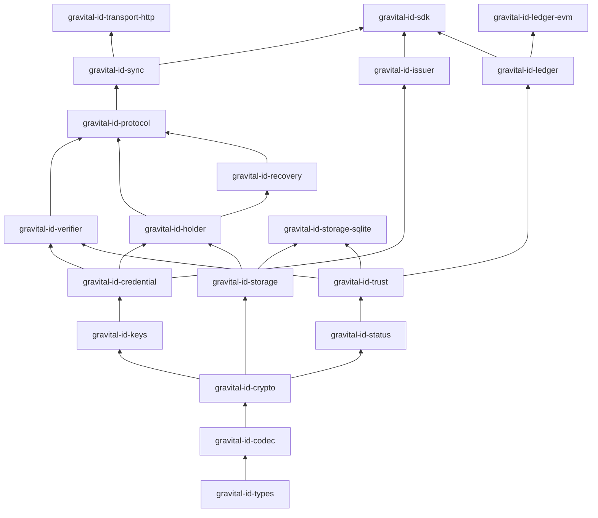

# PROJECT_STRUCTURE.md — Estructura del repositorio

> **Estado:** Borrador normativo v0.2 · **Depende de:** `ARCHITECTURE.md`, `REQUIREMENTS.md`
> **Revisión v0.2 (2026-10-10):** incorpora la revisión de arquitectura (ADR-0016 a ADR-0020, en estado **Propuesto**); lo que depende de ellos es propuesta hasta su aceptación por un mantenedor humano.
> Este documento fija **dónde vive cada cosa** y **qué puede depender de qué**. Crear un directorio, crate o paquete fuera de esta estructura requiere actualizar este documento en el mismo PR (y un ADR si cambia una regla de capas).

---

## 1. Decisión: monorepo

Un único repositorio contiene núcleo, bindings, servicios, contratos, conformidad y documentación. Motivos:

- Un cambio de protocolo toca especificación, núcleo, vectores, bindings y servicios a la vez; un monorepo permite hacerlo en un solo PR atómico y revisable.
- Los vectores de conformidad son la fuente de verdad compartida por todas las implementaciones.
- Los agentes de código ven todo el contexto con una sola lectura.

Los artefactos se **publican por separado** (crates, paquetes por lenguaje, imágenes de servicios, contratos), cada uno con su versión.

---

## 2. Árbol del repositorio

```text
gravital-id/
├── AGENTS.md                     # Reglas para agentes y desarrolladores (obligatorio leer)
├── CLAUDE.md                     # Importa AGENTS.md (compatibilidad con herramientas)
├── README.md                     # Puerta de entrada y mapa de documentación
├── SECURITY.md                   # Divulgación responsable (vulnerabilidades NO van a issues públicos)
├── CHANGELOG.md                  # Keep a Changelog, por componente
├── CONTRIBUTING.md               # (F1) Guía para humanos; remite a AGENTS.md
├── LICENSE-MIT / LICENSE-APACHE  # (F0, según ADR-0002)
├── Cargo.toml                    # Workspace: miembros, lints, perfiles, dependencias compartidas
├── Cargo.lock                    # Versionado siempre
├── rust-toolchain.toml           # Toolchain fijada (ADR-0014)
├── deny.toml                     # Política de cargo-deny (licencias, fuentes, advisories)
├── clippy.toml / rustfmt.toml
├── .cargo/config.toml            # Alias (xtask), flags por target (wasm getrandom, etc.)
│
├── .github/
│   ├── ISSUE_TEMPLATE/           # bug, tarea de roadmap, hueco de especificación, decisión
│   ├── PULL_REQUEST_TEMPLATE.md
│   ├── CODEOWNERS                # Rutas sensibles exigen revisión humana
│   └── workflows/                # ci, security, mobile, wasm, contracts, fuzz, release, docs
│
├── .issues/
│   ├── pending/                  # Respaldo cuando un agente no puede crear issues en GitHub
│   └── synced/                   # Registros ya convertidos en issues
│
├── docs/
│   ├── ARCHITECTURE.md
│   ├── REQUIREMENTS.md
│   ├── PROJECT_STRUCTURE.md      # Este documento
│   ├── ROADMAP.md
│   ├── STATUS.md                 # Estado vivo: fase, tareas en curso, bloqueos, traspaso
│   ├── TRACEABILITY.md           # Matriz generada requisito → pruebas (cargo xtask trace)
│   ├── adr/                      # Architecture Decision Records (NNNN-titulo.md)
│   ├── proposals/                # Propuestas de alcance y planes de implementación
│   ├── specs/                    # Especificaciones normativas (creadas en F0 / F19)
│   │   ├── THREAT_MODEL.md
│   │   ├── CRYPTO_PROFILES.md
│   │   ├── PROTOCOL.md
│   │   ├── TRUST_FRAMEWORK.md
│   │   ├── TRUST_BUNDLE.md
│   │   ├── STORAGE_FORMAT.md
│   │   ├── SDK_API.md
│   │   ├── ERROR_CODES.md
│   │   ├── GRAVITAL_EXPERIENCE_UI.md # Sistema de diseño de interfaces Flutter (ADR-0030)
│   │   ├── TEST_STRATEGY.md
│   │   ├── models/               # (F13) Modelos formales de protocolo
│   │   ├── CONTRACTS.md
│   │   └── profiles/
│   │       ├── pip-personal-v1.md
│   │       ├── pip-financial-v1.md
│   │       ├── pip-enterprise-v1.md
│   │       ├── pip-identity-v1.md            # (F19, según ADR-0021 / ADR-0026 / ADR-0028)
│   │       └── pip-tenant-role-v1.md         # (F19/F10, según ADR-0027)
│   ├── guides/                   # (F9 / F24) Integración por lenguaje y caso de uso
│   ├── runbooks/                 # (F15) Operación, incidentes, ceremonias
│   ├── postmortems/              # Análisis de incidentes y bugs S0/S1
│   └── legal/                    # (F14) DPIA, análisis regulatorio (sin datos personales)
│
├── crates/                       # Núcleo Rust (ver §3)
│   ├── gravital-id-types/
│   ├── gravital-id-codec/
│   ├── gravital-id-crypto/
│   ├── gravital-id-keys/
│   ├── gravital-id-credential/
│   ├── gravital-id-status/
│   ├── gravital-id-trust/
│   ├── gravital-id-verifier/
│   ├── gravital-id-holder/
│   ├── gravital-id-issuer/
│   ├── gravital-id-storage/
│   ├── gravital-id-storage-sqlite/       # Adaptador L5
│   ├── gravital-id-protocol/
│   ├── gravital-id-proximity/            # (F20, L4 sans-I/O, según ADR-0021 / ADR-0022)
│   ├── gravital-id-recovery/
│   ├── gravital-id-sync/
│   ├── gravital-id-transport-http/       # Adaptador L5
│   ├── gravital-id-transport-pcsc/       # (F21, Adaptador L5 PC/SC, según ADR-0021)
│   ├── gravital-id-ledger/
│   ├── gravital-id-ledger-evm/
│   ├── gravital-id-sdk/
│   └── gravital-id-testkit/              # Solo dev-dependency
│
├── cards/                        # (F22, según ADR-0021 / ADR-0024)
│   └── javacard/
│       └── gid-applet/           # Applet Java Card con pruebas en jCardSim
│
├── bindings/
│   ├── uniffi/                   # Crate pip-ffi-uniffi → Kotlin, Swift, Python
│   │   ├── kotlin/               # Proyecto Gradle (AAR/JAR) + pruebas + ejemplo
│   │   ├── swift/                # Swift Package + XCFramework + pruebas + ejemplo
│   │   └── python/               # Paquete Python + pruebas
│   ├── wasm/                     # Crate pip-wasm → paquete npm (navegador y Node)
│   ├── c/                        # Crate pip-ffi-c + cabecera generada (cbindgen)
│   │   ├── go/                   # Módulo Go (cgo)
│   │   └── dotnet/               # Paquete NuGet (P/Invoke)
│   └── dart/                     # flutter_rust_bridge (sujeto a ADR-0006)
│
├── services/
│   ├── pip-service-common/       # Config, telemetría, salud, errores HTTP compartidos
│   ├── pip-issuer-service/
│   ├── pip-trust-service/
│   ├── pip-indexer/
│   └── pip-relay/
│
├── contracts/                    # Foundry
│   ├── src/                      # TrustRegistry.sol, StatusAnchor.sol
│   ├── test/                     # Unitarias, fuzz, invariantes
│   ├── script/                   # Despliegue reproducible
│   └── foundry.toml
│
├── packages/
│   └── gravital_experience_ui/   # Paquete Dart/Flutter compartido del sistema de diseño Gravital-Experience-UI (ADR-0030)
│
├── apps/
│   ├── pip-cli/                  # Herramienta de desarrollo y operación
│   ├── gid-perso/                # (F22) Herramienta de personalización de tarjetas físicas
│   ├── reference-wallet/         # (F11) Wallet de referencia Flutter sobre Gravital-Experience-UI
│   ├── reference-verifier/       # (F11) Verificador de referencia
│   └── issuer-console/           # (F11) Consola mínima de emisor
│
├── conformance/
│   ├── vectors/                  # Vectores JSON inmutables, versionados por perfil (incl. proximity/ en F20)
│   ├── suites/                   # Definición de casos (positivos y negativos)
│   ├── runner/                   # Crate pip-conformance (ejecuta vectores contra cualquier SDK)
│   └── interop/                  # Adaptadores a implementaciones externas
│
├── fuzz/                         # cargo-fuzz: un objetivo por parser
├── benches/                      # Benchmarks transversales (criterion); los locales viven en cada crate
├── deploy/
│   ├── docker/                   # Dockerfiles reproducibles
│   ├── iac/                      # OpenTofu/Terraform por entorno
│   └── environments/             # dev, testnet, pilot, production (sin secretos)
├── spikes/                       # PoCs de F0 / F19. Código desechable: NUNCA importado por crates/
└── xtask/                        # Automatización: check-layers, trace, bindgen, vectors, release
```

---

## 3. Crates del núcleo

| Crate | Capa | Responsabilidad | I/O | WASM | Depende de (internos) |
|---|---|---|---|---|---|
| `gravital-id-types` | L1 | Identificadores (`IssuerId`, `Kid`, `Vct`, `ProfileId`), tiempo (`UnixTime`), versiones, `SessionCode` (F23), newtypes validados | No | Sí | — |
| `gravital-id-codec` | L1 | base64url estricto, JSON con límites y rechazo de duplicados, CBOR con límites, DEFLATE con límite, Base45 | No | Sí | types |
| `gravital-id-crypto` | L1 | Trait `CryptoBackend`; ES256, SHA-256, HMAC, HKDF, XChaCha20-Poly1305, ECDH P-256, HPKE, JWK, thumbprints, comparación en tiempo constante | No | Sí | types, codec |
| `gravital-id-keys` | L1 | `KeyPurpose`, `KeyHandle`, trait `KeyStore` (firma y acuerdo de claves), normalización de firmas DER → P1363, keystore software (feature `software-keystore`) | No | Sí | types, crypto |
| `gravital-id-credential` | L2 | SD-JWT (RFC 9901), SD-JWT VC, KB-JWT, esquemas de perfil | No | Sí | types, codec, crypto, keys |
| `gravital-id-status` | L2 | Token Status List: parseo, verificación, índice, frescura | No | Sí | types, codec, crypto |
| `gravital-id-trust` | L2 | Raíz de confianza, trust bundle multi-firma, manifiesto de estado, anti-rollback, piso de tiempo, `Policy`, trait `VerifierStateStore` | No | Sí | types, codec, crypto, status |
| `gravital-id-verifier` | L3 | Pipeline de verificación con typestate, caché de nonces (sobre `VerifierStateStore`), `VerificationResult` | No | Sí | credential, status, trust |
| `gravital-id-holder` | L3 | Gestión de credenciales, lotes, preparar/confirmar presentaciones | No* | Sí | credential, keys, storage (trait) |
| `gravital-id-issuer` | L3 | Construcción y firma de credenciales, asignación de índices | No | Sí | credential, status, keys |
| `gravital-id-storage` | L3 | Trait `StorageBackend`, cifrado de sobre, índices ciegos, migraciones, backend en memoria | No | Sí | types, crypto |
| `gravital-id-recovery` | L3 | Respaldo, código de recuperación, Shamir, migración SAS, solicitudes de re-vinculación | No | Sí | crypto, keys, holder |
| `gravital-id-protocol` | L4 | Mensajes OID4VCI/OID4VP, perfil offline QR, sobres de operación | No | Sí | credential, verifier, holder, recovery |
| `gravital-id-proximity` | L4 | (F20, ADR-0021) Sesión cifrada HPKE, transcrito, fragmentación por MTU, codec `GID-APDU`, máquinas de estado sans-I/O | No | Sí | types, codec, crypto, keys, credential, verifier, holder, protocol |
| `gravital-id-sync` | L4 | Cola de operaciones y sincronización como máquina de estado sans-I/O; trait `Transport` (lo implementa L5 o el host) | No | Sí | protocol, trust, status, storage |
| `gravital-id-ledger` | L4 | Trait `LedgerAdapter`, tipos de eventos, reconstrucción pura del estado, derivación determinista del bundle, contraste bundle ↔ estado | No | Sí | trust, types |
| `gravital-id-storage-sqlite` | L5 | Backend SQLite (`rusqlite`) de `StorageBackend` y de `VerifierStateStore` | Sí | No | storage, trust |
| `gravital-id-transport-http` | L5 | Implementación por defecto de `Transport`; conduce las máquinas de `gravital-id-sync` y `gravital-id-protocol` | Sí | No (en web el host inyecta `fetch`) | sync |
| `gravital-id-transport-pcsc` | L5 | (F21, ADR-0021) Adaptador PC/SC para lectores USB ISO/IEC 14443 / 7816 que conduce `gravital-id-proximity` | Sí | No | proximity |
| `gravital-id-ledger-evm` | L5 | Implementación EVM con `alloy`; solo servicios y modo completo | Sí | No | ledger |
| `gravital-id-sdk` | L6 | API pública estable; fachada sobre L1–L4; features `verifier`, `holder`, `issuer`, `sync`, `proximity`, `full-verification` | Según features | Sí (sin `full-verification`) | todos salvo testkit |
| `gravital-id-testkit` | — | `FixedClock`, `SeededRng`, emisores y bundles de prueba, generadores proptest | — | Sí | todos (solo dev) |

\* `gravital-id-holder` usa el trait de almacenamiento; el I/O real lo hace el backend.

Los crates L1–L3 son `#![no_std]` + `alloc` (ADR-0019): no pueden hacer I/O, leer el reloj ni obtener aleatoriedad del sistema, porque esas APIs no existen para ellos. Los crates L4 pueden usar `std`, pero son sans-I/O: exponen máquinas de estado que emiten efectos y consumen resultados. Solo L5 (adaptadores) y el host ejecutan I/O.

---

## 4. Reglas de dependencias (verificadas por `cargo xtask check-layers`)

1. Un crate solo puede depender de crates de **su capa o inferiores** según `xtask/layers.toml`.
2. Los crates L1–L4 **no** pueden depender de: `tokio` ni otro runtime async, `reqwest`, `hyper`, `alloy`, `rusqlite`, ni de ningún crate de `services/`. Los crates L1–L3 son además `#![no_std]`: `check-layers` falla si alguno enlaza `std`.
3. `gravital-id-verifier` **no** puede depender de `gravital-id-sync`, `gravital-id-ledger*`, `gravital-id-storage*` ni `gravital-id-transport-http` (persiste su estado mediante el trait `VerifierStateStore` de `gravital-id-trust`).
4. Ningún crate de `crates/` puede depender de `bindings/`, `services/`, `apps/` o `spikes/`.
5. `gravital-id-testkit` solo puede aparecer en `[dev-dependencies]`.
6. Los bindings solo pueden depender de `gravital-id-sdk` (nunca de crates internos directamente).
7. Los servicios pueden depender de `gravital-id-sdk` y de los adaptadores L5 (`gravital-id-ledger-evm`, `gravital-id-storage-sqlite`, `gravital-id-transport-http`); no de crates internos salvo que `layers.toml` lo autorice explícitamente con justificación.

Violaciones ⇒ CI falla. Cambiar `layers.toml` requiere ADR.



---

## 5. Configuración del workspace

### 5.1 Lints (en `Cargo.toml` del workspace)

```toml
[workspace.lints.rust]
unsafe_code = "deny"            # Ver nota sobre unsafe: "forbid" no admite excepciones ni sobrescritura por crate
missing_docs = "deny"
unused_must_use = "deny"

[workspace.lints.clippy]
unwrap_used = "deny"
expect_used = "deny"
panic = "deny"
indexing_slicing = "deny"
todo = "deny"
unimplemented = "deny"
dbg_macro = "deny"
print_stdout = "deny"
print_stderr = "deny"
float_arithmetic = "deny"          # CI compila con -D warnings: declararlos "deny" evita diferencias entre local y CI
arithmetic_side_effects = "deny"   # Usar checked_*/saturating_* en cálculos de tamaños e índices
```

**`unsafe`:** Cargo no permite heredar los lints del workspace y sobrescribir uno en un crate, y `forbid` no admite `allow` posteriores. Por eso el workspace declara `deny`, cada crate fuera de `bindings/` añade `#![forbid(unsafe_code)]` en su `lib.rs` (§6) y `cargo xtask check-layers` falla si falta. En `bindings/`, cada bloque lleva `#[allow(unsafe_code)]` local junto a su `// SAFETY:` (INV-09).

En pruebas (`#[cfg(test)]`, `tests/`, `benches/`, `xtask`, `pip-cli`) se permite `unwrap`/`expect` mediante `#![allow(...)]` local con comentario.

### 5.2 Perfiles de compilación

```toml
[profile.release]
lto = "fat"
codegen-units = 1
panic = "unwind"      # Necesario para catch_unwind en FFI
strip = "symbols"

[profile.release-mobile]
inherits = "release"
opt-level = "z"
```

`wasm32-unknown-unknown` usa `panic=abort` por defecto y no desenrolla con la toolchain estable aunque el perfil pida `unwind`: el binding WASM usa la estrategia de instancia envenenada de `ARCHITECTURE.md §3`. `opt-level = "z"` puede penalizar la criptografía; el valor definitivo (`z` o `s`) se fija con las mediciones de F2.T12.

### 5.3 Feature flags

- **Aditivas**: activar una feature nunca elimina comportamiento.
- Nombres en kebab-case; features peligrosas llevan `insecure-`/`dangerous-` (p. ej., `dangerous-allow-software-keys-financial` **no existirá**: es un ejemplo de lo que no se acepta).
- Cada combinación relevante se compila en CI con `cargo hack --feature-powerset` acotado.
- La elección de backend criptográfico **no** es una feature (sería excluyente, no aditiva): se hace por tipo (ADR-0007).

---

## 6. Estructura interna de cada crate

```text
crates/gravital-id-<nombre>/
├── Cargo.toml          # lints.workspace = true; versión del workspace
├── README.md           # Propósito, capa, invariantes, requisitos que implementa
├── src/
│   ├── lib.rs          # Docs del crate, re-exports públicos, #![forbid(unsafe_code)]
│   ├── error.rs        # Enum de error con thiserror; #[non_exhaustive]
│   └── ...             # Un módulo por concepto; sin "utils.rs" genéricos
├── tests/              # Pruebas de integración (incluye vectores negativos)
└── benches/            # criterion (si aplica)
```

Reglas:

- Enums públicos: `#[non_exhaustive]`. Resultados importantes: `#[must_use]`.
- Tipos con secretos: `Zeroize`/`ZeroizeOnDrop`; `Debug` manual que imprime `[REDACTED]`.
- Ningún `pub` sin documentación con al menos un ejemplo en los tipos principales.
- Constructores validan invariantes (newtypes); no existen estados inválidos representables cuando el tipo lo permite.

---

## 7. Modelo de errores

- Cada crate define su error con `thiserror`. `anyhow` solo en binarios, `xtask` y pruebas.
- `gravital-id-sdk` define `GidError` (y alias `PipError`) con **código estable** `GID-Exxxx` / `PIP-Exxxx` (catálogo en `docs/specs/ERROR_CODES.md`):

| Rango | Área |
|---|---|
| E0001–E0999 | Codificación y entrada |
| E1000–E1999 | Criptografía y claves |
| E2000–E2999 | Credenciales y presentaciones |
| E3000–E3999 | Estado y confianza |
| E4000–E4999 | Almacenamiento |
| E5000–E5999 | Sincronización y transporte |
| E6000–E6999 | Ledger |
| E7000–E7999 | Recuperación |
| E8000–E8999 | Proximidad (NFC/BLE), tarjeta física y código de sesión (F19–F23, ADR-0021) |
| E9000–E9999 | Interno (E9999 = pánico capturado en FFI) |

- **Los resultados de verificación no son errores**: `Invalid` o `Unverifiable` son valores de `VerificationResult`, no `Err`. `Err` se reserva para fallos de uso de la API o del entorno.
- Un código publicado nunca cambia de significado.

---

## 8. Pruebas

| Tipo | Ubicación | Herramienta | Obligatorio en |
|---|---|---|---|
| Unitarias | `src/**` (`#[cfg(test)]`) | `cargo test` / `cargo nextest` | Todo crate |
| Integración y negativas | `crates/*/tests/` | `cargo nextest` | Todo crate L1–L4 |
| Propiedades | `tests/` | `proptest` | codec, credential, status, trust, verifier, storage, proximity |
| Vectores de conformidad | `conformance/vectors/` | `gravital-id-conformance` | Desde F3 en Rust; desde F9 en cada lenguaje; desde F22 en applet |
| Vectores externos | `crates/gravital-id-crypto/tests/vectors/` | Project Wycheproof, ejemplos de RFC | gravital-id-crypto, gravital-id-credential |
| Fuzzing | `fuzz/fuzz_targets/` | `cargo-fuzz` | Todo parser |
| Mutación | — | `cargo-mutants` | Reglas de rechazo de credential, status, trust y verifier (desde F4) |
| Comprobación acotada de modelos | `src/**` (`#[cfg(kani)]`) | Kani | gravital-id-codec: ausencia de pánicos y de desbordamientos |
| Modelos formales de protocolo | `docs/specs/models/` | Tamarin o ProVerif | Presentación, re-vinculación y migración (F13) |
| Benchmarks | `benches/` | `criterion` | Desde F2 |
| Contratos | `contracts/test/` | Foundry (unit, fuzz, invariantes), Slither | F6 |
| Tarjeta física (applet) | `cards/javacard/gid-applet/` | jCardSim + vectores `conformance/vectors/proximity/` | F22 |
| Servicios | `services/*/tests/` | Testcontainers (PostgreSQL, nodo EVM local) | F7 |
| End-to-end | `apps/*/tests/`, `conformance/e2e/` | Escenarios scripted | F11 |

Reglas:

- Las pruebas **no** usan red real, reloj real ni aleatoriedad sin semilla (`gravital-id-testkit`).
- Los vectores en `conformance/vectors/` son **inmutables**: un vector publicado nunca se edita; se añade uno nuevo y el antiguo se marca obsoleto con referencia a ADR.
- Nombres de prueba: `<comportamiento>_<condición>_<resultado>`, con `// Verifies: REQ-...` cuando aplique.

---

## 9. Integración continua

| Workflow | Disparador | Contenido |
|---|---|---|
| `ci.yml` | Cada PR y push a `main` | fmt, clippy (todas las features), build, nextest, doc (`-D warnings`), `xtask check-layers`, `xtask trace`, MSRV, `cargo hack` acotado, build `wasm32-unknown-unknown` y build *bare-metal* de L1–L3 (`no_std`) |
| `security.yml` | Cada PR + diario | `cargo-deny`, `cargo-audit`, revisión de nuevas dependencias, búsqueda de secretos |
| `mobile.yml` | Push a `main` + nocturno + PR con label `ci:mobile` | Android (cargo-ndk, todas las ABIs) e iOS (XCFramework); pruebas de bindings en emulador/simulador |
| `wasm.yml` | PR que toque `bindings/wasm` o crates L1–L4 | wasm-pack, pruebas en Node y navegador headless |
| `contracts.yml` | PR que toque `contracts/` | `forge build/test`, fuzz, invariantes, gas snapshot, Slither |
| `cards.yml` | PR que toque `cards/` o `conformance/vectors/proximity/` (desde F22) | Compilación reproducible del applet Java Card y ejecución de vectores de proximidad en jCardSim |
| `fuzz.yml` | Nocturno | Cada objetivo durante un tiempo fijo; corpus persistido; un crash ⇒ issue automático `type:bug` + `area:security` **privado** |
| `bench.yml` | Nocturno + PR con label `ci:bench` | criterion con comparación contra `main` (gate desde G9) |
| `release.yml` | Tag | Builds reproducibles, firma de artefactos, SBOM, publicación por canal |
| `docs.yml` | PR que toque `docs/` | Enlaces rotos, lint de Markdown, IDs de requisitos válidos |

`main` está protegida: PR obligatorio, CI verde, revisión de CODEOWNERS en rutas sensibles, historial lineal (squash merge).

---

## 10. Bindings

- Generados desde `pip-sdk` por `cargo xtask bindgen <lenguaje>`. El código generado **no se edita a mano** y **no se versiona** (salvo cabecera C, que se versiona y CI verifica que esté actualizada).
- Cada binding contiene: envoltorio idiomático mínimo (solo ergonomía, sin lógica), implementación de `KeyStore` de plataforma, pruebas que ejecutan `conformance/vectors/`, ejemplo ejecutable.
- Los adaptadores de plataforma (Android Keystore, Secure Enclave, WebCrypto, IndexedDB) viven en el binding de su plataforma y tienen pruebas en dispositivo/emulador.

---

## 11. Servicios

```text
services/pip-<servicio>/
├── src/
│   ├── main.rs        # Arranque: config, telemetría, señales
│   ├── config.rs      # Config tipada desde entorno; secretos solo por referencia a KMS/gestor
│   ├── http/          # Rutas axum (si aplica)
│   ├── domain/        # Lógica; llama a pip-sdk
│   └── store/         # Persistencia (sqlx + PostgreSQL con migraciones)
├── migrations/
├── tests/
└── Dockerfile -> deploy/docker/
```

Principios: sin estado en memoria entre peticiones (escalado horizontal y serverless), idempotencia en toda mutación, endpoints `/healthz` y `/readyz`, apagado ordenado, ninguna credencial completa ni PII en logs.

---

## 12. Contratos

- Solidity con Foundry; versión del compilador fijada.
- Dependencias externas (p. ej., OpenZeppelin) fijadas por commit.
- Sin proxies actualizables (REQ-LEDG-003).
- Cada función que muta estado emite un evento; funciones, roles, eventos y errores están versionados y documentados en `docs/specs/CONTRACTS.md`.
- Scripts de despliegue deterministas; direcciones desplegadas registradas en `deploy/environments/<entorno>/contracts.json` (públicas, sin secretos).

---

## 13. Convenciones

| Elemento | Convención |
|---|---|
| Ramas | `<tipo>/<issue>-<slug>` — p. ej., `feat/142-status-list-parser`, `fix/201-kb-jwt-aud` |
| Commits | Conventional Commits: `feat(pip-status): parse token status list (#142)` |
| Tipos de commit | `feat`, `fix`, `docs`, `test`, `refactor`, `perf`, `build`, `ci`, `chore`, `security` |
| PRs | Un issue por PR; título en formato de commit; plantilla completa |
| Versiones | SemVer. Crates del SDK en *lockstep* (misma versión). Servicios y contratos con versión propia |
| Tags | `sdk-vX.Y.Z`, `svc-<servicio>-vX.Y.Z`, `contracts-vX.Y.Z`, `spec-vX.Y` |
| ADRs | `docs/adr/NNNN-titulo-en-kebab.md`, numeración consecutiva |
| Idioma | Documentación de gobierno en español; código, identificadores, rustdoc, commits y mensajes de error en inglés |
