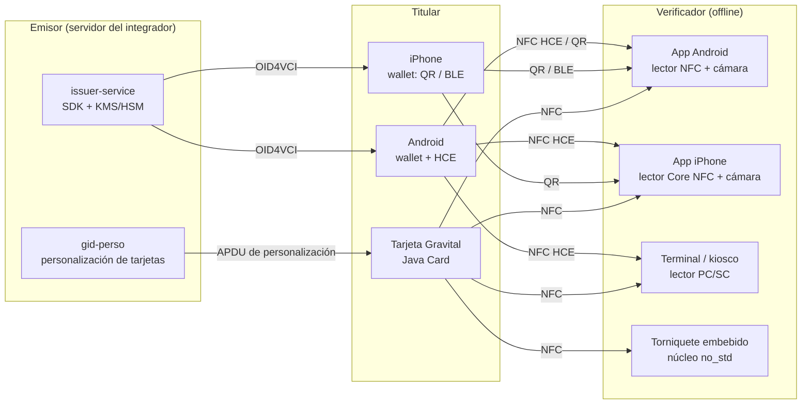
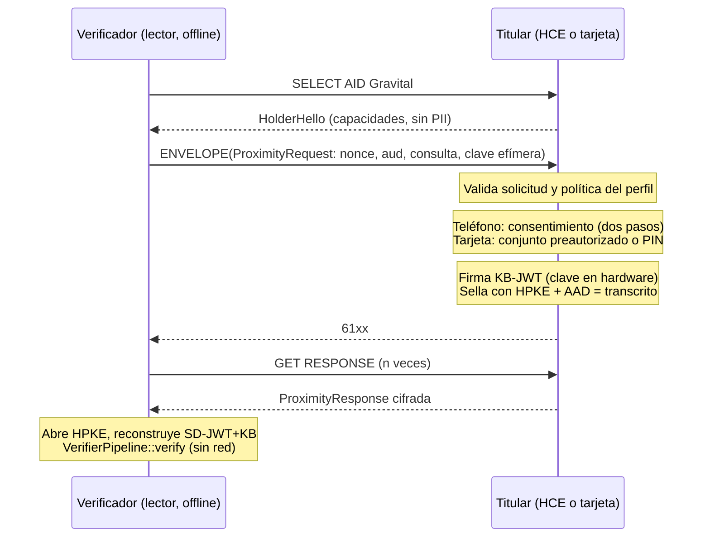
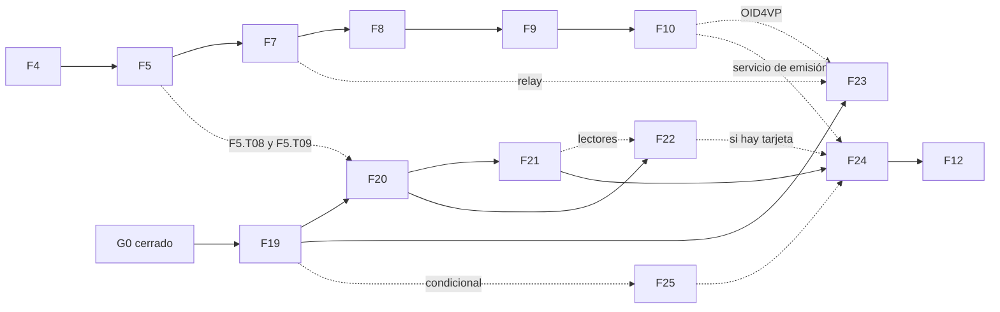

# Gravital ID — Plan de ampliación: identidad portable por NFC, tarjeta física, QR y código numérico

> **Tipo:** Propuesta de alcance y plan de implementación para agentes de código
> **Estado:** Borrador — pendiente de aprobación del mantenedor humano (Angel Nereira)
> **Fecha:** 2026-10-15
> **Base analizada:** `angelnereira/gravital-id`, rama `main`, commit `802a835` (merge del PR #72, pipeline del verificador)
> **Ubicación sugerida en el repositorio:** `docs/proposals/2026-10-15-alcance-identidad-portable.md`
> **Autoridad:** este documento está **subordinado** a `AGENTS.md`, a los ADR aceptados y a `docs/REQUIREMENTS.md` / `docs/ARCHITECTURE.md`. No modifica ninguna regla por sí mismo: propone ADRs, requisitos y fases que solo entran en vigor cuando el mantenedor los acepta.

---

## 0. Instrucciones obligatorias para el agente que ejecute este plan

1. **Lee primero** `AGENTS.md` completo y `docs/STATUS.md`. El orden de lectura de `AGENTS.md §2` sigue vigente; este documento se lee después de `STATUS.md`.
2. **Nada de este documento es norma todavía.** Los identificadores nuevos que aparecen aquí (`F19`–`F25`, `G19`–`G25`, `MP1`–`MP3`, `ADR-0021`–`ADR-0026`, `REQ-PROX-*`, `REQ-CARD-*`, `REQ-CODE-*`, `REQ-IDDOC-*`, `R-15`–`R-23`, familia de errores `GID-E8xxx`) son **candidatos**. Se vuelven oficiales cuando un PR los incorpora a `ROADMAP.md`, `REQUIREMENTS.md`, `ERROR_CODES.md` o `docs/adr/` y el mantenedor lo aprueba. Hasta entonces, no los cites en código como si existieran (`AGENTS.md §14`: no inventar requisitos ni decisiones).
3. **Spec-first.** La primera fase (F19) es solo documentación, ADRs y spikes. **Ningún código de producción de F20–F25 se escribe antes de que ADR-0021 esté Aceptado.**
4. **No se salta ninguna fase existente (INV-13).** El alcance nuevo depende de F4 y F5. La prioridad inmediata sigue siendo cerrar F4 (F4.T08–F4.T12) y ejecutar F5. F19 puede avanzar en paralelo porque no toca código.
5. **Los 16 invariantes (`INV-01`–`INV-16`) aplican a todo lo nuevo**, en particular: verificación sin red (INV-01), cero PII en ledger, logs y errores (INV-02), claves privadas del titular fuera de FFI (INV-03), cuatro estados (INV-04), fail-closed (INV-05), claves de emisor solo del trust bundle (INV-06) y bindings sin lógica (INV-15).
6. **Toolchain:** el repositorio fija Rust `1.85.0` (`rust-toolchain.toml`, ADR-0014). Las pruebas `trybuild` (`compile_fail`) comparan mensajes del compilador y dependen de esa versión. Si ejecutas con otra versión y fallan solo por formato del diagnóstico, **no** regeneres las instantáneas (`TRYBUILD=overwrite`): instala 1.85.0 o anótalo en la nota de traspaso.
7. Cada tarea de este plan se convierte en un issue (`type:task`, plantilla `task.md`) con el ID en el título, p. ej. `[F20.T03] Cifrado de sesión de proximidad`. Si no puedes crear issues, usa `.issues/pending/` (`AGENTS.md §7.3`).

---

## 1. Resumen ejecutivo

**Qué pide el alcance:** que Gravital ID sea la capa de identificación que cualquier organización integre en su servidor, con credenciales de usuario (perfiles, datos personales, incluso la cédula) que el titular porta y presenta **como una tarjeta Visa o Mastercard**: por **NFC** (sin contacto), por **QR**, o mediante un **identificador numérico de 9–10 dígitos**, y que funcione **sin conexión a Internet**.

**Diagnóstico:**

- El **modelo de confianza ya es equivalente al de EMV** (la tecnología de Visa/Mastercard): raíz fijada en el terminal, claves de emisor certificadas, clave del titular ligada por el emisor, firma de un desafío del verificador y verificación offline con listas de excepción. Esa parte (núcleo criptográfico, SD-JWT VC, estado, trust bundle k-de-n y pipeline del verificador) está **construida y probada** (~27.900 líneas de Rust en `crates/`, 395 de 397 pruebas en verde; ver §5).
- Lo que falta para el alcance pedido son sobre todo **factores de forma y transportes**: wallet con almacenamiento cifrado (F5, no iniciada), transporte QR (F5, no iniciado), **NFC** (solo previsto en F18), **tarjeta física** (no prevista), **código numérico** (no previsto y en tensión con el principio de no correlación), **perfil de identidad tipo cédula con retrato** (no previsto), SDK de servidor y bindings (F9/F10, solo esqueleto hoy).
- Hay **límites duros** que el diseño debe respetar (§3): un número de 10 dígitos **no puede validar a nadie de forma segura sin conexión**; un **iPhone en Panamá no puede actuar como tarjeta NFC** (sí como lector); el **retrato no cabe en un QR**; la **validez legal de una cédula portable** depende del Tribunal Electoral, no del código.

**Propuesta:** añadir una pista de seis fases (F19–F24) más una condicional (F25), encadenadas a las existentes por dependencias, con tres hitos intermedios: **MP1 · Tap offline** (teléfono Android → lector por NFC), **MP2 · Tarjeta física**, **MP3 · Identidad portable**.

---

## 2. Objetivos de producto del alcance solicitado

| ID | Objetivo | Origen |
|---|---|---|
| OBJ-01 | Guardar datos y perfiles de usuario como credenciales cifradas, portables y verificables. | Solicitud del mantenedor |
| OBJ-02 | Presentar la identidad por **NFC**, como un pago sin contacto, desde teléfono o tarjeta. | Ídem |
| OBJ-03 | Presentar la identidad por **QR**. | Ídem (ya en F5) |
| OBJ-04 | Validar mediante un **identificador numérico de 9–10 dígitos**. | Ídem |
| OBJ-05 | Funcionar **sin conexión a Internet** en la verificación. | Ídem (ya es INV-01) |
| OBJ-06 | Ser una **capa integrable**: el integrador instala el SDK en su servidor, emite credenciales y aprovisiona dispositivos (teléfonos y tarjetas). | Ídem |
| OBJ-07 | Portar documentos de identidad, **incluida la cédula**. | Ídem |
| OBJ-08 | Seguridad de grado alto ("robusto, potente, ultra seguro"). | Ídem |

---

## 3. Viabilidad: qué es posible y qué no (vinculante para el agente)

Igual que `ARCHITECTURE.md §2`, esta tabla existe para que nadie intente construir algo imposible.

| Objetivo | ¿Viable? | Condiciones y límites |
|---|---|---|
| Verificar por NFC sin Internet | **Sí** | Igual que el QR: el verificador necesita un trust bundle y un snapshot de estado obtenidos antes. La revocación posterior al último snapshot no se puede conocer offline (`ARCHITECTURE.md §2`); el resultado declara la antigüedad (`ValidWithStaleStatus`). |
| Teléfono **Android** como tarjeta NFC | **Sí** | Host Card Emulation (HCE, `HostApduService`). Clave del titular en StrongBox/TEE. |
| **iPhone** como tarjeta NFC en Panamá | **No hoy** | Apple limita la emulación de tarjeta en apps de terceros a mercados elegibles: el programa HCE se documenta para el Espacio Económico Europeo y la plataforma NFC & SE se anunció para Australia, Brasil, Canadá, Japón, Nueva Zelanda, Reino Unido y EE. UU.; Panamá no aparece (fuentes en §11). El iPhone **sí** puede ser **lector** (Core NFC, ISO 7816). El titular con iPhone presenta por QR o BLE. Reevaluar si Apple amplía mercados. |
| Tarjeta física que funcione offline "como una Visa" | **Sí, con hardware específico** | Requiere un elemento seguro programable (p. ej. Java Card con ECDSA P-256) donde se genera la clave del titular, y un proceso de **personalización** por el emisor. Ver §7.5. |
| Validar **solo** con un número de 9–10 dígitos **sin Internet** | **Imposible de forma segura** | 10 dígitos con uno de control dejan ~10⁹ combinaciones (≈ 30 bits): no hay firma ni prueba de posesión. Es el equivalente a dictar el número de una tarjeta: en EMV, una compra "sin tarjeta presente" **siempre** se autoriza en línea con el emisor. |
| Validar con un número de 9–10 dígitos **con Internet** | **Sí, como código de sesión** | El número identifica una **sesión**, no a una persona; la seguridad la dan la solicitud firmada, el cifrado HPKE y la firma KB-JWT del titular. Ver §7.6. |
| Número persistente y global por persona | **No como identificador del protocolo** | Contradice `ARCHITECTURE.md §7.1` ("no existe un identificador global del titular") y P-09 (no correlación). Alternativa admisible: número **por emisor**, tratado como dato personal y resuelto solo con consentimiento (opcional, ADR). |
| Cédula portable **técnicamente** | **Sí** | Perfil nuevo `pip-identity-v1` con retrato, número de documento y predicados (§7.7). |
| Cédula portable **con validez legal de documento oficial** | **No la resuelve el código** | Depende de que el Tribunal Electoral sea el emisor o de que la ley lo reconozca. El TE presentó en 2024 su propia app de identidad digital en beta (§11). Sin acuerdo con el TE, lo viable es una **credencial derivada** ("identidad verificada por la entidad X"), útil entre quienes confían en ese emisor. |
| Retrato (foto) por QR | **No práctico** | El presupuesto de un QR es 1.200 caracteres Base45 (ADR-0011) ≈ 800 bytes; un retrato JPEG útil pesa del orden de decenas de KB y ya está comprimido. Por NFC o BLE sí. |
| Equivalente de banda magnética (dato estático) | **No recomendado** | Un dato estático firmado es copiable: prueba que el emisor firmó los datos, no que quien lo muestra es el titular. Solo tendría sentido como "nivel bajo" con retrato y requeriría ADR. Fuera del plan. |
| "Ultra seguro" | **Se demuestra, no se declara** | Requiere auditorías externas (F13), elementos seguros certificados para tarjetas y pruebas de campo. El código por sí solo no lo garantiza. |

---

## 4. Cómo funciona "como Visa/Mastercard": correspondencia EMV → Gravital ID

El trust model de Gravital ID ya replica la lógica de autenticación offline de EMV. Esta tabla es la guía conceptual para diseñar NFC y tarjeta sin romper lo existente.

| Concepto EMV | Equivalente en Gravital ID | Estado |
|---|---|---|
| Claves públicas de las autoridades (CA) cargadas en el terminal | `TrustRoot` fijada por el integrador + `TrustBundle` cofirmado k-de-n | ✅ `gravital-id-trust` |
| Certificado de la clave del emisor (firmado por la CA) | Claves de emisor con estado en el trust bundle | ✅ |
| Certificado de la clave de la tarjeta (firmado por el emisor) | Credencial SD-JWT VC con `cnf.jwk` (clave del titular ligada por el emisor) | ✅ `gravital-id-credential` |
| SDA (datos estáticos firmados, clonables) | SD-JWT sin Key Binding / QR estático | ⛔ No usar para presentación interactiva |
| DDA/CDA: la tarjeta firma el número impredecible del terminal | KB-JWT firmado por el titular sobre `nonce`, `aud`, `iat`, `sd_hash` | ✅ `kb.rs` |
| Autenticación offline de datos en el terminal | Pipeline del verificador (11 comprobaciones, 4 estados) | 🟡 F4 en curso |
| Clave privada dentro del chip, no exportable | Clave del titular en StrongBox / Secure Enclave / elemento seguro de tarjeta vía `KeyStore` | 🟡 Trait listo; implementaciones de plataforma en F9 |
| Archivo de excepciones (lista negra) del terminal | Snapshot de Token Status List + frescura | ✅ `gravital-id-status` |
| Gestión de riesgo del terminal (límite de piso: cuándo ir en línea) | `VerificationPolicy` con frescura por operación | ✅ `policy.rs` |
| Autorización en línea (ARQC/ARPC) | Modo en línea: estado fresco + OID4VP | ⬜ F7 / F10 |
| Selección de aplicación por AID (`SELECT`) | Applet/servicio Gravital seleccionado por AID | 🆕 F21 |
| Método de verificación del titular (PIN, biometría) | Presencia de usuario en la clave (teléfono) / PIN en tarjeta | 🆕 F21 / F22 |
| Personalización de tarjetas por el emisor | Aprovisionamiento: clave generada en el chip + credencial escrita por el emisor | 🆕 F22 |
| Tokenización (número distinto por dispositivo) | Emisión por lotes con claves distintas por copia | ✅ `gravital-id-issuer` (lotes) |
| PAN (número de tarjeta) | Código de sesión (por defecto) o número por emisor (opcional) | 🆕 F23 |
| 3-D Secure (el emisor pide confirmación al titular en su app) | Resolución de número por emisor con consentimiento push (opción B) | 🆕 F23 (opcional) |

**Conclusión de diseño:** no hace falta otra criptografía ni otro modelo de confianza. Hace falta (1) un **transporte de proximidad cifrado** y (2) **nuevos portadores** de la clave del titular (HCE y tarjeta), reutilizando credencial, KB-JWT, trust bundle, estado y verificador tal como están.

---

## 5. Estado actual verificado

### 5.1 Evidencia

- Repositorio clonado en `802a835` y suite ejecutada con `cargo test --workspace` (rustc 1.97 estable, porque 1.85.0 no estaba disponible en el entorno de análisis): **395 pruebas pasan; 2 fallan solo por formato del diagnóstico** en las pruebas `trybuild` de `gravital-id-keys` y `gravital-id-verifier` (el código sigue sin compilar, que es lo que se prueba). Con la toolchain fijada, `STATUS.md` registra 393/393.
- Líneas de Rust por crate (código + pruebas):

| Crate | Líneas | De ellas, pruebas | Estado real |
|---|---|---|---|
| `gravital-id-credential` | 8.202 | 2.661 | Funcional |
| `gravital-id-verifier` | 4.060 | 1.361 | Funcional (F4 en curso) |
| `gravital-id-crypto` | 3.885 | 952 | Funcional |
| `gravital-id-codec` | 3.293 | 144 | Funcional |
| `gravital-id-trust` | 2.636 | 652 | Funcional |
| `gravital-id-status` | 2.290 | 470 | Funcional |
| `gravital-id-issuer` | 1.125 | 374 | Funcional |
| `gravital-id-types` | 1.063 | 87 | Funcional |
| `gravital-id-keys` | 951 | 242 | Funcional |
| `gravital-id-testkit` | 232 | — | Funcional |
| `gravital-id-sdk` | 52 | — | **Esqueleto F1.T13** (re-exporta `Clock`, `Rng`, errores) |
| `bindings/wasm` | 43 | — | **Esqueleto F1.T13** (2 funciones de humo) |
| `holder`, `storage`, `storage-sqlite`, `protocol`, `sync`, `recovery`, `ledger`, `ledger-evm`, `transport-http` | 11–14 c/u | — | **Vacíos** |
| `xtask` | 2.525 | — | Funcional (capas, trazabilidad, errores, vectores) |

- 24 vectores de conformidad SD-JWT VC en `conformance/vectors/sd-jwt-vc/`, 9 objetivos de fuzzing.
- La prueba `nominal_valid_presentation_passes_all_checks` demuestra hoy, en memoria, el flujo **emitir → presentar con KB-JWT → verificar offline contra trust bundle y snapshot de estado**.

### 5.2 Capacidades: hecho, parcial y pendiente

Leyenda: ✅ hecho y probado · 🟡 parcial · ⬜ en el roadmap, sin iniciar · 🆕 fuera del roadmap actual

| # | Capacidad | Estado | Dónde / fase |
|---|---|---|---|
| 1 | Primitivas: ES256, SHA-256, HMAC, HKDF, XChaCha20-Poly1305, ECDH, **HPKE**, JWK | ✅ | `gravital-id-crypto` (F2) |
| 2 | Codecs acotados: base64url, JSON, CBOR, DEFLATE, Base45 | ✅ | `gravital-id-codec` (F2) |
| 3 | Claves tipadas por propósito, trait `KeyStore`, keystore software | ✅ | `gravital-id-keys` (F2) |
| 4 | Keystores de hardware (StrongBox, Secure Enclave, WebCrypto, KMS/HSM) | ⬜ | F9.T04–T06, F10, F15 |
| 5 | Credenciales SD-JWT VC: emisión, parseo, KB-JWT, perfiles, predicados, lotes | ✅ | `gravital-id-credential`, `-issuer` (F3) |
| 6 | Interoperabilidad con una implementación externa | ⬜ bloqueada | F3.T10 |
| 7 | Estado y revocación (Token Status List, caché, frescura por perfil) | ✅ | `gravital-id-status` (F4) |
| 8 | Raíz y trust bundle k-de-n, anti-rollback | ✅ | `gravital-id-trust` (F4) |
| 9 | Verificador offline (11 comprobaciones, typestate, nonces, piso de tiempo, política) | 🟡 | F4.T08–T12 pendientes |
| 10 | Wallet: almacenamiento cifrado, importar, preparar/confirmar presentación | ⬜ | F5 |
| 11 | Transporte QR de dos pasos y multi-QR | ⬜ (solo especificado) | F5.T09 |
| 12 | Contratos y ledger | ⬜ | F6 |
| 13 | Servicios: relay, trust service, indexador, sincronización | ⬜ | F7 |
| 14 | Recuperación y migración | ⬜ | F8 |
| 15 | SDK completo y bindings (Kotlin, Swift, TS, Python, Dart, Go, .NET) | 🟡 esqueleto | F9 |
| 16 | OID4VCI / OID4VP y servicio de emisión | ⬜ | F10 |
| 17 | **Transporte NFC** (HCE, lectores, APDU) | 🆕 | Solo en F18.T04 |
| 18 | **Cifrado de sesión en proximidad** | 🆕 | El flujo QR actual no cifra la respuesta |
| 19 | **Tarjeta física** con elemento seguro | 🆕 | No prevista |
| 20 | **Código numérico de 9–10 dígitos** | 🆕 | No previsto |
| 21 | **Perfil de identidad (cédula) con retrato** | 🆕 | Solo "perfil gubernamental" en F18.T08 |
| 22 | **Formato mdoc / ISO 18013-5** | 🆕 | Solo en F18.T04 |

### 5.3 Discrepancias detectadas (registrar como `type:spec-gap` en F19.T02)

1. **Presupuesto y cabecera multi-QR contradictorios:** ADR-0011 fija 1.200 caracteres y la cabecera `GID01/P…`; `PROTOCOL.md §3.3` dice ≈ 800 caracteres, cabecera `PIP1/M/<índice>/<total>/<hash8>/` y N ≤ 8; `spikes/qr/REPORT.md` propone fragmentos de 900 caracteres con `GID01/P<idx>/<total>/<checksum>/`. Bloquea F5.T09.
2. **Calendario de BLE/NFC contradictorio:** ADR-0011 los sitúa en "fases futuras (F11)"; `ARCHITECTURE.md §9.4` y `ROADMAP.md F18.T04` en F18.
3. **README sobrestima el estado:** marca `gravital-id-sdk` y `bindings/wasm` como "Listo", pero son esqueletos de F1.T13 (§5.1).
4. **Spikes sin evidencia reproducible:** los cuatro informes de `spikes/` (QR, keystore, WASM, ledger) reportan mediciones en dispositivos físicos concretos, pero el directorio no contiene código, scripts ni datos crudos. G0 se cerró apoyándose en ellos. Para el alcance nuevo, QR y keystore son críticos: deben repetirse con código y datos versionados (F19.T14).
5. **Identificador numérico vs. no correlación:** el objetivo OBJ-04 choca con `ARCHITECTURE.md §7.1`; debe resolverse por ADR (ADR-0025), no en código.
6. **Bloqueo de CI:** GitHub Actions no ejecuta por un problema de facturación de la cuenta (`STATUS.md`, Bloqueos). G1, G2 y G3 siguen abiertos. Ningún gate nuevo puede cerrarse sin CI.

---

## 6. Brechas para el alcance propuesto

| Capacidad pedida | Qué falta concretamente | Fase |
|---|---|---|
| Datos y perfiles cifrados en el dispositivo (OBJ-01) | Wallet, `StorageBackend`, cifrado de sobre, SQLite, índices ciegos | F5 (existente) |
| QR (OBJ-03) | Transcodificación, multi-QR, solicitudes, CLI de ida y vuelta; resolver spec-gap 1 | F5 (existente) |
| NFC teléfono (OBJ-02) | Sesión de proximidad cifrada; protocolo APDU; HCE Android; lectores Android/iOS/PC-SC; binding Kotlin mínimo | F20, F21 |
| NFC tarjeta (OBJ-02, OBJ-06) | Applet Java Card; personalización; PIN; pruebas con jCardSim y tarjetas reales | F22 |
| Código numérico (OBJ-04) | Modelo de identificadores (ADR); código de sesión con relay; opcional número por emisor | F23 (+ F7, F10) |
| Offline (OBJ-05) | Ya garantizado por diseño; extender a NFC sin red | F20–F22 |
| SDK de servidor y aprovisionamiento (OBJ-06) | Servicio de emisión, adaptadores KMS/HSM, empaquetado TS/Go/.NET, guías | F24 (+ F9, F10) |
| Cédula / identidad (OBJ-07) | Perfil `pip-identity-v1`, retrato, distinción oficial/derivada, análisis legal | F19, F24, F14 |
| Seguridad alta (OBJ-08) | Modelo de amenazas de proximidad; auditoría del applet y del transporte; certificación del chip | F19, F13 |
| Interoperabilidad de proximidad con estándares | mdoc ISO/IEC 18013-5 (condicional) | F25 |

---

## 7. Diseño técnico propuesto (borrador para los ADR de F19)

### 7.1 Vista de factores de forma



Todos los caminos terminan en el **mismo** `VerifierPipeline::verify` y producen el mismo `VerificationResult` de cuatro estados. Ningún transporte añade estados (INV-04).

### 7.2 Sesión de proximidad cifrada (núcleo de F20)

**Problema:** el flujo QR actual entrega la presentación en claro (es visual). Por radio (NFC/BLE) la señal puede capturarse a distancia y retransmitirse; además, una respuesta no debe poder reenviarse a otra sesión.

**Propuesta (decidir en ADR-0023):**

1. **Contacto (engagement):** el verificador genera un par efímero P-256 (`KeyPurpose` de acuerdo de claves, nunca de firma) y lo envía con la solicitud.
2. **Solicitud** `ProximityRequest` (CBOR determinista): versión, `verifier_id`/`aud`, `nonce` (≥ 128 bits), consulta (subconjunto DCQL acordado en F5.T08), `expires_at`, instante del verificador, clave pública efímera, firma opcional del verificador (obligatoria según perfil, REQ-PRES-007).
3. **Transcrito de sesión:** `transcript_hash = SHA-256(engagement ‖ request)` con codificación canónica.
4. **Respuesta** `ProximityResponse`: la presentación SD-JWT+KB transcodificada (misma transcodificación de `PROTOCOL.md §3.2`) **sellada con HPKE** (`gravital-id-crypto`, suite de `CRYPTO_PROFILES.md`) hacia la clave efímera del verificador, con `transcript_hash` como datos asociados.
5. **Vinculación:** el KB-JWT firma el `nonce` del verificador y su `aud`; ADR-0023 decide si además el `nonce` se deriva del transcrito. Requisito resultante: una respuesta reenviada a otra sesión o a otro verificador **debe** dar `Invalid`.
6. **Independiente del medio:** los mismos mensajes viajan por NFC, BLE o QR. ADR-0023 decide si el flujo QR adopta también el cifrado cuando la solicitud trae clave efímera (recomendado: protege contra fotos del QR de respuesta).
7. Esto se alinea conceptualmente con la sesión cifrada de ISO/IEC 18013-5 (claves efímeras y transcrito de sesión), lo que facilita F25.

Esqueleto orientativo (no normativo; F19.T09 fija la gramática en `PROTOCOL.md`):

```text
ProximityRequest = {
  v: 1, verifier_id: tstr, aud: tstr, nonce: bstr(>=16),
  query: DcqlSubset, expires_at: uint, verifier_time: uint,
  eph_pub: bstr(P-256 SEC1), ? verifier_sig: bstr
}
ProximityResponse = {
  v: 1, enc: bstr(HPKE enc), ct: bstr(HPKE ciphertext de la presentación transcodificada)
} ; aad = transcript_hash
```

### 7.3 Transporte NFC: protocolo APDU "GID-APDU" (núcleo de F21)

El titular (teléfono HCE o tarjeta) actúa como tarjeta ISO/IEC 14443-4; el verificador como lector. Comandos ISO/IEC 7816-4:

| Paso | Comando | Contenido | Respuesta |
|---|---|---|---|
| 1 | `SELECT` por AID (`00 A4 04 00`) | AID de Gravital | `HolderHello`: versiones, tamaño máximo de mensaje, capacidades (PIN, BLE), sin PII |
| 2 | `ENVELOPE` (`INS C3`), encadenado si excede el tamaño | `ProximityRequest` | `9000`, `61xx` (hay datos) o estado "consentimiento pendiente" |
| 3 | `GET RESPONSE` (`INS C0`) repetido | — | Fragmentos de `ProximityResponse` |
| 4 (tarjeta) | `VERIFY` (`INS 20`) | PIN del titular, según ADR-0024 | `9000` / `63Cx` (intentos restantes) / `6983` (bloqueado) |

- **Alineación con ISO 18013-5:** usar `ENVELOPE`/`GET RESPONSE` para el intercambio de datos facilita migrar a mdoc (F25).
- **AID:** en desarrollo, un AID propietario (los AID que empiezan por `F` no requieren registro). Para producción, ADR-0022 decide si se registra un RID ante la autoridad de ISO/IEC 7816-5.
- **Tamaños:** usar APDU de longitud extendida cuando el lector lo soporte, con encadenamiento como alternativa; F19.T12 mide el rendimiento real.
- **Parsers acotados + fuzzing** para cada comando y respuesta (REQ-SEC-005).
- **Códigos de error nuevos** en una **familia 8** de `ERROR_CODES.md` (`GID-E8000..E8999`, hoy libre): AID no soportado, mensaje fuera de límites, sesión expirada, consentimiento pendiente, PIN requerido, PIN bloqueado, descifrado fallido (este último siempre fail-closed).



**Consentimiento en teléfono (REQ-PRES-003 se mantiene):** un toque NFC dura poco. Modelo propuesto de **dos toques**:

1. El titular abre la app y "arma" un conjunto de datos (p. ej. "identidad básica") durante un tiempo corto, con biometría si el perfil lo exige; eso es la *preparación*.
2. Al tocar, si la solicitud está contenida en lo armado, se firma y responde (*confirmación*). Si pide más, la app responde "consentimiento pendiente", muestra qué se pide y quién lo pide, y el titular aprueba y vuelve a tocar.

### 7.4 Plataformas

| Plataforma | Rol | Tecnología | Nota |
|---|---|---|---|
| Android | Titular (tarjeta emulada) | `HostApduService` (HCE) + `KeyStore` StrongBox/TEE | Adaptador Kotlin sin lógica (INV-15): reenvía APDU a la máquina de estado Rust. |
| Android | Verificador | `IsoDep` (lector) | Detectar soporte de longitud extendida. |
| iPhone | Verificador | Core NFC `NFCTagReaderSession` (ISO 7816) con el AID declarado | Lectura sí; emulación no en Panamá (§3). |
| iPhone | Titular | QR y, si F21.T08 se aprueba, BLE | Limitación documentada (R-15). |
| Linux / Windows / macOS | Terminal, kiosco, servidor | Lector PC/SC; adaptador L5 nuevo `gravital-id-transport-pcsc` | Útil para puntos de atención y para personalizar tarjetas. |
| Microcontrolador | Torniquete, control de acceso | Núcleo `no_std` (ya compila para `thumbv7em-none-eabihf`) + front-end NFC | Fuera de alcance del MVP; posible tras G21. |

### 7.5 Tarjeta física Gravital (núcleo de F22)

**Qué es:** una tarjeta sin contacto con elemento seguro programable que guarda la credencial y la clave del titular, y responde al mismo GID-APDU. Funciona offline con cualquier lector Gravital.

**Decisiones para ADR-0024:**

- **Plataforma:** Java Card con soporte de ECDSA P-256/SHA-256 y de acuerdo de claves ECDH P-256; versión mínima y chips candidatos a evaluar en F19.T13.
- **Cifrado de sesión en la tarjeta (riesgo principal, R-16):** HPKE necesita ECDH P-256, HKDF-SHA256 y un AEAD (ChaCha20-Poly1305 o AES-GCM). Muchos chips Java Card no ofrecen AEAD; AES-GCM depende de la versión y del fabricante. **F19.T13 debe confirmar qué chips lo soportan.** Si ninguno candidato lo hace, ADR-0024 elige entre: exigir chips que lo soporten, definir un modo alternativo revisado por criptógrafos, o limitar la tarjeta a conjuntos de datos no sensibles sin cifrado de sesión. **Nunca** se implementa criptografía propia en el applet (INV-07).
- **Clave del titular:** generada dentro de la tarjeta, nunca exportable; se exporta solo la clave pública (y la atestación del fabricante si existe).
- **Ciclo de vida:** `PERSONALIZACIÓN` → `ACTIVA` → `BLOQUEADA` / `TERMINADA`. La credencial solo se escribe en `PERSONALIZACIÓN`, autenticada por el emisor.
- **Reloj:** la tarjeta no tiene reloj; usa el instante del verificador para el `iat` del KB-JWT. La frescura la garantiza el `nonce`.
- **Niveles de verificación del titular (como el CVM de EMV):**
  - Nivel 0, sin PIN: conjunto preautorizado de datos no sensibles (p. ej. `age_over_18`, nombre).
  - Nivel 1, con PIN: datos sensibles (número de documento, fecha de nacimiento, retrato).
  - Contador de intentos con bloqueo; desbloqueo solo por el emisor.
  - Riesgo: el PIN se teclea en el dispositivo del verificador. ADR-0024 decide si el PIN viaja dentro de la sesión cifrada.
- **Correlación (R-18):** una sola clave por tarjeta hace que la tarjeta sea rastreable entre verificadores, como un número de tarjeta bancaria. Mitigación: varias copias de la credencial con claves distintas en la tarjeta (lotes, REQ-KEY-008) si el almacenamiento lo permite; si no, el perfil documenta la contrapartida.
- **Pérdida o robo:** revocación por lista de estado (REQ-CARD-005); los verificadores la ven al sincronizar.
- **Fuente de verdad:** el applet en Java duplica parte de la lógica del titular. Para evitar divergencias, **los vectores de conformidad de proximidad se ejecutan contra el applet en CI** (jCardSim) y deben dar resultados idénticos al núcleo Rust (REQ-CARD-004).

```mermaid
sequenceDiagram
    participant E as Emisor (issuer-service + KMS)
    participant P as gid-perso (lector PC/SC)
    participant C as Tarjeta (PERSONALIZACIÓN)
    P->>C: Autenticación de personalización (claves del emisor)
    P->>C: GENERATE KEY (P-256, propósito HolderBinding)
    C-->>P: Clave pública + atestación opcional
    P->>E: Solicitud de emisión (clave pública de la tarjeta)
    E->>E: Construye SD-JWT VC con cnf = clave de la tarjeta<br/>Asigna índice de estado aleatorio; firma en KMS
    E-->>P: Credencial firmada
    P->>C: STORE CREDENTIAL (fragmentada)
    P->>C: SET PIN inicial / conjunto preautorizado
    P->>C: Cierra personalización → ACTIVA
```

### 7.6 Identificadores numéricos de 9–10 dígitos (núcleo de F23)

Tres conceptos que **no deben mezclarse**:

| Concepto | Qué identifica | Persistente | Dónde vive | Decisión |
|---|---|---|---|---|
| Número de documento (cédula) | A la persona, ante el Estado | Sí | Claim `document_number` dentro de la credencial, de divulgación selectiva | Ya existe en `pip-personal-v1`; nunca se usa como clave de búsqueda del protocolo |
| **Código de sesión Gravital** | Una sesión de verificación | No (TTL corto, un solo uso) | Relay (rendezvous) | **Recomendado por defecto** |
| Número Gravital por emisor | A la persona ante **un** emisor | Sí | Claim en la credencial + sistema del emisor | **Opcional**, solo con ADR y perfil que lo habilite |

**A. Código de sesión (por defecto).** Caso típico: atención telefónica o web, sin cámara ni NFC.

1. El verificador (en línea) crea una solicitud firmada con su clave efímera y obtiene un código de 10 dígitos: 9 aleatorios + 1 dígito de control Damm (detecta todo error de un dígito y toda transposición de dígitos adyacentes).
2. El verificador le dicta el código al titular; el titular lo escribe en su wallet.
3. La wallet obtiene del relay la solicitud firmada, la valida (REQ-PRES-007), muestra **quién** pide **qué**, el titular consiente y la respuesta viaja cifrada con HPKE hacia el verificador.
4. El código caduca en minutos y se consume al primer uso.

**Por qué es seguro aunque el código sea corto:** el código solo localiza la sesión. Adivinarlo da acceso a una solicitud firmada (información pública) y, como mucho, permite responder con **la propia** credencial del atacante, que el verificador verá con otro nombre. No permite suplantar a nadie. Aun así: limitación de intentos por origen y global, TTL corto y código de un solo uso (REQ-CODE-001/002).

**Límite que hay que comunicar:** este flujo **requiere conexión** en ambos extremos, igual que una compra con tarjeta no presente. Sin conexión, la identidad viaja por NFC o QR.

**B. Número Gravital por emisor (opcional).** Si un integrador necesita un número estable "tipo número de tarjeta":

- Es un dato personal del titular emitido por un emisor concreto. **Nunca** va al ledger, a logs, a métricas ni a errores (INV-02).
- Formato a fijar en ADR-0025. Con 10 dígitos y uno de control quedan 9: cada dígito que se dedique al prefijo del emisor divide por 10 la capacidad por emisor. Un emisor de escala nacional necesita al menos 7 dígitos de cuenta, así que un prefijo de 2 dígitos es el máximo razonable. Registrar los **prefijos de emisor** en el `TrustRegistry` es admisible (es un dato del emisor, no del titular).
- **Resolución con consentimiento, como 3-D Secure:** el verificador introduce el número → la solicitud se enruta al emisor dueño del prefijo → el emisor envía un aviso a la wallet del titular por el relay → el titular consiente → la wallet entrega la presentación al verificador.
- **Contrapartidas que el ADR debe aceptar explícitamente:** el emisor se entera de quién verifica a quién (rompe "sin phone-home" de P-09 para ese flujo); quien conozca el número puede generar avisos no deseados (requiere límites por número y bloqueo); el número es correlacionable entre verificadores.

### 7.7 Perfil de identidad portable `pip-identity-v1` (núcleo de F24)

- **Dos variantes con `vct` distintos (REQ-IDDOC-001):**
  - *Oficial:* emitida por la autoridad de registro civil. Solo existe si el Tribunal Electoral (o la autoridad competente) opera como emisor en el marco de confianza.
  - *Derivada:* emitida por una entidad que verificó la identidad (p. ej. un banco tras su debida diligencia). Su valor depende de la confianza en ese emisor.
- **Claims candidatos:** `given_name`, `family_name`, `birth_date`, `age_over_18`, `age_over_21`, `nationality`, `document_number`, `document_expiry`, `portrait`, `sex` (si la ley lo exige), `issuing_authority`. Todos de divulgación selectiva salvo los obligatorios de SD-JWT VC.
- **Retrato:** formato y tamaño máximos fijados en ADR-0026 (p. ej. JPEG con límite en KB); validación estricta de formato en emisión y verificación; **solo por NFC/BLE**; el verificador no lo persiste salvo base legal (REQ-IDDOC-002). El retrato es una imagen facial: su tratamiento como dato sensible bajo la Ley 81 de 2019 debe validarse con asesoría legal (F19.T15).
- **Parámetros del perfil (propuesta inicial):** clave del titular en hardware obligatoria (como `pip-financial-v1`), suspensión de 2 bits, solicitud de verificador firmada para claims sensibles, frescura de estado por operación (acceso físico: días; trámites: horas o en línea).

### 7.8 SDK de servidor y kit del integrador (OBJ-06)

Lo que un integrador debe poder hacer, y con qué:

| Rol del integrador | Qué instala | Qué hace | Fase |
|---|---|---|---|
| **Emisor** | `issuer-service` (contenedor) + adaptador KMS/HSM | Verifica identidad con su propio proceso (`IdentityVerificationPort`, F10.T03), emite credenciales por OID4VCI a teléfonos, personaliza tarjetas con `gid-perso`, revoca y suspende | F10, F22, F24 |
| **Verificador** | SDK en su app o servidor + raíz fijada + política | Crea solicitudes (QR, NFC, código), verifica offline, aplica su política (como un "límite de piso") | F5, F20–F23 |
| **App del titular** | SDK de wallet (Kotlin, Swift, Dart/Flutter) o la wallet de referencia | Guarda credenciales cifradas, presenta por QR, NFC (Android) o código | F5, F9, F21 |

- **Adaptadores `KeyStore` de servidor** (fuera del núcleo; crates adaptadores L5 o servicios): Azure Key Vault, AWS KMS y PKCS#11/HSM, todos con ES256 y normalización DER → P1363 ya implementada en `gravital-id-keys`.
- **Prioridad de bindings sugerida** para llegar antes a integradores, usando lenguajes que ya se trabajan en el ecosistema del proyecto: TypeScript/Node (WASM, ya iniciado) → Go y .NET (C ABI) → Kotlin (Android, necesario para HCE) → Dart/Flutter → Swift → Python. Cambiar el orden de F9 requiere justificarlo en ADR-0021.

### 7.9 Cambios de estructura (requieren ADR porque tocan `layers.toml`)

| Elemento | Capa | Propósito | ADR |
|---|---|---|---|
| `crates/gravital-id-proximity` | L4 (sans-I/O) | Mensajes de proximidad, sesión cifrada, transcrito, fragmentación, codec GID-APDU, máquinas de estado titular/verificador | 0022 / 0023 |
| `crates/gravital-id-transport-pcsc` | L5 | Lectores PC/SC (terminales, `gid-perso`) | 0022 |
| Adaptadores KMS (`gravital-id-keystore-azure`, `-aws`, `-pkcs11`) | L5 / servicios | Firma del emisor en KMS/HSM | 0021 |
| `cards/javacard/gid-applet/` | Fuera del workspace Rust | Applet de tarjeta + pruebas jCardSim | 0024 |
| `apps/gid-perso/` | L7 | Personalización de tarjetas | 0024 |
| `conformance/vectors/proximity/` | — | Vectores inmutables de proximidad | 0023 |
| `.github/workflows/cards.yml` | CI | Compilación y pruebas del applet | 0024 |
| `CODEOWNERS` | — | Añadir `crates/gravital-id-proximity/`, `cards/` como rutas sensibles | 0021 |

`gravital-id-verifier` **no** debe depender de `gravital-id-proximity`: la proximidad descifra y reconstruye; el verificador sigue recibiendo la presentación compacta (mantiene la regla 3 de `PROJECT_STRUCTURE.md §4`).

### 7.10 Amenazas nuevas (adenda a `THREAT_MODEL.md`, F19.T10)

| Amenaza | Mitigación propuesta | REQ candidato |
|---|---|---|
| Escucha de la radio NFC/BLE | Respuesta sellada con HPKE hacia clave efímera del verificador | REQ-PROX-001 |
| Ataque de relay (reenviar en tiempo real entre la tarjeta y un lector lejano) | Vinculación al transcrito; solicitud firmada con verificador visible en teléfono; PIN para claims sensibles en tarjeta; ventanas de tiempo cortas | REQ-PROX-002, REQ-CARD-003 |
| Lectura no autorizada en el bolsillo (skimming) | Tarjeta: solo nivel 0 sin PIN; teléfono: HCE solo responde con la app armada | REQ-PROX-006, REQ-CARD-003 |
| Clonación de tarjeta | Clave generada y retenida en el elemento seguro; KB-JWT por toque | REQ-CARD-001 |
| Pérdida o robo de tarjeta o teléfono | PIN o biometría por perfil; revocación por lista de estado | REQ-CARD-005 |
| Verificador que pide de más | Solicitud firmada y registrada; consentimiento; conjuntos preautorizados mínimos | REQ-PRES-007 |
| Fuerza bruta o ingeniería social con el código | TTL, uso único, límites; la seguridad no depende del secreto del código; la wallet muestra quién pide | REQ-CODE-001..003 |
| Acoso mediante número por emisor (opción B) | Límites por número, bloqueo, opción desactivada por defecto | REQ-CODE-004 |
| Malware en Android con root que intercepta HCE | Clave en StrongBox con presencia de usuario; atestación de clave en perfiles altos | REQ-KEY-002, REQ-ISS-005 |
| Bloqueo malicioso del PIN (DoS) | Desbloqueo por el emisor; contador visible | REQ-CARD-003 |
| Fuga en logs de APDU | Logs sin payload ni identificadores | REQ-PROX-007 |
| Divergencia entre applet y núcleo | Vectores de conformidad sobre el applet en CI | REQ-CARD-004 |

---

## 8. Plan por fases

### 8.0 Prerrequisitos (fases existentes, sin cambios de alcance)

Ejecutar en este orden, según `ROADMAP.md`:

1. **F4 restante:** F4.T08 (estados de clave), F4.T09 (matriz negativa, mutación), F4.T10 (sin red), F4.T11 (determinismo), F4.T12 (CLI de desarrollo offline, llamada `pip-cli` en `ROADMAP.md`; su nombre final sigue ADR-0001). Gate G4.
2. **F5 completa** (M1 · núcleo offline). Antes de F5.T09, resolver el spec-gap 1 (§5.3) del presupuesto y cabecera multi-QR.
3. **Resolver el bloqueo de CI** (facturación de GitHub). Acción del mantenedor, no del agente.

F19 puede ejecutarse **en paralelo** a estos pasos porque solo produce documentación y spikes.

### 8.1 F19 — Especificación de la ampliación (spec-first)

**Objetivo:** cerrar decisiones, requisitos y especificaciones del alcance nuevo antes de escribir código.
**Entrada:** G0 cerrado (ya lo está). **Duración orientativa:** 2–4 semanas (los plazos de aceptación humana no se aceleran).

| ID | Tarea | Entregable y criterio de aceptación | REQ (candidatos) |
|---|---|---|---|
| F19.T01 | ADR-0021: ampliación de alcance y cambio de hoja de ruta | ADR Propuesto con opciones (incluida "no ampliar"); añade F19–F25, G19–G25, MP1–MP3; adelanta el subconjunto Kotlin de F9.T03/F9.T04 a F21 y el de TS/Go/.NET de F9.T06/F9.T09 a F24; mueve NFC de F18.T04 a F21. Tras la aceptación, `ROADMAP.md` (§1, §2, §3, §26) y `ARCHITECTURE.md` (§1.1, §8.4, §9.4, §22) actualizados en el mismo PR. | — |
| F19.T02 | Registrar discrepancias | Un issue `type:spec-gap` (o archivo en `.issues/pending/`) por cada punto de §5.3, con plantilla completa. | REQ-DOC-001 |
| F19.T03 | ADR-0022: transporte de proximidad | Compara (a) GID-APDU propio con SD-JWT VC, (b) ISO/IEC 18013-5 con mdoc, (c) BLE con traspaso por NFC. Debe justificar la opción frente a P-04 (estándares primero), considerando que en el ecosistema EUDI la proximidad se hace con mdoc. Incluye cambios en `layers.toml`, AID y registro de RID. | REQ-PROX-003 |
| F19.T04 | ADR-0023: cifrado de sesión y transcrito | Suite HPKE (de `CRYPTO_PROFILES.md`), construcción del transcrito, vinculación del KB-JWT, si el QR adopta cifrado. | REQ-PROX-001, REQ-PROX-002 |
| F19.T05 | ADR-0024: tarjeta física | Plataforma y versión Java Card, chips candidatos, soporte AEAD (resultado de F19.T13), ciclo de vida, PIN y su transporte, lotes en tarjeta, certificación del chip, atestación. | REQ-CARD-* |
| F19.T06 | ADR-0025: identificadores numéricos | Código de sesión (formato, Damm, TTL, límites) y decisión sobre la opción B con sus contrapartidas; resuelve el conflicto con `ARCHITECTURE.md §7.1`. | REQ-CODE-* |
| F19.T07 | ADR-0026: perfil de identidad y retrato | Variantes oficial/derivada, claims, retrato (formato, tamaño, transportes), parámetros del perfil. | REQ-IDDOC-* |
| F19.T08 | Requisitos | Familias PROX, CARD, CODE, IDDOC (§8.8) incorporadas a `REQUIREMENTS.md` según los ADR aceptados; `cargo xtask trace` en verde. | REQ-DOC-003 |
| F19.T09 | `PROTOCOL.md` §7 Proximidad + `ERROR_CODES.md` familia 8 | Gramática CBOR de los mensajes, tabla APDU, máquinas de estado, errores `GID-E8xxx`; `cargo xtask check-error-codes` en verde. | REQ-PROX-003 |
| F19.T10 | Adenda de `THREAT_MODEL.md` | Tabla §7.10 desarrollada con STRIDE/LINDDUN; cada amenaza enlazada a mitigación y REQ. | REQ-SEC-* |
| F19.T11 | `docs/specs/profiles/pip-identity-v1.md` | Perfil completo con el formato de los perfiles existentes. | REQ-CRED-004, REQ-IDDOC-001 |
| F19.T12 | Spike NFC/HCE (código en `spikes/nfc-hce/`) | App Android HCE mínima + lector Android + lector iPhone + lector PC/SC; payloads de 1, 4 y 20 KB; latencia por APDU, rendimiento con longitud extendida y tasa de éxito al primer toque. **Script reproducible y datos crudos (CSV) versionados.** | REQ-PROX-005 |
| F19.T13 | Spike Java Card (código en `spikes/javacard/`) | Applet mínimo: generar clave P-256, firmar, ECDH y AEAD disponible; en jCardSim y en ≥ 2 modelos de tarjeta reales; tiempos y memoria; **datos crudos versionados**. Resultado decisivo para ADR-0024. | REQ-CARD-001 |
| F19.T14 | Reproducibilidad de spikes existentes | Repetir los spikes QR y keystore con código y datos crudos en `spikes/`; si los resultados difieren de los informes, issue y actualización de ADR-0011 por la vía de ADR. | REQ-PRES-005, REQ-KEY-002 |
| F19.T15 | Adenda legal | Preguntas para F14 en `docs/legal/`: emisión por el Tribunal Electoral o credencial derivada, retrato como dato sensible (Ley 81 de 2019), número por emisor como dato personal, obligaciones del emisor de tarjetas. | REQ-COMP-001 |
| F19.T16 | Revisión cruzada | Cada documento nuevo revisado por alguien distinto de su autor, con la lista de F0.T21. | REQ-DOC-001 |

**Gate G19:** ADR-0021 a ADR-0026 aceptados (o diferidos con fase límite) por el mantenedor humano; especificaciones fusionadas y revisadas; spikes F19.T12–T14 con código y datos crudos; ningún spec-gap abierto del alcance nuevo.

### 8.2 F20 — Núcleo de proximidad (sesión cifrada, independiente del medio)

**Entrada:** G19; F5.T08 y F5.T09 completadas (el gate G20 espera a G5). **Duración orientativa:** 3–4 semanas.

| ID | Tarea | Entregable y criterio de aceptación | REQ (candidatos) |
|---|---|---|---|
| F20.T01 | Crate `gravital-id-proximity` (L4) | Crate creado con `#![forbid(unsafe_code)]`, README y lints; `layers.toml` actualizado según ADR-0022; caso negativo de `check-layers` (p. ej. dependencia de `tokio` rechazada). | REQ-MAINT-002 |
| F20.T02 | Mensajes CBOR | `ProximityRequest`, `ProximityResponse`, `HolderHello`, estado de sesión; parser acotado sobre `gravital-id-codec`; propiedad de ida y vuelta; objetivo de fuzzing por mensaje. | REQ-PROX-003, REQ-PROX-004 |
| F20.T03 | Cifrado de sesión | Clave efímera del verificador (propósito de acuerdo, nunca de firma); sellado y apertura HPKE con AAD = transcrito. Pruebas negativas: clave errónea, texto cifrado alterado, AAD de otra sesión ⇒ fallo cerrado. | REQ-PROX-001 |
| F20.T04 | Transcrito y vinculación | Construcción canónica del transcrito; vinculación del KB-JWT según ADR-0023; prueba: respuesta reenviada a otra sesión o a otro `aud` ⇒ `Invalid`. | REQ-PROX-002 |
| F20.T05 | Fragmentación | Fragmentación por MTU con hash de integridad, compartida por NFC y BLE; reutiliza la transcodificación de F5.T09. | REQ-PROX-003 |
| F20.T06 | Máquinas de estado | Titular y verificador sans-I/O; tiempos de espera como eventos del `Clock` inyectado; sin `std::time`. | REQ-VER-009 |
| F20.T07 | Integración con el verificador | El verificador recibe la presentación reconstruida y llama a `VerifierPipeline::verify`; misma presentación por QR y por proximidad ⇒ mismo `VerificationResult`. Ningún estado nuevo. | REQ-PROX-005, INV-04 |
| F20.T08 | Vectores de conformidad | `conformance/vectors/proximity/`: positivos y al menos un negativo por regla de rechazo; `cargo xtask conformance` los ejecuta. | REQ-MAINT-003 |
| F20.T09 | Fachada del SDK | Feature `proximity` en `gravital-id-sdk`: iniciar sesión (verificador) y responder (titular) manteniendo preparar/confirmar. | REQ-PRES-003, REQ-SDK-001 |
| F20.T10 | Benchmarks | Tiempo de establecimiento + verificación y tamaños por perfil; resultados en `STATUS.md`. | REQ-PERF-001 |

**Gate G20:** vectores publicados; horas de fuzzing según `TEST_STRATEGY.md`; cobertura ≥ 90 % en `gravital-id-proximity`; demostración con transporte en memoria en la CLI de F4.T12: `Valid`, replay ⇒ `Invalid`, respuesta alterada ⇒ `Invalid`, sesión cruzada ⇒ `Invalid`.

### 8.3 F21 — NFC: teléfono Android como tarjeta y lectores → **MP1 · Tap offline**

**Entrada:** G20; ADR-0021 aceptado (adelanta el subconjunto de F9.T03/F9.T04). **Duración orientativa:** 4–6 semanas.

| ID | Tarea | Entregable y criterio de aceptación | REQ (candidatos) |
|---|---|---|---|
| F21.T01 | Codec GID-APDU | `SELECT`, `ENVELOPE` con encadenamiento, `GET RESPONSE`, `VERIFY`; palabras de estado mapeadas a `GID-E8xxx`; fuzzing de comandos y respuestas. | REQ-PROX-004 |
| F21.T02 | AID | AID propietario de desarrollo definido en un único lugar; decisión de RID documentada (ADR-0022). | — |
| F21.T03 | Frontera FFI mínima (Kotlin) | UniFFI limitado a la superficie de proximidad; `catch_unwind` en cada frontera; pánico inducido ⇒ `GID-E9999`; ninguna clave privada cruza FFI. | REQ-SDK-004, REQ-KEY-003 |
| F21.T04 | Titular Android (HCE) | `HostApduService` que solo reenvía APDU a la máquina Rust (INV-15); `KeyStore` StrongBox con alternativa TEE; modelo de consentimiento de dos toques (§7.3); prueba en dispositivo físico. | REQ-PROX-006, REQ-PROX-008, REQ-KEY-002 |
| F21.T05 | Verificador Android | Lector `IsoDep` con detección de longitud extendida; verificación offline con trust bundle precargado. | REQ-PROX-005 |
| F21.T06 | Verificador iPhone | Core NFC (ISO 7816) con el AID declarado; binding Swift mínimo; documentar que el iPhone no actúa como titular por NFC. | REQ-PROX-005 |
| F21.T07 | Adaptador PC/SC | `gravital-id-transport-pcsc` (L5) y subcomando de verificación por NFC en la CLI de F4.T12, con lector USB. | REQ-PROX-005 |
| F21.T08 | BLE (condicional) | Solo si F19.T12 muestra que NFC no basta para el retrato o si se exige al titular con iPhone: traspaso NFC → BLE GATT con la misma sesión cifrada. Si no aplica, se cierra con referencia al ADR. | REQ-PROX-003 |
| F21.T09 | Prueba de campo | ≥ 3 Android (gama baja, media, alta) como titulares; ≥ 2 iPhone y 1 lector PC/SC como verificadores; tasa de éxito y latencia con datos crudos versionados; umbral fijado en ADR-0022. | REQ-PROX-005 |
| F21.T10 | Demostración MP1 | Script reproducible: emitir → wallet Android → toque → verificación offline en Android, iPhone y PC/SC con divulgación selectiva, rechazo de replay y de sesión cruzada. | — |

**Gate G21 / Hito MP1:** demostración aprobada; prueba de campo dentro del umbral; logs auditados sin PII (REQ-PROX-007).

### 8.4 F22 — Tarjeta física Gravital (Java Card) → **MP2 · Tarjeta física**

**Entrada:** G20 y ADR-0024 aceptado; lectores de F21.T05–T07. **Duración orientativa:** 6–10 semanas (incluye adquisición de tarjetas y lectores).

| ID | Tarea | Entregable y criterio de aceptación | REQ (candidatos) |
|---|---|---|---|
| F22.T01 | Proyecto del applet | `cards/javacard/gid-applet/` con compilación reproducible, pruebas en jCardSim y workflow `cards.yml`; ruta añadida a `CODEOWNERS`. | REQ-MAINT-004 |
| F22.T02 | Clave en la tarjeta | Generación P-256 en la tarjeta; exportación solo de la clave pública; prueba: ningún comando devuelve material privado. | REQ-CARD-001 |
| F22.T03 | Almacenamiento y ciclo de vida | Credencial y divulgaciones con límites; escritura solo en `PERSONALIZACIÓN` autenticada; estados `ACTIVA`, `BLOQUEADA`, `TERMINADA`. | REQ-CARD-002 |
| F22.T04 | Presentación | KB-JWT construido en la tarjeta con `nonce`, `aud`, instante del verificador y `sd_hash`; divulgación según conjunto autorizado; cifrado de sesión según ADR-0024. | REQ-PROX-001, REQ-PROX-002 |
| F22.T05 | PIN | Niveles 0/1; contador con bloqueo; desbloqueo solo por el emisor; transporte del PIN según ADR-0024. | REQ-CARD-003 |
| F22.T06 | Personalización | `apps/gid-perso` (PC/SC + SDK de emisor + `KeyStore` KMS): flujo de §7.5 de extremo a extremo en jCardSim y en tarjeta real. | REQ-CARD-002 |
| F22.T07 | Conformidad del applet | Vectores de `conformance/vectors/proximity/` ejecutados contra el applet en CI: resultados idénticos al núcleo. | REQ-CARD-004 |
| F22.T08 | Tarjeta perdida | Revocación por lista de estado: tras sincronizar el snapshot, el verificador devuelve `Invalid`. | REQ-CARD-005 |
| F22.T09 | Revisión de seguridad del applet | Lista: sin exportación de privadas, sin datos sensibles fuera de la sesión, manejo de errores sin fuga, dependencia de las protecciones del chip documentada. | REQ-SEC-001 |
| F22.T10 | Demostración MP2 | Personalizar una tarjeta real → verificar offline en Android, iPhone y PC/SC; nivel 0 sin PIN, nivel 1 con PIN; tarjeta revocada ⇒ `Invalid`. | — |

**Gate G22 / Hito MP2:** demostración aprobada; conformidad del applet idéntica al núcleo; revisión de seguridad sin hallazgos altos abiertos.

### 8.5 F23 — Códigos numéricos

**Entrada:** ADR-0025 aceptado; F7.T06 (relay) y F10.T05–T06 (OID4VP) completadas, porque el flujo es en línea. **Duración orientativa:** 3–4 semanas (+2 si se adopta la opción B).

| ID | Tarea | Entregable y criterio de aceptación | REQ (candidatos) |
|---|---|---|---|
| F23.T01 | Newtype `SessionCode` | En `gravital-id-types`: 10 dígitos con control Damm; constructor que rechaza valores inválidos; propiedades y fuzzing del parser. | REQ-CODE-002 |
| F23.T02 | Rendezvous en el relay | Código → solicitud firmada del verificador; TTL por perfil; un solo uso; límites por origen y globales; sin PII en logs. | REQ-CODE-001 |
| F23.T03 | Flujo de la wallet | Introducir código → obtener solicitud → validarla → mostrar quién y qué → consentimiento → respuesta HPKE por el relay. | REQ-CODE-003, REQ-PRES-003 |
| F23.T04 | Flujo del verificador | Crear solicitud y código desde el SDK de servidor; recibir la respuesta (sondeo o webhook); verificar. | REQ-CODE-003 |
| F23.T05 | Pruebas de abuso | Simulación de adivinación dentro del TTL con la cota de probabilidad documentada; carrera entre dos respuestas (gana la primera, el resto se rechaza). | REQ-CODE-001 |
| F23.T06 | Número por emisor (opcional) | Solo si ADR-0025 adopta la opción B: prefijos de emisor en el registro, número como claim, resolución con consentimiento por el relay, límites por número; prueba automatizada de que el número no aparece en ledger, logs ni errores. | REQ-CODE-004 |
| F23.T07 | Guía de atención telefónica | Caso de uso documentado con ejemplo ejecutado en CI. | REQ-SDK-009 |

**Gate G23:** flujos E2E en testnet; pruebas de abuso aprobadas; logs auditados sin PII.

### 8.6 F24 — Identidad portable y kit del integrador → **MP3 · Identidad portable**

**Entrada:** G21; G22 si se usará tarjeta; F10.T08 (servicio de emisión); para producción, además F14 (legal). **Duración orientativa:** 6–8 semanas.

| ID | Tarea | Entregable y criterio de aceptación | REQ (candidatos) |
|---|---|---|---|
| F24.T01 | Esquema `pip-identity-v1` | Esquema incorporado en compilación (como F3.T06); validación en emisión y verificación; variantes oficial/derivada con `vct` distintos. | REQ-IDDOC-001, REQ-CRED-004 |
| F24.T02 | Retrato | Validación estricta de formato y tamaño; rechazo del retrato en transportes no permitidos; el verificador de referencia no lo persiste. | REQ-IDDOC-002 |
| F24.T03 | Emisión derivada | Flujo de un emisor que verificó identidad (`IdentityVerificationPort`) → `pip-identity-v1` derivada. | REQ-IDDOC-001 |
| F24.T04 | Kit para emisor gubernamental | Documento de requisitos para una autoridad de registro civil: HSM, alta en el marco de confianza, personalización de tarjetas. Solo documentación hasta que exista acuerdo. | REQ-GOV-001 |
| F24.T05 | Adaptadores KMS/HSM | `KeyStore` para Azure Key Vault, AWS KMS y PKCS#11 con ES256; pruebas con emuladores o cuentas de prueba; ninguna clave en variables en claro. | REQ-ISS-002 |
| F24.T06 | SDK de servidor | Paquetes para TS/Node, Go y .NET (subconjunto adelantado de F9.T06/F9.T09) con la superficie emisor + verificador; vectores de conformidad en cada lenguaje con resultados idénticos. | REQ-SDK-002, REQ-SDK-007 |
| F24.T07 | API de aprovisionamiento | En `issuer-service`: emisión a teléfono (OID4VCI) y a tarjeta (personalización remota o en punto de atención); imagen de contenedor. | REQ-ISS-001 |
| F24.T08 | Verificador de referencia tipo terminal | App Android o kiosco PC/SC con políticas predefinidas por operación (aceptar offline con estado de hasta N días, o exigir estado fresco). | REQ-VER-005 |
| F24.T09 | Guías de integración | `docs/guides/` para emisor, verificador, wallet y tarjeta, con ejemplos ejecutados en CI. | REQ-SDK-009 |
| F24.T10 | Demostración MP3 | Emitir `pip-identity-v1` → teléfono Android y tarjeta → verificar offline por NFC con retrato, por QR sin retrato y por código de sesión en línea; revocar y comprobar `Invalid` tras sincronizar. | — |

**Gate G24 / Hito MP3:** demostración aprobada; SDK de servidor con conformidad idéntica; guías ejecutables.

### 8.7 F25 — Formato mdoc e interoperabilidad ISO/IEC 18013-5 (condicional)

**Solo si ADR-0022 lo decide** (p. ej. si hay acuerdo con una autoridad de identidad o se exige interoperar con lectores estándar). Adelanta F18.T04. Incluye: formato mdoc (CBOR/COSE), emisión de ambos formatos para el mismo titular, sesión de 18013-5 sobre NFC/BLE, vectores de conformidad oficiales disponibles y pruebas con lectores de terceros. Se planifica en detalle en el propio ADR.

### 8.8 Requisitos candidatos (para F19.T08)

| ID | Requisito | Nivel | Fase |
|---|---|---|---|
| REQ-PROX-001 | La respuesta de proximidad (NFC/BLE) DEBE cifrarse extremo a extremo con HPKE hacia una clave efímera del verificador, con la suite de `CRYPTO_PROFILES.md`. | DEBE | F20 |
| REQ-PROX-002 | La presentación DEBE vincularse al transcrito de la sesión; una respuesta reenviada a otra sesión u otro verificador DEBE resultar `Invalid`. | DEBE | F20 |
| REQ-PROX-003 | Los mensajes de proximidad DEBEN ser independientes del medio y reutilizar la transcodificación de `PROTOCOL.md`. | DEBE | F20 |
| REQ-PROX-004 | Los parsers de APDU y de mensajes de proximidad DEBEN ser acotados y tener objetivo de fuzzing. | DEBE | F20–F21 |
| REQ-PROX-005 | La verificación por proximidad NO DEBE requerir red y DEBE producir el mismo `VerificationResult` que la ruta QR para la misma presentación. | DEBE | F20–F21 |
| REQ-PROX-006 | El titular DEBE consentir antes de cada respuesta; el perfil DEFINE si se exige presencia de usuario por toque. | DEBE | F21 |
| REQ-PROX-007 | Ningún log de transporte DEBE contener payloads, claims, nonces completos ni identificadores. | DEBE | F20–F22 |
| REQ-PROX-008 | Los adaptadores de plataforma (HCE, Core NFC, PC/SC, BLE) NO DEBEN contener lógica de protocolo. | DEBE | F21 |
| REQ-CARD-001 | La clave de vinculación de la tarjeta DEBE generarse dentro del elemento seguro y NO DEBE ser exportable. | DEBE | F22 |
| REQ-CARD-002 | La tarjeta DEBE aceptar escritura de credenciales solo en estado de personalización autenticado por el emisor. | DEBE | F22 |
| REQ-CARD-003 | Los claims que el perfil marque como sensibles DEBEN requerir PIN; el contador de intentos DEBE bloquear tras el máximo fijado. | DEBE | F22 |
| REQ-CARD-004 | El applet DEBE superar los vectores de conformidad de proximidad con resultados idénticos al núcleo Rust. | DEBE | F22 |
| REQ-CARD-005 | Una tarjeta perdida DEBE poder revocarse por lista de estado sin contacto con la tarjeta. | DEBE | F22 |
| REQ-CODE-001 | Un código numérico corto DEBE identificar una sesión, nunca a un titular; DEBE caducar y ser de un solo uso. | DEBE | F23 |
| REQ-CODE-002 | El código DEBE incluir dígito de control y el servicio DEBE limitar intentos. | DEBE | F23 |
| REQ-CODE-003 | La seguridad del flujo por código NO DEBE depender del secreto del código. | DEBE | F23 |
| REQ-CODE-004 | Si se adopta, el número por emisor DEBE tratarse como dato personal (fuera de ledger, logs, métricas y errores) y su resolución DEBE requerir consentimiento del titular. | DEBE | F23 |
| REQ-IDDOC-001 | El perfil de identidad DEBE distinguir con `vct` distintos la credencial oficial de la derivada. | DEBE | F24 |
| REQ-IDDOC-002 | El retrato DEBE validarse en formato y tamaño, viajar solo por los transportes que el perfil permita y no persistirse en el verificador salvo base legal. | DEBE | F24 |
| REQ-IDDOC-003 | El número de documento DEBE ser de divulgación selectiva y nunca usarse como identificador de correlación del protocolo. | DEBE | F24 |

### 8.9 Riesgos nuevos (para `ROADMAP.md §26`)

| ID | Riesgo | Prob. | Impacto | Mitigación |
|---|---|---|---|---|
| R-15 | iPhone no puede emular tarjeta NFC en Panamá | Alta | Medio | QR/BLE para titulares iOS; reevaluar cuando Apple amplíe mercados |
| R-16 | Chips Java Card sin AEAD para HPKE | Media | Alto | Spike F19.T13 antes de comprar en volumen; ADR-0024 |
| R-17 | Ataques de relay NFC | Media | Alto | Transcrito, solicitud firmada, PIN para datos sensibles |
| R-18 | Tarjeta rastreable por clave fija | Alta | Medio | Varias copias con claves distintas; contrapartida documentada |
| R-19 | Validez legal de la cédula portable | Alta | Alto | Credencial derivada; acuerdo con la autoridad; F14 |
| R-20 | Divergencia entre applet y núcleo | Media | Alto | Vectores de conformidad sobre el applet en CI |
| R-21 | Phishing o ingeniería social con códigos | Media | Medio | Wallet muestra el verificador; solicitudes firmadas; TTL corto |
| R-22 | Costo y plazo de certificación de chips y registro de RID | Media | Medio | AID propietario en desarrollo; presupuesto en F15 |
| R-23 | Spikes de F0 sin evidencia reproducible | Media | Alto | F19.T14 |

### 8.10 Dependencias con las fases existentes



Las fases de producción (F12–F17) no cambian, pero su alcance crece: F13 incluye la auditoría del applet y del transporte de proximidad; F14 incluye el perfil de identidad, el retrato y, si aplica, el número por emisor; F15 incluye la cadena de suministro de tarjetas.

### 8.11 Orden recomendado de las próximas sesiones del agente

1. F4.T08 → F4.T12 (en curso según `STATUS.md`).
2. En paralelo, sesión de documentación: F19.T02 (registrar las discrepancias de §5.3) y F19.T01 (redactar ADR-0021 en estado Propuesto).
3. Resolver el spec-gap del presupuesto multi-QR (bloquea F5.T09).
4. F5.T01 → F5.T14 (M1).
5. Mientras el mantenedor revisa ADR-0021: F19.T03 a F19.T07 (ADRs Propuestos) y F19.T12–T13 (spikes con hardware, requieren al mantenedor con dispositivos físicos).
6. Tras G19 y F5.T09: F20.
7. F21 → MP1. Luego F22 y F23 según prioridad del mantenedor.

### 8.12 Hardware necesario (para el mantenedor)

- Teléfonos Android con NFC, al menos uno con StrongBox, de gama baja, media y alta.
- Al menos dos iPhone (XS o posterior) para probar la lectura con Core NFC.
- Un lector USB PC/SC compatible con ISO/IEC 14443 y APDU extendidas.
- Tarjetas Java Card de desarrollo de al menos dos fabricantes, elegidas tras F19.T13 según su soporte de ECDSA P-256, ECDH y AEAD.
- jCardSim (simulador) para CI.

---

## 9. Lista de comprobación adicional por PR del alcance nuevo

Además de la Definition of Done de `AGENTS.md §10`:

- [ ] Ningún parser nuevo (APDU, CBOR de proximidad, código) sin objetivo de fuzzing.
- [ ] Ningún log de transporte con payload, claims, nonces completos o identificadores.
- [ ] Ningún adaptador de plataforma con lógica de protocolo (revisar Kotlin, Swift y Java del applet).
- [ ] Toda respuesta de proximidad sellada con HPKE, salvo excepción documentada en ADR-0024.
- [ ] Pruebas negativas de sesión cruzada, replay, descifrado fallido y PIN bloqueado.
- [ ] Vectores de proximidad ejecutados también contra el applet cuando el PR toca `cards/`.
- [ ] Datos de prueba sintéticos (`gravital-id-testkit`); ninguna foto ni número de cédula reales.

---

## 10. Nota de traspaso sugerida tras la primera sesión sobre este plan

```markdown
### Traspaso — <fecha> — <agente>
- Tarea: F19.T01 / F19.T02 — #<issue> — rama `docs/<issue>-adr-0021-ampliacion`
- Estado: lista para revisión del mantenedor
- Hecho en esta sesión:
  - ADR-0021 redactado en estado Propuesto
  - <n> spec-gaps registrados (§5.3 del plan)
- Pendiente (siguiente paso concreto):
  - Aceptación de ADR-0021 por el mantenedor; luego ADR-0022 a ADR-0026
- Decisiones tomadas: ninguna (todo queda Propuesto)
- Riesgos o dudas: R-15, R-16, R-19
- Comprobaciones locales: fmt ✅ clippy ✅ tests ✅ layers ✅ trace ✅
```

---

## 11. Fuentes externas consultadas

- Apple Developer — *HCE-based contactless NFC transactions for apps in the European Economic Area (EEA)*: https://developer.apple.com/support/hce-transactions-in-apps
- Beebom — disponibilidad de la plataforma NFC & SE de Apple por país (agosto de 2024): https://beebom.com/apple-nfc-feature-third-party-availability/amp/
- Panamá América — el Tribunal Electoral presenta el Sistema de Identidad Digital (15 de octubre de 2024): https://www.panamaamerica.com.pa/sociedad/tribunal-electoral-presenta-sistema-de-identidad-digital-1241830/amp
- Didit — *SD-JWT VC frente a mdoc (ISO/IEC 18013-5)* (octubre de 2026): https://didit.me/es/blog/sd-jwt-vc-vs-mdoc
- Documentación interna del repositorio: `AGENTS.md`, `docs/ARCHITECTURE.md`, `docs/ROADMAP.md`, `docs/REQUIREMENTS.md`, `docs/STATUS.md`, `docs/specs/PROTOCOL.md`, `docs/adr/0011-transporte-offline.md`, `spikes/qr/REPORT.md`, `docs/legal/2026-analisis-regulatorio-preliminar.md`.
