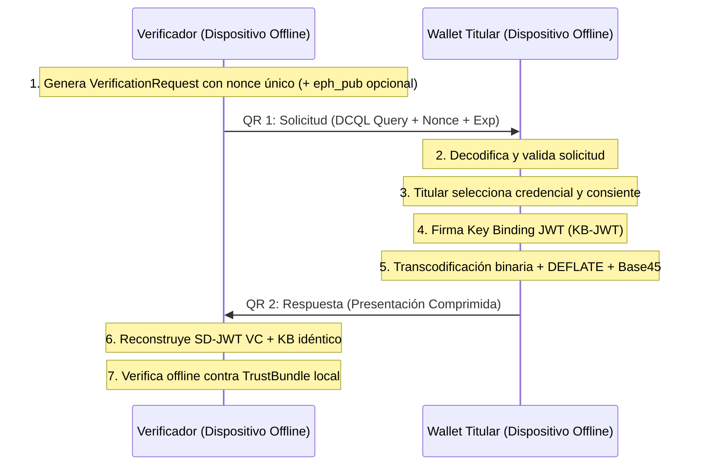
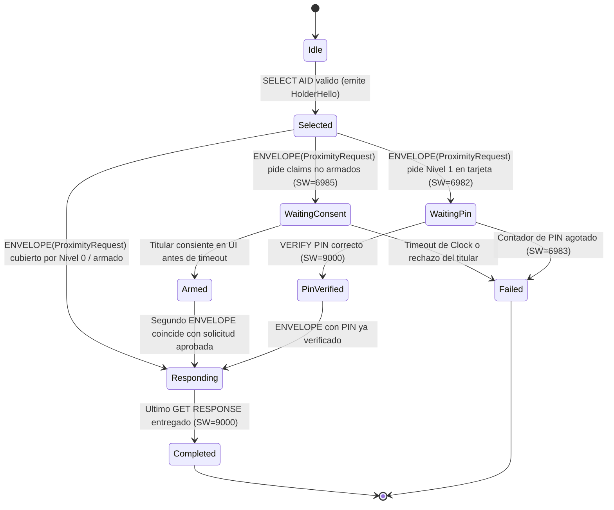

# Especificación PIP: Protocolos, Flujos y Mensajes

> **Identificador normativo:** `SPEC-PIP-PROTO-001`  
> **Versión:** `0.2.0-draft` (Fase F0 `F0.T12` / Fase F19 `F19.T09`)  
> **Estado:** Normativo / En revisión  
> **Fecha:** 2026-10-15  
> **Trazabilidad:** REQ-PRES-001..008, REQ-SYNC-001..007, REQ-VER-001..009, REQ-PROX-001..008, REQ-CARD-001..005, REQ-CODE-001..004, REQ-IDDOC-001..003; ADR-0001, ADR-0011, ADR-0019, ADR-0020, ADR-0021, ADR-0022, ADR-0023, ADR-0024, ADR-0025, ADR-0026; P-01, P-04, P-08, P-09, P-10; INV-01, INV-04, INV-05.

---

## 1. Visión General del Protocolo

El Protocolo PIP (Portable Identity Protocol / Gravital ID) define los intercambios criptográficos para:
1. **Emisión de credenciales:** Basado en OpenID for Verifiable Credential Issuance (OID4VCI 1.0) con soporte para SD-JWT VC y vinculación de clave de titular (`cnf`), así como aprovisionamiento en tarjeta física (`gid-perso`).
2. **Presentación fuera de línea (Transporte QR de 2 pasos):** Flujo óptico optimizado para pantallas y cámaras, utilizando transcodificación binaria sin pérdida, compresión DEFLATE y codificación Base45 alfanumérica.
3. **Presentación fuera de línea por proximidad (NFC `GID-APDU` y BLE):** Flujo sin contacto desde teléfono Android (HCE) o tarjeta física Java Card hacia lectores Android, iPhone (Core NFC) o terminales PC/SC, con sesión cifrada extremo a extremo mediante HPKE y vinculación al transcrito.
4. **Presentación en línea (OID4VP 1.0 y Código de Sesión `SessionCode`):** Perfil OpenID for Verifiable Presentations (OID4VP 1.0) con Digital Credential Query Language (DCQL), y resolución mediante código numérico efímero de 10 dígitos con dígito de control Damm para canales sin cámara ni NFC.
5. **Sincronización asíncrona:** Difusión de sobres cifrados vía HPKE (RFC 9180) y colas de operaciones idempotentes.

---

## 2. Flujo de Emisión de Credenciales (OID4VCI)

```text
Titular (Wallet)                                Emisor (Issuer Service)
      │                                                   │
      │ 1. Solicitud o escaneo de Oferta (Credential Offer)│
      │<──────────────────────────────────────────────────│
      │                                                   │
      │ 2. DPoP Proof + Key Binding (`cnf` con clave P-256)│
      │──────────────────────────────────────────────────>│
      │                                                   │
      │ 3. Verificación de identidad y asignación de sal  │
      │    y estado en Token Status List                  │
      │                                                   │
      │ 4. Emisión de Credencial (SD-JWT VC firmado)      │
      │<──────────────────────────────────────────────────│
      │                                                   │
      │ 5. Almacenamiento seguro local cifrado            │
      ▼                                                   ▼
```

### 2.1 Requisitos de Emisión
* **Vinculación de Titular (`cnf`):** La credencial debe incluir la clave pública del titular en el claim `cnf` (`jwk`). Cada credencial (o copia) debe utilizar un par de claves único e inconexo para prevenir correlación.
* **Divulgaciones y Sales (REQ-CRED-002):** Cada claim divulgado individualmente debe incorporar una sal criptográfica independiente de al menos 128 bits generada por un CSPRNG.
* **Hashes Señuelo (Decoys, REQ-CRED-003):** El emisor debe inyectar digests señuelo aleatorios en el array `_sd` según la política del perfil para ocultar el número total de atributos emitidos.

### 2.2 Extensión Normativa: Registro de Clave de Recuperación del Titular (`REQ-REC-004`, `REQ-REC-007`)

Para permitir la re-vinculación de credenciales tras pérdida o migración de dispositivo (`F8.T04`, `REQ-REC-004`) sin comprometer la privacidad ni permitir la correlación del titular entre distintos emisores (`REQ-REC-007`, `P-09`), el protocolo define una extensión normativa en la solicitud y estructura de confirmación (`cnf`) de la credencial:

1. **Derivación de clave por emisor:**
   A partir del secreto maestro de recuperación del titular ($S_{\text{recovery}} \in \{0, 1\}^{256}$) generado a partir del `RecoveryCode` ($\ge 128$ bits de entropía), el titular deriva deterministamente una clave privada P-256 exclusiva para cada emisor:
   $$\text{PRK} = \text{HKDF-Extract}(\text{salt} = \text{IssuerId}, \text{IKM} = S_{\text{recovery}})$$
   $$\text{PrivKey}_{\text{Issuer}} = \text{HKDF-Expand}(\text{PRK}, \text{"pip-issuer-recovery-key-v1"}, 32)$$
   A partir de $\text{PrivKey}_{\text{Issuer}}$ se obtiene la clave pública JWK EC P-256 ($\text{PubKey}_{\text{Issuer}}$).

2. **Propósito exclusivo (`KeyPurpose::HolderRecovery`):**
   La clave de recuperación se aísla en el sistema de tipos bajo `KeyPurpose::HolderRecovery` (`REQ-KEY-001`, `REQ-REC-004`). Su uso está restringido exclusivamente a la firma del desafío de re-vinculación ante el emisor específico; **NUNCA** se emplea para la firma de presentaciones de credenciales (KB-JWT) ni para operaciones de acuerdo de claves (HPKE).

3. **Huella canónica RFC 7638:**
   El titular calcula el thumbprint canónico SHA-256 de su JWK de recuperación según RFC 7638 y lo codifica como URI RFC 9278:
   $$\text{rec\_thumbprint} = \text{"urn:ietf:params:oauth:jwk-thumbprint:sha-256:"} \mathbin{\Vert} \text{base64url}(\text{SHA-256}(\text{CanonicalJWK}(\text{PubKey}_{\text{Issuer}})))$$

4. **Registro en el claim `cnf` (`cnf.rec`):**
   En el momento de la emisión, el titular aporta la huella de recuperación al emisor en la solicitud de credencial. El emisor la registra en su base de datos de titulares/dispositivos vinculada a la credencial y la incluye en el claim de nivel superior `cnf` de la credencial SD-JWT VC emitida:
   ```json
   {
     "cnf": {
       "jwk": {
         "kty": "EC",
         "crv": "P-256",
         "x": "...",
         "y": "..."
       },
       "rec": "urn:ietf:params:oauth:jwk-thumbprint:sha-256:NzbLsXh8uuoIdNdAlq7hg0avcEbBNJUZxTyiRf5-DaE"
     }
   }
   ```

5. **Invariante de no-correlación (`REQ-REC-007`, `P-09`, `INV-02`):**
   Dado que $\text{IssuerId}$ actúa como sal del extractor HKDF, para dos emisores distintos $I_1 \ne I_2$:
   $$\text{PubKey}_{\text{Issuer}}(I_1) \ne \text{PubKey}_{\text{Issuer}}(I_2) \implies \text{rec\_thumbprint}(I_1) \ne \text{rec\_thumbprint}(I_2)$$
   Dos emisores nunca reciben la misma huella de recuperación, imposibilitando la correlación cruzada de credenciales del mismo titular entre diferentes entidades.

### 2.3 Protocolo Normativo de Re-vinculación y Reemplazo Atómico por Clase de Dispositivo (`SPEC-PIP-REBIND-001`, `ADR-0029`)

Cuando un titular pierde su dispositivo, lo renueva o migra a un nuevo soporte físico (`REQ-REC-004`), ejecuta el protocolo de re-vinculación ante el emisor. Este protocolo garantiza la exclusión mutua dentro de la misma clase (`REQ-DEVSLOT-001`, `REQ-DEVSLOT-003`) y la no-correlación (`REQ-REC-007`):

```text
Nuevo Dispositivo (Titular)                       Servicio del Emisor (Issuer)
            │                                                   │
            │ 1. Solicita desafío de re-vinculación             │
            │    (GET /rebind/challenge?class=mobile)           │
            │──────────────────────────────────────────────────>│
            │                                                   │
            │ 2. Emite RebindingChallenge                       │
            │    { nonce, issuer_uri, expires_at }              │
            │<──────────────────────────────────────────────────│
            │                                                   │
            │ 3. Genera par P-256 de silicio en el nuevo equipo │
            │    y firma el desafío con HolderRecoveryKey:      │
            │    RebindingRequest {                             │
            │      issuer_uri, nonce, device_class,             │
            │      new_holder_key, recovery_thumbprint,         │
            │      signature (ES256 con HolderRecovery)         │
            │    }                                              │
            │──────────────────────────────────────────────────>│
            │                                                   │
            │ 4. Verificación y Reemplazo Atómico:              │
            │    a) Valida frescura y un solo uso del nonce     │
            │    b) Valida la firma contra la clave derivada    │
            │       de recovery_thumbprint (KeyPurpose::HolderRecovery)
            │    c) Reemplazo atómico por clase (ADR-0029):     │
            │       - Si la ranura de esa clase ya está ocupada:│
            │         marca su índice en Token Status List      │
            │         como 01 (Revoked).                        │
            │       - Las ranuras de OTRAS clases no se alteran.│
            │    d) Asigna nuevo status_index y emite credencial│
            │       con new_holder_key y recovery_thumbprint.   │
            │                                                   │
            │ 5. RebindingResult {                              │
            │      issued_credential (SD-JWT VC),               │
            │      revoked_status_index (opcional),             │
            │      device_class, new_status_index               │
            │    }                                              │
            │<──────────────────────────────────────────────────│
```

1. **Transcrito Canónico de Re-vinculación (`RebindingTranscript`):**
   Para prevenir ataques de alteración o inyección en tránsito, la firma de re-vinculación se evalúa sobre el digest SHA-256 de la cadena canónica UTF-8:
   $$\text{Transcript} = \text{"pip-rebinding-v1:"} \mathbin{\Vert} \text{issuer\_uri} \mathbin{\Vert} \text{":"} \mathbin{\Vert} \text{nonce} \mathbin{\Vert} \text{":"} \mathbin{\Vert} \text{device\_class} \mathbin{\Vert} \text{":"} \mathbin{\Vert} \text{new\_holder\_key\_thumbprint}$$
   $$\text{Digest} = \text{SHA-256}(\text{Transcript})$$
   La firma digital DEBE generarse en formato IEEE P1363 (64 bytes) utilizando la clave de recuperación del titular con propósito exclusivo `KeyPurpose::HolderRecovery`.

2. **Reglas de Aceptación y Atomicidad en el Emisor:**
   - **Fail-closed en firma o huella:** Si la firma no verifica contra la clave pública de recuperación asociada a `recovery_thumbprint`, la petición se rechaza con `InvalidSignature` (`PIP-E3003`).
   - **Anti-replay de Nonce:** Cada `nonce` es de un solo uso y caduca en $\le 300$ segundos.
   - **Revocación atómica por clase:** El emisor busca si el titular posee una ranura activa para `device_class`. Si existe, en la misma transacción atómica marca su `status_index` previo como `01 Revoked` en la `Token Status List` y activa la nueva ranura. Las credenciales de otras clases (`mobile`, `card`, `other`) no se modifican (`REQ-DEVSLOT-003`).

---

## 3. Transporte Offline: Flujo QR de Dos Pasos

En entornos desconectados (sin conectividad celular ni Wi-Fi), el verificador y el titular pueden interactuar mediante la captura visual de códigos QR ópticos.



### 3.1 Mensaje 1: Solicitud de Verificación (`VerificationRequest`)

Generado por el verificador y renderizado como el primer código QR:

```json
{
  "type": "pip-verification-request-v1",
  "verifier_id": "org.gov.security.gate-4",
  "nonce": "k8X1-LZ53nmEa2Qt_P4fG8bNlT2L6lM...",
  "audience": "https://verifier.org/gate-4",
  "issued_at": 1791633600,
  "expires_at": 1791633900,
  "query": {
    "credentials": [
      {
        "id": "cred1",
        "format": "dc+sd-jwt",
        "meta": {
          "vct_values": ["urn:gravital-id:vct:pip-identity-derived-v1"]
        },
        "claims": ["given_name", "family_name", "birth_date"]
      }
    ]
  }
}
```

#### Reglas de Validación de la Solicitud
1. **Frescura:** `expires_at > current_time` (con ventana de tolerancia máxima de 300 segundos).
2. **Entropía:** El `nonce` debe ser único y contener $\ge 128$ bits de entropía generados por CSPRNG.
3. **Solicitudes Firmadas (Opcional por Perfil):** Si el perfil lo exige (`REQ-PRES-007`), el objeto anterior debe encapsularse en un JWS/CBOR firmado por una clave registrada en `verifiers` del `TrustBundle`.
4. **Cifrado Opcional en QR (ADR-0023):** Si la solicitud incluye una clave pública efímera P-256 (`eph_pub`), la respuesta se sella con HPKE igual que en el flujo de proximidad (§7.3) antes de codificarse en Base45.

---

### 3.2 Mensaje 2: Presentación Comprimida (Transcodificación Binaria Sin Pérdida)

Un SD-JWT en formato compacto de texto estándar consiste en:
$$\text{Issuer-Signed-JWT} \sim \text{Disclosure}_1 \sim \text{Disclosure}_2 \sim \dots \sim \text{KB-JWT}$$
Debido a que Base64URL es altamente ineficiente para compresión y renderizado QR, el protocolo aplica una **transcodificación binaria biyectiva sin pérdida**:

#### Algoritmo de Empaquetado
1. **Decodificación Binaria:** Cada componente del SD-JWT separado por tilde (`~`):
   - El Issuer-Signed-JWT se divide por puntos (`.`): Header, Payload, Signature se decodifican desde Base64URL a bytes crudos.
   - Cada Disclosure se decodifica desde Base64URL a su string JSON UTF-8 canónico.
   - El KB-JWT se divide por puntos (`.`): Header, Payload, Signature se decodifican desde Base64URL a bytes crudos.
2. **Estructura CBOR:** Se empaquetan los componentes binarios en una tupla CBOR determinista (RFC 8949 §4.2):
   ```text
   TranscodedPresentation = [
     version: 1,
     issuer_header: bstr,
     issuer_payload: bstr,
     issuer_sig: bstr(64),
     disclosures: [* bstr],
     kb_header: bstr,
     kb_payload: bstr,
     kb_sig: bstr(64)
   ]
   ```
3. **Compresión DEFLATE:** Se aplica compresión zlib/DEFLATE (RFC 1951) sobre el payload CBOR determinista (con los límites de seguridad de `CRYPTO_PROFILES.md §5.1`: ratio máximo $10:1$ y salida $\le 2\text{ MiB}$).
4. **Codificación Base45 (en transporte QR):** El flujo resultante se codifica en Base45 (RFC 9285) y se le antepone el prefijo canónico `GID1:` (aceptando `PIP1:` como alias legado en decodificación conforme a `ADR-0001`).

#### Reconstrucción en el Verificador
El verificador ejecuta el proceso inverso:
1. Decodifica Base45 (en QR) o abre el sobre HPKE (en proximidad) y descomprime DEFLATE con validación acotada.
2. Desempaqueta CBOR y recodifica exactamente cada componente a Base64URL sin padding.
3. Ensambla la cadena canónica `Header.Payload.Signature~D1~D2~...~KB_Header.KB_Payload.KB_Signature`.
4. **Garantía Criptográfica:** Dado que la decodificación Base64URL canónica es estrictamente biyectiva, los bytes firmados resultantes son **100 % idénticos a los bytes que firmaron el emisor y el titular**. La verificación de firma tiene éxito sin alterar las firmas originales.

---

### 3.3 Fragmentación Multi-QR (Para Presentaciones Extensas, ADR-0011)

Conforme a **ADR-0011** y a las mediciones empíricas de `spikes/qr/REPORT.md`:
1. **Umbral de activación (QR único):** El presupuesto máximo de un código QR individual es de **1.200 caracteres Base45** con nivel de corrección de errores M (15 %). Toda presentación cuya cadena Base45 sea $\le 1\,200$ caracteres se muestra en un único código QR con prefijo `GID1:`.
2. **Activación y tamaño de fragmento Multi-QR:** Si el texto Base45 supera los **1.200 caracteres**, se divide en $N$ ($2 \le N \le 8$) fragmentos equilibrados de como máximo **900 caracteres Base45** de carga útil cada uno, precedidos por la cabecera canónica:

$$\text{Cabecera canónica: } \texttt{GID01/P<índice>/<total>/<hash8>/<fragmento>}$$

*(El decodificador acepta `PIP1/M/<índice>/<total>/<hash8>/<fragmento>` como alias legado de compatibilidad).*

* `<índice>`: Entero decimal de `1` a `N` (basado en 1).
* `<total>`: Número total de fragmentos `N` ($2 \le N \le 8$).
* `<hash8>`: Primeros 8 caracteres en Base64URL sin padding (48 bits) del resumen `SHA-256` del payload Base45 completo sin fragmentar, garantizando que todos los fragmentos pertenecen a la misma sesión y presentación.
* `<fragmento>`: Subcadena Base45 de hasta 900 caracteres.
* El receptor acumula los fragmentos en cualquier orden; si recibe un fragmento con `<total> > 8`, `<índice> == 0`, `<índice> > <total>` o `<hash8>` discrepante, lo rechaza; al reunir los $N$ fragmentos verifica que `Base64UrlNoPad(SHA-256(concat))[0..8] == <hash8>` antes de decodificar Base45. Si expira el temporizador de captura sin completar los $N$ fragmentos, devuelve `GID-E1008` (`MultiQrIncomplete`).

---

## 4. Presentación en Línea (OpenID4VP 1.0)

Para verificaciones en navegadores web o apps nativas conectadas:
1. Se utiliza el estándar **OpenID4VP 1.0 (Final)**.
2. La solicitud se transmite mediante parámetro `request_uri` o invocación de URL scheme personalizado (`openid4vp://`).
3. Las consultas de selección de atributos se definen en formato **DCQL (Digital Credentials Query Language)**.
4. La respuesta se envía al endpoint `response_uri` del verificador vía HTTPS POST mutuo con protección DPoP.

---

## 5. Sincronización y Sobres de Operación (SYNC)

Para propagar actualizaciones de estado, revocaciones, re-vinculaciones o migraciones de wallet a través de relays no confiables:

### 5.1 Sobre de Operación Cifrado con HPKE (RFC 9180)
Todo mensaje transportado por un relay no confiable se cifra extremo a extremo:
* **KEM:** DHKEM(P-256, HKDF-SHA256) (`0x0010`).
* **KDF:** HKDF-SHA256 (`0x0001`).
* **AEAD:** ChaCha20Poly1305 (`0x0003`) o AES-256-GCM (`0x0002`).
* **Autenticación:** El emisor firma el payload antes de cifrar; el sobre solo revela al relay el ID del buzón receptor (un identificador ciego derivado).

### 5.2 Idempotencia y Tolerancia a Fallos
* Cada operación contiene un `idempotency_key` (UUID v4 o hash único).
* El procesamiento en el receptor es estrictamente idempotente: mensajes duplicados se descartan sin efectos colaterales.
* Los reintentos de cliente ante fallos transitorios aplican backoff exponencial con jitter:
  $$t_{\text{reintento}} = \min(t_{\text{máx}}, t_{\text{base}} \times 2^{\text{intento}}) \pm \text{aleatorio}(0, \Delta t)$$

---

## 6. Catálogo de Errores de Protocolo y Proximidad

Los errores de protocolo utilizan las familias **Familia 1 (`GID-E1001..E1010` / `PIP-E1001..E1010`)** y **Familia 8 (`GID-E8001..E8010` / `PIP-E8001..E8010`)** definidas normativamente en [`docs/specs/ERROR_CODES.md`](ERROR_CODES.md):

| Código Canónico | Alias Legado | Identificador | Causa |
|---|---|---|---|
| `GID-E1001` | `PIP-E1001` | `MalformedMessage` | Estructura JSON o CBOR de solicitud/respuesta corrupta o inválida. |
| `GID-E1002` | `PIP-E1002` | `ExpiredRequest` | Marca de tiempo `expires_at` anterior al reloj confiable. |
| `GID-E1003` | `PIP-E1003` | `NonceReused` | El `nonce` presentado ya fue utilizado o no existe en la caché. |
| `GID-E1004` | `PIP-E1004` | `UnsupportedProtocolVersion` | Versión de protocolo no soportada por el motor. |
| `GID-E1005` | `PIP-E1005` | `DisclosuresMismatch` | Divulgaciones entregadas no corresponden a los claims solicitados. |
| `GID-E1006` | `PIP-E1006` | `KeyBindingFailed` | El KB-JWT no coincide con el `cnf` de la credencial o el `sd_hash` es erróneo. |
| `GID-E1007` | `PIP-E1007` | `DecompressionRatioExceeded` | El ratio de descompresión DEFLATE excedió los límites de seguridad (mitigación DoS). |
| `GID-E1008` | `PIP-E1008` | `MultiQrIncomplete` | Secuencia multi-QR incompleta tras expirar la ventana de captura. |
| `GID-E1009` | `PIP-E1009` | `Base45DecodeFailed` | Error al decodificar la carga alfanumérica Base45 del código QR. |
| `GID-E1010` | `PIP-E1010` | `HpkeDecryptionFailed` | Fallo al desencapsular o descifrar el sobre de operación HPKE. |
| `GID-E8001` | `PIP-E8001` | `UnsupportedAid` | Identificador de aplicación (AID) ISO/IEC 7816-4 desconocido o no soportado (`SW=6A82`). |
| `GID-E8002` | `PIP-E8002` | `ProximityMessageTooLarge` | Mensaje APDU, fragmento o atributo (p. ej. retrato en QR) excede los límites del transporte (`SW=6700`). |
| `GID-E8003` | `PIP-E8003` | `ProximitySessionExpired` | La sesión de proximidad, el armado de toque NFC o el `SessionCode` ha expirado. |
| `GID-E8004` | `PIP-E8004` | `ConsentPending` | El titular debe confirmar interactivamente la divulgación antes del segundo toque (`SW=6985`). |
| `GID-E8005` | `PIP-E8005` | `CardPinRequired` | La tarjeta física exige verificación de PIN (`VERIFY`) para claims de Nivel 1 (`SW=6982`). |
| `GID-E8006` | `PIP-E8006` | `CardPinBlocked` | El contador de intentos de PIN de la tarjeta física se agotó (`SW=6983`). |
| `GID-E8007` | `PIP-E8007` | `ProximityDecryptionFailed` | Fallo al abrir el sobre HPKE de proximidad o discrepancia en el `transcript_hash` (fail-closed, INV-05). |
| `GID-E8008` | `PIP-E8008` | `InvalidApduCommand` | Comando o respuesta APDU malformado, `INS` no soportada o fuera de secuencia (`SW=6D00`/`6986`). |
| `GID-E8009` | `PIP-E8009` | `CardNotPersonalized` | La tarjeta no se encuentra en el estado de ciclo de vida requerido (`PERSONALIZACION` vs `ACTIVA`). |
| `GID-E8010` | `PIP-E8010` | `InvalidSessionCode` | Código numérico de sesión malformado, dígito Damm inválido, ya consumido o límite de intentos excedido. |

---

## 7. Transporte de Proximidad (NFC / Tarjeta Física / BLE) y Código de Sesión

Esta sección especifica de forma normativa los protocolos de sesión cifrada, transporte NFC (`GID-APDU`), fragmentación y código numérico de sesión definidos arquitectónicamente en **ADR-0022**, **ADR-0023**, **ADR-0024** y **ADR-0025** (`REQ-PROX-001..008`, `REQ-CARD-001..005`, `REQ-CODE-001..004`).

### 7.1 Principios e Invariantes del Canal de Proximidad
1. **Verificación 100 % sin red e identidad de resultados (`INV-01`, `INV-04`, `REQ-PROX-005`):** La capa de proximidad (`gravital-id-proximity`, L4 sans-I/O) descifra el sobre de sesión, descomprime la presentación transcodificada (§3.2) y entrega la cadena SD-JWT+KB compacta a `VerifierPipeline::verify`. La misma presentación recibida por QR o por proximidad **DEBE** producir el mismo `VerificationResult` de cuatro estados.
2. **Independencia del medio (`REQ-PROX-003`):** Los mensajes `ProximityRequest` y `ProximityResponse` son idénticos en NFC (`GID-APDU`), BLE, QR cifrado y `SessionCode`.
3. **Cero PII en logs y errores (`INV-02`, `REQ-PROX-007`):** Ningún log de comando APDU, paquete BLE o evento de sesión puede registrar cargas útiles, claims, nonces completos ni identificadores de titulares.

---

### 7.2 Esquema Binario CBOR de Mensajes de Proximidad (`REQ-PROX-003`, `REQ-PROX-004`)

Todos los mensajes de proximidad se codifican en **CBOR determinista (RFC 8949 §4.2)** utilizando claves enteras compactas y se parsean con límites estrictos de tamaño y profundidad en `gravital-id-codec::cbor` (máximo `64 KiB` por mensaje reensamblado, profundidad máxima `8`).

#### 7.2.1 `HolderHello` (Respuesta al `SELECT AID` en NFC o anuncio en BLE)
No contiene ningún identificador único ni dato personal del titular (`INV-02`):
```text
HolderHello = {
  1: uint,          ; version: 1
  2: uint,          ; form_factor: 1 = MobileWallet, 2 = PhysicalCardJavaCard
  3: uint,          ; max_apdu_len: tamaño máximo de APDU soportado (255..65535 bytes)
  4: uint,          ; capabilities_bitmap: bit 0 = ExtendedLengthApdu,
                    ;                      bit 1 = PinVerificationSupported,
                    ;                      bit 2 = BleHandoverSupported
  5: [+ uint]       ; supported_hpke_aead_ids: [0x0003] (ChaCha20Poly1305) en móvil;
                    ;                          [0x0001] o [0x0002] (AES-GCM) en tarjeta según ADR-0024
}
```

#### 7.2.2 `ProximityRequest` (Solicitud del Verificador al Titular)
```text
ProximityRequest = {
  1: uint,          ; version: 1
  2: tstr,          ; verifier_id: identificador registrado del verificador (<= 128 chars)
  3: tstr,          ; aud: URI de audiencia para el KB-JWT (<= 256 chars)
  4: bstr,          ; nonce: entropía fresca del verificador (16..64 bytes, >= 128 bits)
  5: uint,          ; verifier_time: marca de tiempo Unix actual del verificador (segundos)
  6: uint,          ; expires_at: marca de tiempo Unix de expiración de la solicitud
  7: bstr,          ; eph_pub: clave pública efímera P-256 SEC1 sin comprimir (exactamente 65 bytes: 0x04 || X || Y)
  8: DcqlSubset,    ; query: consulta de credenciales y claims solicitados
  ? 9: tstr,        ; verifier_kid: Kid de la clave de firma del verificador en el TrustBundle
  ? 10: bstr        ; verifier_sig: firma ES256 IEEE P1363 (64 bytes) sobre cbor_det(ProximityRequest sin claves 9 y 10)
}

DcqlSubset = {
  1: [+ CredentialQuery] ; credentials (1..4 consultas por solicitud)
}

CredentialQuery = {
  1: tstr,          ; id de la consulta (<= 32 chars)
  2: [+ tstr],      ; vct_values admitidos (1..4 URIs Vct)
  3: [* tstr]       ; claims solicitados (0..32 nombres de claim)
}
```

#### 7.2.3 `SessionTranscript` (Transcrito Canónico de Sesión, `ADR-0023`)
Ambas partes construyen en memoria la tupla CBOR determinista:
```text
SessionTranscript = [
  version: 1,                ; uint = 1
  transport_type: uint,      ; 1 = NFC (GID-APDU), 2 = BLE, 3 = QR, 4 = SessionCode
  holder_engagement: bstr,   ; bytes exactos de HolderHello (en NFC/BLE) o bstr vacío h'' (en QR/SessionCode)
  request_bytes: bstr        ; bytes CBOR deterministas exactos de ProximityRequest
]

transcript_hash = SHA-256(cbor_det(SessionTranscript)) ; exactamente 32 bytes
```

#### 7.2.4 `ProximityResponse` (Respuesta Cifrada del Titular al Verificador)
```text
ProximityResponse = {
  1: uint,          ; version: 1
  2: uint,          ; hpke_aead_id: 0x0003 (ChaCha20Poly1305) | 0x0001 (AES-128-GCM) | 0x0002 (AES-256-GCM)
  3: bstr,          ; enc: clave pública efímera encapsulada DHKEM(P-256) en SEC1 (exactamente 65 bytes)
  4: bstr           ; ct: texto cifrado HPKE + etiqueta de autenticación AEAD (16 bytes)
}
```
El texto en claro (`plaintext`) dentro de `ct` es exactamente el flujo comprimido `DEFLATE(cbor_det(TranscodedPresentation))` definido en **§3.2** (sin la capa de codificación Base45, que solo se usa para códigos QR ópticos).

---

### 7.3 Reglas Criptográficas de la Sesión de Proximidad (`REQ-PROX-001`, `REQ-PROX-002`)

1. **Separación de propósito de clave:** La clave efímera del verificador (`eph_pub`) se genera por sesión con propósito exclusivo de acuerdo de claves (`KeyPurpose::KeyAgreement`) y se destruye al finalizar la sesión o expirar `expires_at`.
2. **Vinculación del KB-JWT al transcrito:**
   - El titular construye el KB-JWT fijando:
     - `aud` = `ProximityRequest.aud`,
     - `nonce` = `Base64UrlNoPad(transcript_hash)` (43 caracteres ASCII),
     - `iat` = marca del reloj del titular (o `ProximityRequest.verifier_time` en tarjetas físicas sin reloj propio, `ADR-0024`),
     - `sd_hash` = `Base64UrlNoPad(SHA-256( ASCII("<issuer-jwt>~<D1>~...~<Dn>~") ))`.
3. **Sellado y apertura HPKE (RFC 9180 Modo Base):**
   - Parámetros: `KEM = 0x0010` (`DHKEM(P-256, HKDF-SHA256)`), `KDF = 0x0001` (`HKDF-SHA256`), `AEAD = 0x0003` (`ChaCha20Poly1305`, o `0x0001`/`0x0002` en tarjeta física según `ADR-0024`), `info = b"gravital-proximity-v1"`, `aad = transcript_hash`.
   - Si `open_base` falla por clave inválida, etiqueta AEAD incorrecta o `transcript_hash` de otra sesión, el verificador aborta inmediatamente con `GID-E8007` (`ProximityDecryptionFailed`) y nunca invoca una ruta permisiva (`INV-05`).
   - Tras abrir el sobre HPKE y reconstruir la cadena SD-JWT+KB, el verificador invoca `VerifierPipeline::verify` pasando como `expected_nonce` el valor `Base64UrlNoPad(transcript_hash)` y como `expected_audience` el valor `ProximityRequest.aud`. Cualquier respuesta reenviada a otra sesión o a otro verificador produce `VerificationResult::Invalid` en la comprobación `KeyBinding` (`GID-E1006`).

---

### 7.4 Protocolo NFC ISO/IEC 7816-4 (`GID-APDU`, `ADR-0022`, `ADR-0024`)

El titular (servicio HCE en Android o applet en tarjeta Java Card) opera como tarjeta sin contacto ISO/IEC 14443-4; el verificador opera como lector PCD.

#### 7.4.1 Identificador de Aplicación (AID)
- **AID de desarrollo y pilotos (`ADR-0022`):** `F0 47 52 41 56 49 54 41 4C 01` (10 bytes, hexadecimal `F0475241564954414C01`).

#### 7.4.2 Tabla de Comandos APDU

| Comando | `CLA` | `INS` | `P1` | `P2` | Datos (`Lc` / `Data`) | `Le` | Respuesta exitosa (`Data` + `SW1 SW2`) |
|---|---|---|---|---|---|---|---|
| `SELECT` | `00` | `A4` | `04` | `00` | `0A F0 47 52 41 56 49 54 41 4C 01` | `00` | `HolderHello` (CBOR) + `90 00` |
| `VERIFY PIN` (solo tarjeta Nivel 1) | `00` | `20` | `00` | `80` | PIN codificado / sobre ligado a sesión | — | `90 00` (o `63 Cx` con $x$ intentos restantes) |
| `ENVELOPE` (fragmento intermedio) | `10` | `C3` | `00` | `00` | Fragmento de `ProximityRequest` | — | `90 00` |
| `ENVELOPE` (último o único fragmento) | `00` | `C3` | `00` | `00` | Último fragmento de `ProximityRequest` | `00` | Primer bloque de `ProximityResponse` + `90 00` (si completo) o `61 xx` (quedan datos; `61 00` indica $\ge 256\text{ B}$) |
| `GET RESPONSE` | `00` | `C0` | `00` | `00` | — | `xx` / `00` | Siguiente bloque de `ProximityResponse` + `61 xx` o `90 00` (fin) |

*(En estado `PERSONALIZACION` de tarjeta física Java Card, `gid-perso` utiliza instrucciones administrativas autenticadas de clase propietaria `CLA=80`: `INS=E0` `GENERATE KEY`, `INS=E2` `STORE CREDENTIAL`, `INS=E4` `SET PIN`, `INS=E6` `FINALIZE PERSONALIZATION` y `INS=E8` `RESET RETRY COUNTER`, rechazadas con `SW=6986` / `GID-E8009` una vez que la tarjeta está en estado `ACTIVA`).*

#### 7.4.3 Mapeo Normativo de Palabras de Estado (`SW1 SW2` $\to$ `ErrorCode`)

| `SW1 SW2` | Significado ISO/IEC 7816-4 | Código Gravital ID (`ErrorCode`) |
|---|---|---|
| `90 00` | Ejecución normal completada | — (Éxito) |
| `61 xx` | Ejecución normal; quedan `xx` bytes disponibles vía `GET RESPONSE` | — (Continuar lectura) |
| `63 Cx` | Verificación de PIN fallida; quedan $x$ intentos antes del bloqueo | `GID-E8005` (`CardPinRequired`) |
| `67 00` | Longitud incorrecta o mensaje excede el límite negociado | `GID-E8002` (`ProximityMessageTooLarge`) |
| `69 82` | Estado de seguridad no satisfecho (se requiere `VERIFY PIN` para Nivel 1) | `GID-E8005` (`CardPinRequired`) |
| `69 83` | Método de autenticación bloqueado (contador de PIN agotado) | `GID-E8006` (`CardPinBlocked`) |
| `69 85` | Condiciones de uso no satisfechas (consentimiento pendiente en segundo toque) | `GID-E8004` (`ConsentPending`) |
| `69 86` | Comando no permitido en el estado actual del ciclo de vida | `GID-E8009` (`CardNotPersonalized`) |
| `6A 80` | Parámetros incorrectos en el campo de datos (CBOR malformado) | `GID-E1001` (`MalformedMessage`) |
| `6A 82` | Archivo o aplicación (AID) no encontrada | `GID-E8001` (`UnsupportedAid`) |
| `6D 00` / `6E 00` | Instrucción (`INS`) o clase (`CLA`) no soportada | `GID-E8008` (`InvalidApduCommand`) |

#### 7.4.4 Modelo de Consentimiento de Dos Toques en Teléfono vs Niveles en Tarjeta (`REQ-PROX-006`, `REQ-CARD-003`)
1. **En Teléfono Android (HCE):**
   - El servicio `HostApduService` **nunca** responde con credenciales en segundo plano con la pantalla bloqueada o sin acción previa del titular.
   - **Toque armado (1 solo toque):** El titular abre la wallet y "arma" una credencial o conjunto básico de atributos (p. ej. mayoría de edad o identidad básica) durante una ventana corta ($\le 60\text{ s}$ medidos con `Clock`). Si la `ProximityRequest` recibida al tocar solicita únicamente un subconjunto de los claims armados, la máquina de estados firma y devuelve `ProximityResponse` en ese mismo toque (`90 00` / `61 xx`).
   - **Escalada a segundo toque (`ConsentPending`):** Si la `ProximityRequest` solicita atributos adicionales no incluidos en el armado inicial, el titular responde `SW=6985` (`GID-E8004` `ConsentPending`), muestra en la pantalla del teléfono quién es el verificador y qué claims adicionales solicita, y si el usuario consiente (con biometría si el perfil lo exige), deja lista la respuesta para el segundo toque dentro de los siguientes $30\text{ s}$.
2. **En Tarjeta Física Java Card:**
   - **Nivel 0 (sin PIN):** Si `ProximityRequest` solicita únicamente claims preautorizados de Nivel 0 (`age_over_18`, `age_over_21`), la tarjeta firma y responde en un único toque.
   - **Nivel 1 (con PIN):** Si `ProximityRequest` solicita cualquier claim de Nivel 1 (`document_number`, `birth_date`, `portrait`), la tarjeta devuelve `SW=6982` (`GID-E8005` `CardPinRequired`). El lector solicita el PIN al titular, ejecuta `VERIFY PIN` y reenvía `ENVELOPE` en la misma sesión.

---

### 7.5 Fragmentación de Transporte por MTU (`REQ-PROX-003`)

Cuando `ProximityRequest` o `ProximityResponse` viaja sobre APDU de longitud estándar ($\le 240\text{ B}$ por trama) o sobre características GATT de BLE, cada fragmento binario lleva un encabezado de 6 bytes:
```text
FragmentHeader = [
  flags: u8,         ; bit 0 = FirstFragment, bit 1 = LastFragment
  seq_idx: u16 (BE), ; índice de fragmento 0..N-1 (máximo 256 fragmentos)
  total: u16 (BE),   ; total de fragmentos N (1..256)
  reserved: u8       ; 0x00
]
```
El último fragmento añade al final los primeros 8 bytes del `SHA-256` del mensaje completo sin fragmentar. Si la suma de fragmentos supera `64 KiB`, falta algún índice o el resumen de 8 bytes no coincide, el reensamblador descarta el búfer y devuelve `GID-E8002` o `GID-E1001`.

---

### 7.6 Máquinas de Estado Sans-I/O (`gravital-id-proximity`)

Las máquinas de estado del titular y del verificador son estructuras puras en Rust sin I/O ni reloj implícito (`INV-01`, `INV-11`):



---

### 7.7 Flujo por Código Numérico de Sesión (`SessionCode`, `ADR-0025`, `REQ-CODE-001..004`)

Para canales en línea sin cámara ni lector NFC (p. ej. atención telefónica o escritorio remoto):
1. **Formato del `SessionCode`:** Cadena de exactamente **10 dígitos decimales** (`D₁ D₂ D₃ D₄ D₅ D₆ D₇ D₈ D₉ C`), donde `D₁..D₉` son generados con `Rng` criptográfico y `C` es el dígito de control calculado con la matriz cuasigrupo antisimétrica de **Damm (2004)**. Cualquier código cuya validación de Damm falle se rechaza localmente con `GID-E8010` (`InvalidSessionCode`) sin realizar tráfico de red.
2. **Registro en el Relay (Rendezvous):**
   - El verificador crea una `ProximityRequest` **obligatoriamente firmada** (`verifier_sig` presente y verificable contra el `TrustBundle`, `REQ-PRES-007`) con `expires_at <= verifier_time + 180` segundos.
   - El relay almacena la solicitud indexada por el hash `SHA-256("gid-session-code-v1" || SessionCode)` durante como máximo 180 segundos.
3. **Resolución y Consumo de Un Solo Uso:**
   - La wallet del titular valida el dígito Damm, descarga la `ProximityRequest` del relay, verifica la firma del verificador contra su `TrustBundle` local y muestra la identidad del verificador y los claims solicitados (`REQ-PRES-003`).
   - Tras el consentimiento del titular, la wallet calcula `transcript_hash` con `transport_type = 4` y `holder_engagement = h''`, firma el KB-JWT, sella `ProximityResponse` con HPKE hacia `ProximityRequest.eph_pub` y la envía al relay.
   - El relay acepta únicamente la **primera** `ProximityResponse` para ese `SessionCode`, marca la sesión como consumida de forma atómica y rechaza cualquier intento posterior con `GID-E8010` (`REQ-CODE-001`).
   - El verificador recibe `ProximityResponse`, abre el sobre HPKE y ejecuta `VerifierPipeline::verify`.

---

### 7.8 Flujo de Presentación y Transmisión vía Passkey (`FIDO2 / WebAuthn CTAP2`, `ADR-0027`, `REQ-TENANT-001`)

Para transmitir credenciales verificables hacia aplicaciones web, móviles o pasarelas multi-inquilino (`Tenant Gateway`) aprovechando la infraestructura nativa de **Passkeys** del sistema operativo (`Android CredentialManager`, `iOS/macOS ASAuthorizationPlatformPublicKeyCredentialProvider`) o llaves FIDO2 por NFC/BLE/USB (`CTAP2`):

1. **Desafío Ligado al Transcrito y a las Divulgaciones (`challenge`):**
   - El verificador o `Tenant Gateway` emite una `PublicKeyCredentialRequestOptions` cuyo `rpId` coincide con el dominio autenticado del verificador en el `TrustBundle` (`ProximityRequest.aud`).
   - Cuando se combina con divulgación selectiva SD-JWT VC, el desafío firmado por el autenticador FIDO2 vincula criptográficamente el transcrito de la sesión y el resumen de las divulgaciones autorizadas por el titular:
     $$\text{webauthn\_challenge} = \text{Base64UrlNoPad}\bigl(\text{SHA-256}(\text{transcript\_hash} \parallel \text{sd\_hash})\bigr)$$
2. **Aserción `ES256` (`COSE Alg -7`) y Verificación de Usuario (`UV`):**
   - El autenticador genera `authenticatorData` (37+ bytes: `SHA-256(rpId)` de 32 bytes, byte de banderas con `UP = 1` y `UV = 1` para Nivel 1, y contador `signCount` de 4 bytes big-endian) y `clientDataJSON`, firmándolos en hardware con `ES256` (P-256 Low-S).
3. **Sobre de Transmisión Passkey + SD-JWT+KB (`PasskeyPresentationEnvelope`):**
   - La wallet transmite en una única operación atómica la tupla `{ credential_id, authenticator_data, client_data_json, assertion_signature, hpke_or_sd_jwt_presentation }`.
   - El verificador comprueba sin conexión: (a) la firma `ES256` de la aserción WebAuthn, (b) la presencia de los bits `UP` y `UV` en `authenticatorData.flags`, (c) la coincidencia exacta del `challenge` con `SHA-256(transcript_hash || sd_hash)`, y (d) el pipeline `VerifierPipeline::verify` sobre la presentación SD-JWT+KB.

