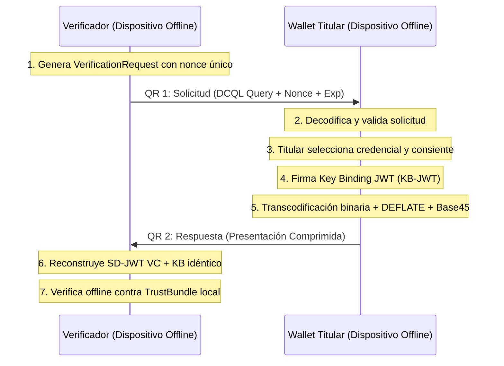

# Especificación PIP: Protocolos, Flujos y Mensajes

> **Identificador normativo:** `SPEC-PIP-PROTO-001`  
> **Versión:** `0.1.0-draft` (Fase F0 / Tarea `F0.T12`)  
> **Estado:** Normativo / En revisión  
> **Fecha:** 2026-10-10  
> **Trazabilidad:** REQ-PRES-001..008, REQ-SYNC-001..007, REQ-VER-001..009; ADR-0011, ADR-0019, ADR-0020; P-01, P-04, P-08, P-09, P-10; INV-01, INV-04, INV-05.

---

## 1. Visión General del Protocolo

El Protocolo PIP (Portable Identity Protocol / Gravital ID) define los intercambios criptográficos para:
1. **Emisión de credenciales:** Basado en OpenID for Verifiable Credential Issuance (OID4VCI 1.0) con soporte para SD-JWT VC y vinculación de clave de titular (`cnf`).
2. **Presentación fuera de línea (Transporte QR de 2 pasos):** Flujo de proximidad optimizado para pantallas y cámaras, utilizando transcodificación binaria sin pérdida, compresión DEFLATE y codificación Base45 alfanumérica.
3. **Presentación en línea:** Perfil OpenID for Verifiable Presentations (OID4VP 1.0) con Digital Credential Query Language (DCQL).
4. **Sincronización asíncrona:** Difusión de sobres cifrados vía HPKE (RFC 9180) y colas de operaciones idempotentes.

---

## 2. Flujo de Emisión de Credenciales (OID4VCI)

```text
Titular (Wallet)                                Emisor (Issuer Service)
      │                                                   │
      │ 1. Solicitud o escaneo de Oferta (Credential Offer)│
      │<──────────────────────────────────────────────────│
      │                                                   │
      │ 2. DPoP Proof + Key Binding (`cnf` con clave P-256)│
      │──────────────────────────────────────────────────>│
      │                                                   │
      │ 3. Verificación de identidad y asignación de sal  │
      │    y estado en Token Status List                  │
      │                                                   │
      │ 4. Emisión de Credencial (SD-JWT VC firmado)      │
      │<──────────────────────────────────────────────────│
      │                                                   │
      │ 5. Almacenamiento seguro local cifrado            │
      ▼                                                   ▼
```

### 2.1 Requisitos de Emisión
* **Vinculación de Titular (`cnf`):** La credencial debe incluir la clave pública del titular en el claim `cnf` (`jwk`). Cada credencial (o copia) debe utilizar un par de claves único e inconexo para prevenir correlación.
* **Divulgaciones y Sales (REQ-CRED-002):** Cada claim divulgado individualmente debe incorporar una sal criptográfica independiente de al menos 128 bits generada por un CSPRNG.
* **Hashes Señuelo (Decoys, REQ-CRED-003):** El emisor debe inyectar digests señuelo aleatorios en el array `_sd` según la política del perfil para ocultar el número total de atributos emitidos.

---

## 3. Transporte Offline: Flujo QR de Dos Pasos

En entornos desconectados (sin conectividad celular ni Wi-Fi), el verificador y el titular interactúan exclusivamente mediante la captura visual de códigos QR ópticos.



### 3.1 Mensaje 1: Solicitud de Verificación (`VerificationRequest`)

Generado por el verificador y renderizado como el primer código QR:

```json
{
  "type": "pip-verification-request-v1",
  "verifier_id": "org.gov.security.gate-4",
  "nonce": "k8X1-LZ53nmEa2Qt_P4fG8bNlT2L6lM...",
  "audience": "https://verifier.org/gate-4",
  "issued_at": 1791633600,
  "expires_at": 1791633900,
  "query": {
    "credentials": [
      {
        "id": "cred1",
        "format": "dc+sd-jwt",
        "meta": {
          "vct_values": ["https://credentials.gob.pa/vct/cedula-digital-v1"]
        },
        "claims": ["given_name", "family_name", "birth_date"]
      }
    ]
  }
}
```

#### Reglas de Validación de la Solicitud
1. **Frescura:** `expires_at > current_time` (con ventana de tolerancia máxima de 300 segundos).
2. **Entropía:** El `nonce` debe ser único y contener $\ge 128$ bits de entropía generados por CSPRNG.
3. **Solicitudes Firmadas (Opcional por Perfil):** Si el perfil lo exige, el objeto anterior debe encapsularse en un JWS firmado por una clave registrada en `verifiers` del `TrustBundle`.

---

### 3.2 Mensaje 2: Presentación Comprimida (Transcodificación Binaria Sin Pérdida)

Un SD-JWT en formato compacto de texto estándar consiste en:
$$\text{Issuer-Signed-JWT} \sim \text{Disclosure}_1 \sim \text{Disclosure}_2 \sim \dots \sim \text{KB-JWT}$$
Debido a que Base64URL es altamente ineficiente para compresión y renderizado QR, el protocolo aplica una **transcodificación binaria biyectiva sin pérdida**:

#### Algoritmo de Empaquetado
1. **Decodificación Binaria:** Cada componente del SD-JWT separado por tilde (`~`):
   - El Issuer-Signed-JWT se divide por puntos (`.`): Header, Payload, Signature se decodifican desde Base64URL a bytes crudos.
   - Cada Disclosure se decodifica desde Base64URL a su string JSON UTF-8 canónico.
   - El KB-JWT se divide por puntos (`.`): Header, Payload, Signature se decodifican desde Base64URL a bytes crudos.
2. **Estructura CBOR:** Se empaquetan los componentes binarios en una tupla o array CBOR compacto.
3. **Compresión DEFLATE:** Se aplica compresión zlib/DEFLATE (RFC 1951) sobre el payload CBOR.
4. **Codificación Base45:** El flujo resultante se codifica en Base45 (RFC 9285) y se le antepone el prefijo `PIP1:`.

#### Reconstrucción en el Verificador
El verificador ejecuta el proceso inverso:
1. Decodifica Base45 y descomprime DEFLATE.
2. Desempaqueta CBOR y recodifica exactamente cada componente a Base64URL sin padding.
3. Ensambla la cadena canónica `Header.Payload.Signature~D1~D2~...~KB_Header.KB_Payload.KB_Signature`.
4. **Garantía Criptográfica:** Dado que la decodificación Base64URL canónica es estrictamente biyectiva, los bytes firmados resultantes son **100 % idénticos a los bytes que firmaron el emisor y el titular**. La verificación de firma tiene éxito sin alterar las firmas originales.

---

### 3.3 Fragmentación Multi-QR (Para Presentaciones Extensas)

Si el tamaño del texto Base45 resultante supera el presupuesto operativo del código QR ($\approx 800$ caracteres alfanuméricos para escaneo ágil con cámaras de baja resolución), se activa la fragmentación indexada:

$$\text{Cabecera: } \texttt{PIP1/M/<índice>/<total>/<hash8>/<fragmento>}$$

* `<índice>`: Entero de 1 a $N$.
* `<total>`: Número total de fragmentos $N$ ($N \le 8$).
* `<hash8>`: Primeros 8 caracteres en Base64URL del SHA-256 de la presentación completa sin fragmentar (para garantizar que los fragmentos corresponden a la misma sesión).
* El receptor acumula los fragmentos en cualquier orden; una vez recibidos los $N$ fragmentos con el mismo `<hash8>`, reconstruye el mensaje completo.

---

## 4. Presentación en Línea (OpenID4VP 1.0)

Para verificaciones en navegadores web o apps nativas conectadas:
1. Se utiliza el estándar **OpenID4VP 1.0 (Final)**.
2. La solicitud se transmite mediante parámetro `request_uri` o invocación de URL scheme personalizado (`openid4vp://`).
3. Las consultas de selección de atributos se definen en formato **DCQL (Digital Credentials Query Language)**.
4. La respuesta se envía al endpoint `response_uri` del verificador vía HTTPS POST mutuo con protección DPoP.

---

## 5. Sincronización y Sobres de Operación (SYNC)

Para propagar actualizaciones de estado, revocaciones, re-vinculaciones o migraciones de wallet a través de relays no confiables:

### 5.1 Sobre de Operación Cifrado con HPKE (RFC 9180)
Todo mensaje transportado por un relay no confiable se cifra extremo a extremo:
* **KEM:** DHKEM(P-256, HKDF-SHA256).
* **KDF:** HKDF-SHA256.
* **AEAD:** ChaCha20Poly1305 o AES-256-GCM.
* **Autenticación:** El emisor firma el payload antes de cifrar; el sobre solo revela al relay el ID del buzón receptor (un identificador ciego derivado).

### 5.2 Idempotencia y Tolerancia a Fallos
* Cada operación contiene un `idempotency_key` (UUID v4 o hash único).
* El procesamiento en el receptor es estrictamente idempotente: mensajes duplicados se descartan sin efectos colaterales.
* Los reintentos de cliente ante fallos transitorios aplican backoff exponencial con jitter:
  $$t_{\text{reintento}} = \min(t_{\text{máx}}, t_{\text{base}} \times 2^{\text{intento}}) \pm \text{aleatorio}(0, \Delta t)$$

---

## 6. Catálogo de Errores de Protocolo

Los errores intercambiados en el protocolo se codifican con el esquema numérico unificado `PIP-E1xxx` para protocolos y transporte:

| Código | Identificador | Causa |
|---|---|---|
| `PIP-E1001` | `MalformedRequest` | Estructura JSON o CBOR de solicitud corrupta o inválida. |
| `PIP-E1002` | `ExpiredRequest` | Marca de tiempo `expires_at` anterior al reloj confiable. |
| `PIP-E1003` | `NonceReused` | El `nonce` presentado ya fue utilizado o no existe en la caché. |
| `PIP-E1004` | `UnsupportedFormat` | Formato de credencial o perfil no soportado por el verificador. |
| `PIP-E1005` | `DisclosuresMismatch` | Divulgaciones entregadas no corresponden a los claims solicitados. |
| `PIP-E1006` | `KeyBindingFailed` | El KB-JWT no coincide con el `cnf` de la credencial o el `sd_hash` es erróneo. |
| `PIP-E1007` | `DecompressionBomb` | El ratio de descompresión excedió los límites de seguridad (mitigación DoS). |
| `PIP-E1008` | `MultiQrTimeout` | Secuencia multi-QR incompleta tras expirar la ventana de captura. |
