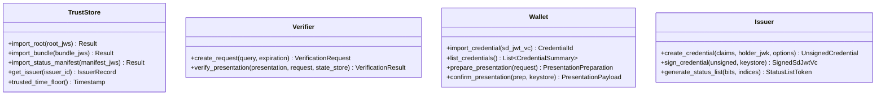

# Especificación PIP: API Pública del SDK e Interfaces del Host

> **Identificador normativo:** `SPEC-PIP-SDK-001`  
> **Versión:** `0.1.0-draft` (Fase F0 / Tarea `F0.T16`)  
> **Estado:** Normativo / En revisión  
> **Fecha:** 2026-10-10  
> **Trazabilidad:** REQ-SDK-001..009, REQ-VER-001..007, REQ-KEY-002, REQ-STOR-001; ADR-0006, ADR-0019, ADR-0020; P-01, P-05, P-08, P-11; INV-01, INV-03, INV-04, INV-05, INV-10.

---

## 1. Visión General de la API

`pip-sdk` es la **única** biblioteca y superficie de API pública expuesta a los integradores de aplicaciones móviles, servidores y sistemas embebidos.
* **Cero I/O en Capas Internas (INV-01):** El motor no realiza llamadas a sockets ni accesos a disco por sí mismo. Toda interacción con el entorno exterior se abstrae a través de traits del host.
* **Typestates y Fail-Closed (ADR-0020 / INV-05):** Las transiciones de estado imposibilitan invocar métodos en fases incorrectas (p. ej., una presentación no puede firmarse sin haber sido preparada y consentida previamente).
* **Seguridad de Memoria en FFI (INV-03, INV-10):** Ninguna clave privada cruza jamás la frontera FFI. Todo pánico en Rust se captura antes de cruzar hacia lenguajes anfitriones y se mapea al código de error fatal `PIP-E9999`.

---

## 2. Objetos Principales del SDK



---

### 2.1 `TrustStore`
Gestiona la memoria y verificación de documentos de confianza:
* `import_root(root_jws: &str) -> Result<RootSummary, PipError>`:  
  Valida una nueva raíz de confianza comprobando encadenamiento ($R_{N+1}$ firmada por $\ge k_N$ de $R_N$ y $\ge k_{N+1}$ de $R_{N+1}$).
* `import_bundle(bundle_jws: &str) -> Result<BundleSummary, PipError>`:  
  Comprueba que el bundle contenga $\ge \text{bundle\_threshold}$ firmas de operadores autorizados en la raíz activa, valida vigencia temporal y aplica anti-rollback.
* `import_status_manifest(manifest_jws: &str) -> Result<ManifestSummary, PipError>`:  
  Valida el manifiesto de estado de un emisor firmado con su `status_keys` registrada.

---

### 2.2 `Verifier`
Motor de verificación desconectada (*sans-I/O*):
* `create_request(params: RequestParams) -> Result<VerificationRequest, PipError>`:  
  Genera un `VerificationRequest` con un `nonce` criptográfico único de 128 bits y expiración configurada.
* `verify_presentation(presentation: &str, expected_request: &VerificationRequest, state_store: &mut impl VerifierStateStore) -> VerificationResult`:  
  Verifica de forma exhaustiva una presentación SD-JWT VC + KB-JWT contra el estado local sin red:
  1. Comprueba formato sintáctico y decodifica disclosures.
  2. Comprueba que el `nonce` exista en la caché del `state_store` y lo consume (marcado de uso único contra replay).
  3. Resuelve la clave pública del emisor **exclusivamente** desde el `TrustBundle` activo (INV-06).
  4. Valida firmas criptográficas de emisor y titular.
  5. Consulta el estado de revocación del titular en el snapshot local.
  6. Devuelve un `VerificationResult` tipado de cuatro estados con el desglose ordenado de comprobaciones.

---

### 2.3 `Wallet` (Titular)
Gestor de credenciales y privacidad en el dispositivo del usuario:
* `import_credential(raw_sd_jwt: &str, storage: &mut impl StorageBackend) -> Result<CredentialId, PipError>`:  
  Valida la estructura de la credencial y la almacena cifrada en reposo.
* `prepare_presentation(request: &VerificationRequest) -> Result<PresentationPreparation, PipError>`:  
  Inspecciona los claims requeridos por la consulta DCQL y genera un resumen legible para la interfaz de usuario con los atributos que se revelarán.
* `confirm_presentation(preparation: PresentationPreparation, keystore: &impl KeyStore) -> Result<String, PipError>`:  
  Tras el consentimiento del usuario, genera el Key Binding JWT firmado por el hardware del dispositivo con `sd_hash`, `nonce` y `aud`, y emite la presentación compacta o transcodificada para QR.

---

## 3. Interfaces Abstractas que Implementa el Host (Host Traits)

Para mantener la neutralidad de plataforma y el aislamiento de capas L1–L4, el host inyecta adaptadores que implementan los siguientes contratos:

### 3.1 `KeyStore`
Permite operaciones criptográficas en módulos de hardware seguro (Secure Enclave / StrongBox / TPM / HSM):

```rust
pub trait KeyStore {
    /// Genera un par de claves P-256 en hardware y devuelve su clave pública JWK.
    fn generate_key(&self, purpose: KeyPurpose) -> Result<Jwk, PipError>;

    /// Firma un resumen SHA-256 mediante ECDSA P-256 en formato IEEE P1363 (r || s, 64 bytes).
    /// La clave privada NUNCA abandona el hardware ni cruza hacia Rust.
    fn sign_digest(&self, kid: &str, digest: &[u8; 32]) -> Result<[u8; 64], PipError>;

    /// Obtiene la atestación de clave emitida por el fabricante del hardware (si está disponible).
    fn get_key_attestation(&self, kid: &str) -> Result<Option<Vec<u8>>, PipError>;
}
```

---

### 3.2 `Clock`
Inyecta la noción de tiempo sin acoplamiento a llamadas de sistema del SO:

```rust
pub trait Clock {
    /// Marca de tiempo Unix actual en segundos.
    fn now_seconds(&self) -> u64;

    /// Tiempo monotónico transcurrido desde un punto arbitrario (opcional, para cota inferior).
    fn monotonic_elapsed_millis(&self) -> Option<u64>;
}
```

---

### 3.3 `VerifierStateStore`
Garantiza la consistencia persistente contra manipulaciones de reloj y ataques de repetición (ADR-0020):

```rust
pub trait VerifierStateStore {
    /// Obtiene el piso de tiempo confiable (máximo instante firmado observado).
    fn get_trusted_time_floor(&self) -> u64;

    /// Actualiza el piso de tiempo confiable de forma atómica.
    fn set_trusted_time_floor(&mut self, timestamp: u64) -> Result<(), PipError>;

    /// Consulta si un nonce de sesión ya fue utilizado o ha expirado.
    fn check_and_consume_nonce(&mut self, nonce: &str, expires_at: u64) -> Result<bool, PipError>;

    /// Obtiene la tupla (bundle_epoch, bundle_version) activa.
    fn get_accepted_bundle_version(&self) -> (u64, u64);

    /// Actualiza atómicamente la versión aceptada.
    fn set_accepted_bundle_version(&mut self, epoch: u64, version: u64) -> Result<(), PipError>;
}
```

---

### 3.4 `StorageBackend` y `Transport`
* **`StorageBackend`**: Operaciones clave-valor con datos asociados autenticados (`get`, `put`, `delete`, `list_prefix`). Implementado por defecto por `pip-storage-sqlite` en L5.
* **`Transport`**: Canal de comunicación de red no bloqueante para descarga de listas y sincronización de sobres. Implementado por defecto por `pip-transport-http` en L5.

---

## 4. Resultado de Verificación (`VerificationResult`)

El resultado nunca es un booleano (INV-04). Representa un modelo exhaustivo de 4 estados:

```rust
#[derive(Debug, Clone, PartialEq, Eq)]
pub enum VerificationStatus {
    Valid,
    ValidWithStaleStatus,
    Unverifiable,
    Invalid,
}

#[derive(Debug, Clone)]
pub struct VerificationResult {
    pub status: VerificationStatus,
    pub checks: Vec<CheckEvidence>,
    pub issuer_id: String,
    pub kid_used: String,
    pub verified_claims: HashMap<String, Value>,
    pub status_age_seconds: Option<u64>,
}
```
